# 📘 Software Requirement Specification (SRS)
# CampusMate — All-in-One Academic Companion

> **Versi Dokumen:** 1.0.0  
> **Tanggal:** 26 Juli 2026  
> **Penulis:** Software Architect  
> **Status:** Approved  

---

## Daftar Isi

1. [Pendahuluan](#1-pendahuluan)
2. [Tujuan Sistem](#2-tujuan-sistem)
3. [Ruang Lingkup](#3-ruang-lingkup)
4. [User Persona](#4-user-persona)
5. [Functional Requirement](#5-functional-requirement)
6. [Non-Functional Requirement](#6-non-functional-requirement)
7. [Use Case Diagram](#7-use-case-diagram)
8. [Activity Diagram](#8-activity-diagram)
9. [Sequence Diagram](#9-sequence-diagram)
10. [ERD (Entity Relationship Diagram)](#10-erd-entity-relationship-diagram)
11. [Database Schema](#11-database-schema)
12. [API Requirement](#12-api-requirement)
13. [Folder Structure Flutter](#13-folder-structure-flutter)
14. [Clean Architecture](#14-clean-architecture)
15. [User Flow](#15-user-flow)
16. [Business Flow](#16-business-flow)
17. [Navigation Flow](#17-navigation-flow)
18. [Validation Rules](#18-validation-rules)
19. [Security Requirement](#19-security-requirement)
20. [Roadmap MVP](#20-roadmap-mvp)
21. [Future Feature](#21-future-feature)
22. [Risk Analysis](#22-risk-analysis)

---

## 1. Pendahuluan

### 1.1 Latar Belakang

Mahasiswa Indonesia saat ini menghadapi fragmentasi tools digital dalam mengelola kehidupan akademik mereka. Jadwal kuliah dicatat di satu aplikasi, tugas di aplikasi lain, catatan di tempat yang berbeda, dan kalender akademik harus dicek manual melalui website kampus. Fragmentasi ini menyebabkan:

- **Missed deadlines** karena tidak ada satu sumber kebenaran (single source of truth)
- **Informasi tersebar** di berbagai platform (WhatsApp, Google Calendar, Notion, dll.)
- **Overhead kognitif** dalam berpindah antar-aplikasi
- **Kurangnya visibilitas** terhadap beban akademik secara keseluruhan

CampusMate hadir sebagai solusi all-in-one yang menyatukan semua kebutuhan manajemen akademik mahasiswa ke dalam satu aplikasi mobile yang terintegrasi.

### 1.2 Definisi dan Akronim

| Akronim | Definisi |
|---------|----------|
| SRS | Software Requirement Specification |
| MVP | Minimum Viable Product |
| API | Application Programming Interface |
| CRUD | Create, Read, Update, Delete |
| UI/UX | User Interface / User Experience |
| JWT | JSON Web Token |
| RLS | Row Level Security (Supabase) |
| FCM | Firebase Cloud Messaging |
| MVVM | Model-View-ViewModel |
| DI | Dependency Injection |
| OTP | One-Time Password |
| SKS | Satuan Kredit Semester |
| D3 | Diploma Tiga |
| D4 | Diploma Empat |
| S1 | Sarjana (Strata Satu) |

### 1.3 Referensi Dokumen

| Dokumen | Sumber |
|---------|--------|
| Flutter Documentation | https://docs.flutter.dev |
| Supabase Documentation | https://supabase.com/docs |
| Riverpod Documentation | https://riverpod.dev |
| Clean Architecture (Robert C. Martin) | ISBN 978-0134494166 |
| Material Design 3 Guidelines | https://m3.material.io |

### 1.4 Target Platform

| Parameter | Spesifikasi |
|-----------|-------------|
| Platform Utama | Android |
| Minimum SDK | Android 6.0 (API Level 23) |
| Target SDK | Android 14 (API Level 34) |
| Framework | Flutter 3.x (Stable Channel) |
| Bahasa | Dart 3.x |
| Arsitektur CPU | ARM64, ARM32, x86_64 |

### 1.5 Stakeholder

| Stakeholder | Peran | Kepentingan |
|-------------|-------|-------------|
| Mahasiswa | Pengguna utama | Mengelola jadwal, tugas, dan catatan akademik |
| Organisasi Kampus | Pengguna sekunder | Koordinasi kegiatan dan informasi |
| Himpunan Mahasiswa | Pengguna sekunder | Manajemen kegiatan himpunan |
| Panitia Kegiatan | Pengguna sekunder | Perencanaan dan tracking kegiatan |
| Developer Team | Pengembang | Membangun dan memelihara aplikasi |
| Product Owner | Pemilik produk | Menentukan arah dan prioritas fitur |

---

## 2. Tujuan Sistem

### 2.1 Tujuan Utama

> Menyediakan platform mobile terintegrasi yang menyatukan seluruh kebutuhan manajemen akademik mahasiswa sehingga meningkatkan produktivitas dan mengurangi risiko kehilangan informasi penting.

### 2.2 Tujuan Spesifik

| ID | Tujuan | Indikator Keberhasilan | Prioritas |
|----|--------|------------------------|-----------|
| OBJ-01 | Sentralisasi informasi akademik | Mahasiswa hanya perlu 1 aplikasi untuk semua kebutuhan akademik | Kritis |
| OBJ-02 | Mengurangi missed deadlines | Penurunan 80% laporan deadline terlewat setelah 3 bulan pemakaian | Tinggi |
| OBJ-03 | Meningkatkan organisasi tugas | 90% pengguna melaporkan peningkatan organisasi tugas | Tinggi |
| OBJ-04 | Mempermudah akses jadwal | Waktu akses jadwal < 3 detik dari home screen | Sedang |
| OBJ-05 | Menyediakan reminder otomatis | 95% reminder terkirim tepat waktu | Kritis |
| OBJ-06 | Mendukung kolaborasi akademik | Minimal 50% pengguna menggunakan fitur berbagi catatan (Future) | Rendah |

### 2.3 Success Metrics (KPI)

| Metrik | Target | Periode Pengukuran |
|--------|--------|-------------------|
| Daily Active Users (DAU) | 500+ | 3 bulan pasca-launch |
| User Retention (D7) | ≥ 40% | Bulanan |
| User Retention (D30) | ≥ 25% | Bulanan |
| App Rating (Play Store) | ≥ 4.2 | Ongoing |
| Crash-Free Rate | ≥ 99.5% | Mingguan |
| Average Session Duration | ≥ 3 menit | Bulanan |
| Task Completion Rate | ≥ 70% | Bulanan |

---

## 3. Ruang Lingkup

### 3.1 Dalam Ruang Lingkup (In Scope) — MVP

| Modul | Fitur | Deskripsi |
|-------|-------|-----------|
| **Authentication** | Register, Login, Logout | Email/password + Google OAuth |
| | Lupa Password | Reset password via email |
| | Email Verification | Verifikasi email setelah register |
| **Dashboard** | Ringkasan Harian | Jadwal hari ini, deadline terdekat |
| | Progress Tracker | Statistik dan progress tugas |
| | Quick Actions | Shortcut ke fitur utama |
| **Jadwal Kuliah** | Manajemen Jadwal | CRUD jadwal mingguan |
| | Detail Kuliah | Mata kuliah, dosen, ruangan, warna |
| | Reminder | Notifikasi otomatis sebelum kuliah |
| **Manajemen Tugas** | CRUD Tugas | Tambah, edit, hapus, lihat tugas |
| | Organisasi | Deadline, prioritas, per mata kuliah |
| | Checklist | Sub-task dalam tugas |
| | Reminder Tugas | Notifikasi H-3, H-1 sebelum deadline |
| **Catatan** | CRUD Catatan | Catatan per mata kuliah |
| | Rich Text Editor | Format teks lengkap |
| | Media | Upload gambar, link Google Drive |
| **Kalender** | Tampilan Kalender | View bulanan/mingguan |
| | Integrasi | Deadline tugas otomatis muncul |
| **Profil** | Edit Profil | Nama, foto, prodi, semester |

### 3.2 Di Luar Ruang Lingkup (Out of Scope) — MVP

| Fitur | Alasan | Rencana |
|-------|--------|---------|
| Chat/Messaging | Kompleksitas tinggi, sudah ada WhatsApp | Phase 2 |
| Forum Diskusi | Membutuhkan moderasi | Phase 2 |
| E-Learning Integration | Membutuhkan API kampus | Phase 3 |
| Absensi Digital | Membutuhkan kerja sama kampus | Phase 3 |
| Nilai/Transkrip | Data sensitif, perlu integrasi SIAKAD | Phase 3 |
| Multi-Platform (iOS, Web) | Fokus Android dahulu | Phase 2 |
| Offline-First Mode | Kompleksitas sinkronisasi | Phase 2 |
| Gamifikasi | Fitur tambahan | Phase 2 |
| Push Notification (Remote) | Butuh FCM setup | Phase 1.5 |

### 3.3 Batasan Sistem

| Batasan | Deskripsi |
|---------|-----------|
| Konektivitas | Membutuhkan koneksi internet untuk sinkronisasi data |
| Storage | Gambar max 5 MB per file, total storage 100 MB per user |
| Concurrent Users | Dirancang untuk 10.000 concurrent users pada MVP |
| Bahasa | Bahasa Indonesia (Lokalisasi bahasa lain di phase 2) |
| Notifikasi | Hanya local notification pada MVP |

---

## 4. User Persona

### 4.1 Persona Primer — Mahasiswa Aktif

```
┌──────────────────────────────────────────────────────┐
│  👤 ANDI PRATAMA                                     │
│  Mahasiswa S1 Teknik Informatika — Semester 5        │
├──────────────────────────────────────────────────────┤
│  Demografi:                                          │
│  • Usia: 21 tahun                                    │
│  • Domisili: Kos dekat kampus, Bandung               │
│  • Device: Android mid-range (6GB RAM)               │
│  • Tech-Savvy Level: Tinggi                          │
│                                                      │
│  Kebiasaan:                                          │
│  • Menggunakan 5+ aplikasi untuk akademik            │
│  • Sering lupa deadline tugas                        │
│  • Mencatat jadwal di Google Calendar                │
│  • Mencatat tugas di Notion                          │
│  • Sering buka WhatsApp untuk info kuliah            │
│                                                      │
│  Pain Points:                                        │
│  • Info tersebar di banyak aplikasi                  │
│  • Tidak ada reminder terintegrasi                   │
│  • Sulit melihat beban tugas secara keseluruhan      │
│  • Sering terlewat deadline karena lupa              │
│                                                      │
│  Goals:                                              │
│  • Satu aplikasi untuk semua kebutuhan akademik      │
│  • Reminder otomatis untuk tugas dan kuliah          │
│  • Dashboard yang menampilkan semua info penting     │
│  • Catatan yang terorganisir per mata kuliah          │
│                                                      │
│  Motivasi: "Saya butuh satu tempat untuk melihat     │
│  semua jadwal, tugas, dan catatan kuliah saya."      │
└──────────────────────────────────────────────────────┘
```

### 4.2 Persona Sekunder — Pengurus Organisasi

```
┌──────────────────────────────────────────────────────┐
│  👤 SARI RAMADHANI                                   │
│  Ketua Himpunan Mahasiswa — Semester 6               │
├──────────────────────────────────────────────────────┤
│  Demografi:                                          │
│  • Usia: 22 tahun                                    │
│  • Domisili: Rumah orang tua, Jakarta                │
│  • Device: Android flagship (8GB RAM)                │
│  • Tech-Savvy Level: Menengah                        │
│                                                      │
│  Kebiasaan:                                          │
│  • Mengelola tugas akademik + organisasi             │
│  • Menggunakan Trello untuk organisasi               │
│  • Koordinasi via WhatsApp Group                     │
│  • Sering multitasking                               │
│                                                      │
│  Pain Points:                                        │
│  • Jadwal akademik dan organisasi sering bentrok     │
│  • Sulit memprioritaskan tugas vs kegiatan           │
│  • Tidak ada satu tempat untuk melihat semua         │
│    commitment                                        │
│                                                      │
│  Goals:                                              │
│  • Melihat jadwal kuliah dan kegiatan dalam satu     │
│    kalender                                          │
│  • Prioritisasi tugas berdasarkan urgensi            │
│  • Quick overview harian                             │
│                                                      │
│  Motivasi: "Saya perlu menyeimbangkan kuliah dan     │
│  organisasi tanpa ada yang terlewat."                │
└──────────────────────────────────────────────────────┘
```

### 4.3 Persona Tersier — Mahasiswa Baru

```
┌──────────────────────────────────────────────────────┐
│  👤 RIZKY MAULANA                                    │
│  Mahasiswa D3 Akuntansi — Semester 1                 │
├──────────────────────────────────────────────────────┤
│  Demografi:                                          │
│  • Usia: 18 tahun                                    │
│  • Domisili: Kos baru, Surabaya                      │
│  • Device: Android entry-level (4GB RAM)             │
│  • Tech-Savvy Level: Rendah-Menengah                 │
│                                                      │
│  Kebiasaan:                                          │
│  • Baru pertama kali mengelola jadwal sendiri        │
│  • Terbiasa diingatkan orang tua                     │
│  • Belum familiar dengan productivity tools          │
│  • Lebih suka UI yang simpel dan jelas               │
│                                                      │
│  Pain Points:                                        │
│  • Bingung mengelola waktu sendiri                   │
│  • Tidak tahu cara mengorganisir tugas               │
│  • Overwhelmed dengan banyaknya mata kuliah          │
│                                                      │
│  Goals:                                              │
│  • Aplikasi yang mudah digunakan                     │
│  • Panduan sederhana untuk mengelola tugas            │
│  • Reminder yang jelas dan tepat waktu               │
│                                                      │
│  Motivasi: "Saya butuh bantuan untuk terbiasa        │
│  mengelola jadwal dan tugas kuliah sendiri."          │
└──────────────────────────────────────────────────────┘
```

### 4.4 Persona Mapping Matrix

| Kebutuhan | Andi (Primer) | Sari (Sekunder) | Rizky (Tersier) |
|-----------|:---:|:---:|:---:|
| Jadwal Kuliah | ⭐⭐⭐ | ⭐⭐⭐ | ⭐⭐⭐ |
| Manajemen Tugas | ⭐⭐⭐ | ⭐⭐⭐ | ⭐⭐ |
| Catatan | ⭐⭐⭐ | ⭐⭐ | ⭐⭐ |
| Kalender | ⭐⭐ | ⭐⭐⭐ | ⭐ |
| Dashboard | ⭐⭐⭐ | ⭐⭐⭐ | ⭐⭐ |
| Reminder | ⭐⭐⭐ | ⭐⭐⭐ | ⭐⭐⭐ |
| Profil | ⭐ | ⭐ | ⭐⭐ |
| UI Sederhana | ⭐ | ⭐⭐ | ⭐⭐⭐ |

---

## 5. Functional Requirement

### 5.1 Modul Authentication (AUTH)

| ID | Requirement | Deskripsi | Prioritas | Acceptance Criteria |
|----|-------------|-----------|-----------|---------------------|
| AUTH-01 | Register dengan Email | User dapat membuat akun baru menggunakan email dan password | Kritis | 1. Form register menampilkan field: nama lengkap, email, password, konfirmasi password<br>2. Validasi real-time pada setiap field<br>3. Setelah submit, email verifikasi terkirim<br>4. User diarahkan ke halaman konfirmasi email |
| AUTH-02 | Login dengan Email | User dapat login menggunakan email dan password yang terdaftar | Kritis | 1. Form login menampilkan field: email, password<br>2. Tombol "Show Password" tersedia<br>3. Login berhasil → redirect ke Dashboard<br>4. Login gagal → error message yang jelas |
| AUTH-03 | Login dengan Google | User dapat login menggunakan akun Google | Tinggi | 1. Tombol "Login with Google" tersedia<br>2. Google OAuth flow berjalan lancar<br>3. Jika akun Google belum terdaftar, otomatis create account<br>4. Redirect ke Dashboard setelah berhasil |
| AUTH-04 | Lupa Password | User dapat mereset password melalui email | Tinggi | 1. Link "Lupa Password?" di halaman login<br>2. Input email → kirim link reset<br>3. Link reset valid selama 1 jam<br>4. User dapat set password baru |
| AUTH-05 | Email Verification | Verifikasi email setelah registrasi | Tinggi | 1. Email verifikasi terkirim otomatis setelah register<br>2. Link verifikasi valid selama 24 jam<br>3. User tidak bisa akses fitur utama sebelum verifikasi<br>4. Opsi "Kirim Ulang" tersedia |
| AUTH-06 | Logout | User dapat keluar dari aplikasi | Kritis | 1. Tombol logout di halaman profil<br>2. Konfirmasi dialog sebelum logout<br>3. Clear semua local data dan session<br>4. Redirect ke halaman login |
| AUTH-07 | Session Management | Aplikasi mengelola sesi pengguna secara otomatis | Kritis | 1. Auto-login jika token masih valid<br>2. Auto-refresh token sebelum expired<br>3. Force logout jika token tidak bisa di-refresh<br>4. Session timeout setelah 30 hari inaktif |
| AUTH-08 | Remember Me | Opsi untuk mengingat sesi login | Sedang | 1. Checkbox "Ingat Saya" di halaman login<br>2. Jika aktif, token disimpan secara persisten<br>3. Jika tidak aktif, token hilang saat app ditutup |

### 5.2 Modul Dashboard (DASH)

| ID | Requirement | Deskripsi | Prioritas | Acceptance Criteria |
|----|-------------|-----------|-----------|---------------------|
| DASH-01 | Jadwal Hari Ini | Menampilkan daftar kuliah pada hari ini | Kritis | 1. Menampilkan semua mata kuliah hari ini berurutan<br>2. Info: nama MK, jam, ruangan, dosen<br>3. Highlight kuliah yang sedang berlangsung<br>4. Indikator jika tidak ada kuliah hari ini |
| DASH-02 | Deadline Terdekat | Menampilkan 5 deadline tugas terdekat | Kritis | 1. Menampilkan max 5 tugas dengan deadline terdekat<br>2. Info: nama tugas, MK, sisa waktu<br>3. Warna indikator: merah (< 24 jam), kuning (< 3 hari), hijau (> 3 hari)<br>4. Tap untuk ke detail tugas |
| DASH-03 | Progress Tugas | Visualisasi progress tugas keseluruhan | Tinggi | 1. Circular progress indicator<br>2. Persentase tugas selesai vs total<br>3. Breakdown per status: belum dimulai, sedang dikerjakan, selesai<br>4. Update real-time saat ada perubahan |
| DASH-04 | Statistik Tugas | Ringkasan statistik tugas | Sedang | 1. Total tugas aktif<br>2. Tugas selesai minggu ini<br>3. Tugas overdue<br>4. Rata-rata waktu penyelesaian |
| DASH-05 | Quick Actions | Tombol shortcut ke fitur utama | Tinggi | 1. Tombol: Tambah Tugas, Tambah Jadwal, Tambah Catatan, Lihat Kalender<br>2. Floating Action Button atau grid buttons<br>3. Navigasi langsung ke form terkait |
| DASH-06 | Greeting & Date | Sapaan personal dan tanggal hari ini | Rendah | 1. "Selamat Pagi/Siang/Sore/Malam, [Nama]"<br>2. Tanggal hari ini dalam format Indonesia<br>3. Hari dalam seminggu |
| DASH-07 | Pull to Refresh | Refresh data dashboard | Sedang | 1. Pull-to-refresh gesture berfungsi<br>2. Semua data di-refresh dari server<br>3. Loading indicator saat refresh<br>4. Feedback jika gagal refresh |

### 5.3 Modul Jadwal Kuliah (SCHED)

| ID | Requirement | Deskripsi | Prioritas | Acceptance Criteria |
|----|-------------|-----------|-----------|---------------------|
| SCHED-01 | Tambah Jadwal | User dapat menambahkan jadwal kuliah baru | Kritis | 1. Form: MK, hari, jam mulai, jam selesai, ruangan, dosen, warna<br>2. Validasi jam mulai < jam selesai<br>3. Deteksi jadwal bentrok<br>4. Simpan ke database |
| SCHED-02 | Lihat Jadwal Mingguan | Tampilan jadwal dalam format mingguan | Kritis | 1. Grid view Senin-Jumat (opsional Sabtu)<br>2. Time slot dari 07:00 - 21:00<br>3. Blok warna per mata kuliah<br>4. Tap blok untuk lihat detail |
| SCHED-03 | Edit Jadwal | User dapat mengubah jadwal yang ada | Tinggi | 1. Tap jadwal → pilih "Edit"<br>2. Pre-fill form dengan data existing<br>3. Validasi ulang jadwal bentrok<br>4. Update ke database |
| SCHED-04 | Hapus Jadwal | User dapat menghapus jadwal | Tinggi | 1. Tap jadwal → pilih "Hapus"<br>2. Konfirmasi dialog<br>3. Hapus dari database dan tampilan<br>4. Hapus juga reminder terkait |
| SCHED-05 | Warna Mata Kuliah | Setiap MK memiliki warna identitas | Sedang | 1. Color picker saat tambah/edit MK<br>2. Minimal 12 pilihan warna<br>3. Warna konsisten di semua tampilan<br>4. Default color jika tidak dipilih |
| SCHED-06 | Reminder Otomatis | Notifikasi sebelum kuliah dimulai | Tinggi | 1. Reminder 30 menit sebelum kuliah (default)<br>2. Opsi kustomisasi: 15, 30, 60 menit<br>3. Notifikasi menampilkan: MK, ruangan, waktu<br>4. Reminder otomatis setiap minggu (recurring) |
| SCHED-07 | Detail Mata Kuliah | Informasi lengkap mata kuliah | Sedang | 1. Nama MK, kode MK, SKS<br>2. Dosen pengajar<br>3. Ruangan<br>4. Jadwal (hari & jam) |
| SCHED-08 | Deteksi Bentrok | Sistem mendeteksi jadwal yang bertabrakan | Tinggi | 1. Cek overlap waktu pada hari yang sama<br>2. Warning dialog jika ada bentrok<br>3. User dapat override atau cancel<br>4. Tampilkan jadwal yang bentrok |

### 5.4 Modul Manajemen Tugas (TASK)

| ID | Requirement | Deskripsi | Prioritas | Acceptance Criteria |
|----|-------------|-----------|-----------|---------------------|
| TASK-01 | Tambah Tugas | User dapat membuat tugas baru | Kritis | 1. Form: judul, deskripsi, deadline, prioritas, MK, checklist<br>2. Deadline menggunakan date & time picker<br>3. Prioritas: Rendah, Sedang, Tinggi, Urgent<br>4. Opsional: link lampiran, catatan |
| TASK-02 | Lihat Daftar Tugas | Menampilkan daftar semua tugas | Kritis | 1. Default sort: deadline terdekat<br>2. Filter: semua, aktif, selesai, overdue<br>3. Filter per MK<br>4. Indikator prioritas dan status |
| TASK-03 | Edit Tugas | User dapat mengubah detail tugas | Tinggi | 1. Semua field dapat diedit<br>2. Perubahan tersimpan otomatis (auto-save) atau tombol simpan<br>3. History perubahan (last modified) |
| TASK-04 | Hapus Tugas | User dapat menghapus tugas | Tinggi | 1. Swipe to delete atau tombol hapus<br>2. Konfirmasi dialog<br>3. Opsi undo (snackbar 5 detik)<br>4. Soft delete (bisa di-restore) |
| TASK-05 | Checklist/Sub-task | User dapat membuat sub-tugas dalam tugas | Tinggi | 1. Tambah checklist item dalam tugas<br>2. Toggle complete/incomplete<br>3. Progress bar berdasarkan checklist selesai<br>4. Reorder checklist (drag & drop) |
| TASK-06 | Set Prioritas | User dapat menentukan prioritas tugas | Tinggi | 1. 4 level: Rendah (🟢), Sedang (🟡), Tinggi (🟠), Urgent (🔴)<br>2. Bisa diubah kapan saja<br>3. Sort berdasarkan prioritas tersedia<br>4. Visual indicator di list view |
| TASK-07 | Tandai Selesai | User dapat menandai tugas sebagai selesai | Kritis | 1. Checkbox atau swipe gesture<br>2. Tugas berpindah ke tab "Selesai"<br>3. Timestamp penyelesaian dicatat<br>4. Bisa di-unmark jika keliru |
| TASK-08 | Reminder Tugas | Notifikasi pengingat deadline | Tinggi | 1. Reminder otomatis H-3 dan H-1 sebelum deadline<br>2. Notifikasi menampilkan: judul tugas, MK, sisa waktu<br>3. Opsi kustomisasi waktu reminder<br>4. Reminder berhenti jika tugas sudah selesai |
| TASK-09 | Filter & Sort | User dapat memfilter dan mengurutkan tugas | Sedang | 1. Filter: status, prioritas, MK, rentang tanggal<br>2. Sort: deadline, prioritas, tanggal dibuat, nama<br>3. Multiple filter bisa dikombinasikan<br>4. Simpan preferensi filter terakhir |
| TASK-10 | Overdue Detection | Deteksi tugas yang melewati deadline | Tinggi | 1. Badge "Overdue" otomatis ditampilkan<br>2. Notifikasi khusus untuk tugas overdue<br>3. Counter overdue di dashboard<br>4. Warna merah untuk tugas overdue |

### 5.5 Modul Catatan (NOTE)

| ID | Requirement | Deskripsi | Prioritas | Acceptance Criteria |
|----|-------------|-----------|-----------|---------------------|
| NOTE-01 | Buat Catatan | User dapat membuat catatan baru | Kritis | 1. Form: judul, konten (rich text), MK terkait<br>2. Rich text editor: bold, italic, underline, heading, list, code<br>3. Auto-save setiap 30 detik<br>4. Timestamp created & modified |
| NOTE-02 | Lihat Daftar Catatan | Menampilkan semua catatan | Kritis | 1. List view dengan judul, preview konten, tanggal<br>2. Grouping berdasarkan MK<br>3. Search catatan berdasarkan judul/konten<br>4. Sort: terbaru, nama, MK |
| NOTE-03 | Edit Catatan | User dapat mengedit catatan | Tinggi | 1. Rich text editor untuk editing<br>2. Auto-save<br>3. Last modified timestamp update<br>4. Undo/redo support |
| NOTE-04 | Hapus Catatan | User dapat menghapus catatan | Tinggi | 1. Tombol hapus atau swipe gesture<br>2. Konfirmasi dialog<br>3. Soft delete<br>4. Opsi undo |
| NOTE-05 | Upload Gambar | User dapat menambahkan gambar ke catatan | Sedang | 1. Upload dari galeri atau kamera<br>2. Max file size: 5 MB<br>3. Format: JPG, PNG, WebP<br>4. Gambar embedded dalam catatan<br>5. Compress otomatis jika > 2 MB |
| NOTE-06 | Link Google Drive | User dapat menambahkan link Drive ke catatan | Sedang | 1. Input URL Google Drive<br>2. Validasi format URL<br>3. Tampil sebagai clickable link<br>4. Preview nama file dari link |
| NOTE-07 | Rich Text Editor | Editor teks berformat | Tinggi | 1. Toolbar: Bold, Italic, Underline, Strikethrough<br>2. Headings: H1, H2, H3<br>3. Lists: ordered, unordered, checkbox<br>4. Code block, quote<br>5. Link insertion |
| NOTE-08 | Catatan per MK | Organisasi catatan berdasarkan MK | Sedang | 1. Tag/label MK pada catatan<br>2. Filter berdasarkan MK<br>3. Folder view per MK<br>4. MK dari modul jadwal (auto-sync) |

### 5.6 Modul Kalender (CAL)

| ID | Requirement | Deskripsi | Prioritas | Acceptance Criteria |
|----|-------------|-----------|-----------|---------------------|
| CAL-01 | Tampilan Kalender Bulanan | View kalender dalam format bulan | Kritis | 1. Grid kalender standar<br>2. Dot indicator pada tanggal yang memiliki event/deadline<br>3. Navigasi antar bulan (swipe/arrow)<br>4. Highlight hari ini |
| CAL-02 | Tampilan Kalender Mingguan | View kalender dalam format minggu | Tinggi | 1. 7-day view dengan time slots<br>2. Jadwal kuliah ditampilkan sebagai blok<br>3. Deadline ditampilkan sebagai marker<br>4. Navigasi antar minggu |
| CAL-03 | Detail Tanggal | Melihat detail event pada tanggal tertentu | Tinggi | 1. Tap tanggal → tampilkan semua event/deadline<br>2. List: jadwal kuliah, deadline tugas, event kalender<br>3. Warna per kategori<br>4. Tap item → navigasi ke detail |
| CAL-04 | Integrasi Deadline | Deadline tugas otomatis tampil di kalender | Kritis | 1. Semua tugas dengan deadline muncul otomatis<br>2. Warna sesuai prioritas tugas<br>3. Update real-time saat tugas berubah<br>4. Indikator tugas selesai vs belum |
| CAL-05 | Tambah Event Kalender | User dapat menambah event manual | Sedang | 1. Form: judul, tanggal, waktu (opsional), deskripsi<br>2. Warna kustom<br>3. Event tampil di kalender<br>4. Reminder opsional |
| CAL-06 | Kalender Akademik | Tampilan kalender akademik kampus | Rendah | 1. User bisa input tanggal-tanggal penting (UTS, UAS, libur)<br>2. Highlight tanggal penting<br>3. Reminder otomatis untuk tanggal penting |

### 5.7 Modul Profil (PROF)

| ID | Requirement | Deskripsi | Prioritas | Acceptance Criteria |
|----|-------------|-----------|-----------|---------------------|
| PROF-01 | Lihat Profil | Menampilkan informasi profil user | Kritis | 1. Foto profil, nama, email<br>2. Program studi, semester<br>3. Universitas<br>4. Statistik penggunaan |
| PROF-02 | Edit Profil | User dapat mengubah informasi profil | Tinggi | 1. Edit: nama, program studi, semester, universitas<br>2. Validasi input<br>3. Simpan perubahan ke database |
| PROF-03 | Ubah Foto Profil | User dapat mengubah foto profil | Sedang | 1. Upload dari galeri atau kamera<br>2. Crop foto (circle crop)<br>3. Max file size: 2 MB<br>4. Compress & upload ke Supabase Storage |
| PROF-04 | Ubah Password | User dapat mengubah password | Tinggi | 1. Input: password lama, password baru, konfirmasi<br>2. Validasi kekuatan password<br>3. Konfirmasi via email |
| PROF-05 | Pengaturan Notifikasi | User dapat mengatur preferensi notifikasi | Sedang | 1. Toggle on/off per kategori: jadwal, tugas, kalender<br>2. Atur waktu default reminder<br>3. Mode senyap (jam tertentu) |
| PROF-06 | Hapus Akun | User dapat menghapus akun | Rendah | 1. Tombol hapus akun di settings<br>2. Konfirmasi berlapis (password + dialog)<br>3. Grace period 30 hari<br>4. Soft delete → hard delete setelah 30 hari |

---

## 6. Non-Functional Requirement

### 6.1 Performance

| ID | Requirement | Target | Metode Pengukuran |
|----|-------------|--------|-------------------|
| NFR-PERF-01 | Cold Start Time | ≤ 3 detik pada device mid-range | Firebase Performance / Stopwatch |
| NFR-PERF-02 | Hot Start Time | ≤ 1 detik | Firebase Performance |
| NFR-PERF-03 | Page Transition | ≤ 300ms | Frame analysis |
| NFR-PERF-04 | API Response Time | ≤ 500ms (p95) | Supabase monitoring |
| NFR-PERF-05 | Frame Rate | ≥ 60 FPS pada scroll & animasi | Flutter DevTools |
| NFR-PERF-06 | Memory Usage | ≤ 150 MB RAM | Android Profiler |
| NFR-PERF-07 | APK Size | ≤ 30 MB (initial download) | Build output |
| NFR-PERF-08 | Battery Consumption | ≤ 3% per jam penggunaan aktif | Android Battery Stats |
| NFR-PERF-09 | Image Loading | ≤ 2 detik (with caching) | Performance logging |
| NFR-PERF-10 | Search Response | ≤ 200ms (local), ≤ 500ms (remote) | Stopwatch |

### 6.2 Reliability & Availability

| ID | Requirement | Target |
|----|-------------|--------|
| NFR-REL-01 | Uptime (Backend) | 99.9% (Supabase SLA) |
| NFR-REL-02 | Crash-Free Rate | ≥ 99.5% |
| NFR-REL-03 | Data Integrity | Zero data loss pada operasi CRUD |
| NFR-REL-04 | Error Recovery | Graceful error handling dengan retry mechanism |
| NFR-REL-05 | Backup | Daily automated backup (Supabase) |

### 6.3 Scalability

| ID | Requirement | Target |
|----|-------------|--------|
| NFR-SCAL-01 | Concurrent Users | 10.000 users pada MVP |
| NFR-SCAL-02 | Database Size | Support hingga 100.000 users |
| NFR-SCAL-03 | Storage | Scalable via Supabase Storage |
| NFR-SCAL-04 | API Rate Limit | 100 requests/menit per user |

### 6.4 Usability

| ID | Requirement | Target |
|----|-------------|--------|
| NFR-USE-01 | Learnability | User baru dapat menyelesaikan task utama dalam < 5 menit tanpa tutorial |
| NFR-USE-02 | Accessibility | Mendukung font scaling system (hingga 200%) |
| NFR-USE-03 | Accessibility | Color contrast ratio ≥ 4.5:1 (WCAG AA) |
| NFR-USE-04 | Error Messages | Semua error message dalam Bahasa Indonesia yang jelas |
| NFR-USE-05 | Onboarding | Onboarding flow max 3 screen |
| NFR-USE-06 | Navigation | Max 3 tap untuk mencapai fitur utama apapun |

### 6.5 Security

| ID | Requirement | Target |
|----|-------------|--------|
| NFR-SEC-01 | Authentication | Supabase Auth dengan JWT |
| NFR-SEC-02 | Authorization | Row Level Security (RLS) di semua tabel |
| NFR-SEC-03 | Data Encryption | TLS 1.3 untuk data in transit |
| NFR-SEC-04 | Password | Hashing dengan bcrypt (Supabase default) |
| NFR-SEC-05 | Token Storage | Secure storage (flutter_secure_storage) |
| NFR-SEC-06 | Input Validation | Server-side validation pada semua endpoint |
| NFR-SEC-07 | OWASP | Compliance dengan OWASP Mobile Top 10 |

### 6.6 Maintainability

| ID | Requirement | Target |
|----|-------------|--------|
| NFR-MAIN-01 | Code Coverage | ≥ 70% unit test coverage |
| NFR-MAIN-02 | Architecture | Clean Architecture dengan separation of concerns |
| NFR-MAIN-03 | Documentation | Inline documentation pada semua public APIs |
| NFR-MAIN-04 | Dependency Management | Pubspec.yaml terkelola dengan version pinning |
| NFR-MAIN-05 | Code Style | Dart analysis rules enforced, zero warnings |

### 6.7 Compatibility

| ID | Requirement | Target |
|----|-------------|--------|
| NFR-COMP-01 | Android Version | Android 6.0+ (API 23+) |
| NFR-COMP-02 | Screen Sizes | 4.7" - 7.0" (phone form factor) |
| NFR-COMP-03 | Orientasi | Portrait only (MVP) |
| NFR-COMP-04 | Theme | Light & Dark mode support |
| NFR-COMP-05 | Bahasa | Bahasa Indonesia (MVP), English (Phase 2) |

---

## 7. Use Case Diagram

### 7.1 Use Case Diagram — System Overview

```mermaid
graph TB
    subgraph "CampusMate System"
        subgraph "Authentication"
            UC1["UC-01: Register"]
            UC2["UC-02: Login Email"]
            UC3["UC-03: Login Google"]
            UC4["UC-04: Lupa Password"]
            UC5["UC-05: Verifikasi Email"]
            UC6["UC-06: Logout"]
        end

        subgraph "Dashboard"
            UC7["UC-07: Lihat Dashboard"]
            UC8["UC-08: Lihat Jadwal Hari Ini"]
            UC9["UC-09: Lihat Deadline Terdekat"]
            UC10["UC-10: Lihat Progress Tugas"]
            UC11["UC-11: Quick Action"]
        end

        subgraph "Jadwal Kuliah"
            UC12["UC-12: Tambah Jadwal"]
            UC13["UC-13: Lihat Jadwal Mingguan"]
            UC14["UC-14: Edit Jadwal"]
            UC15["UC-15: Hapus Jadwal"]
            UC16["UC-16: Set Reminder Jadwal"]
        end

        subgraph "Manajemen Tugas"
            UC17["UC-17: Tambah Tugas"]
            UC18["UC-18: Lihat Daftar Tugas"]
            UC19["UC-19: Edit Tugas"]
            UC20["UC-20: Hapus Tugas"]
            UC21["UC-21: Tandai Selesai"]
            UC22["UC-22: Kelola Checklist"]
            UC23["UC-23: Set Reminder Tugas"]
        end

        subgraph "Catatan"
            UC24["UC-24: Buat Catatan"]
            UC25["UC-25: Lihat Catatan"]
            UC26["UC-26: Edit Catatan"]
            UC27["UC-27: Hapus Catatan"]
            UC28["UC-28: Upload Gambar"]
            UC29["UC-29: Tambah Link Drive"]
        end

        subgraph "Kalender"
            UC30["UC-30: Lihat Kalender"]
            UC31["UC-31: Lihat Detail Tanggal"]
            UC32["UC-32: Tambah Event"]
        end

        subgraph "Profil"
            UC33["UC-33: Lihat Profil"]
            UC34["UC-34: Edit Profil"]
            UC35["UC-35: Ubah Foto"]
            UC36["UC-36: Ubah Password"]
            UC37["UC-37: Pengaturan Notifikasi"]
        end
    end

    Actor["👤 Mahasiswa"] --> UC1 & UC2 & UC3 & UC4
    Actor --> UC7 & UC11
    Actor --> UC12 & UC13 & UC14 & UC15
    Actor --> UC17 & UC18 & UC19 & UC20 & UC21 & UC22
    Actor --> UC24 & UC25 & UC26 & UC27 & UC28 & UC29
    Actor --> UC30 & UC31 & UC32
    Actor --> UC33 & UC34 & UC35 & UC36 & UC37

    System["🔔 System/Timer"] --> UC16 & UC23
    System --> UC8 & UC9 & UC10

    UC2 -.->|"<<include>>"| UC5
    UC1 -.->|"<<include>>"| UC5
    UC12 -.->|"<<extend>>"| UC16
    UC17 -.->|"<<extend>>"| UC23
```

### 7.2 Use Case Detail — Kunci

#### UC-01: Register

| Atribut | Detail |
|---------|--------|
| **Actor** | Mahasiswa (Unregistered) |
| **Precondition** | User belum memiliki akun, aplikasi terinstall |
| **Main Flow** | 1. User membuka aplikasi → tampil halaman login<br>2. User tap "Daftar Sekarang"<br>3. Sistem menampilkan form registrasi<br>4. User mengisi: nama, email, password, konfirmasi password<br>5. User tap "Daftar"<br>6. Sistem validasi input<br>7. Sistem membuat akun di Supabase Auth<br>8. Sistem mengirim email verifikasi<br>9. Sistem menampilkan halaman "Cek Email Anda" |
| **Alternate Flow** | 3a. User memilih "Daftar dengan Google" → UC-03 |
| **Exception Flow** | 6a. Validasi gagal → tampilkan error per field<br>7a. Email sudah terdaftar → "Email sudah digunakan, silakan login" |
| **Postcondition** | Akun dibuat, email verifikasi terkirim |

#### UC-17: Tambah Tugas

| Atribut | Detail |
|---------|--------|
| **Actor** | Mahasiswa (Authenticated) |
| **Precondition** | User sudah login dan terverifikasi |
| **Main Flow** | 1. User tap "Tambah Tugas" (dari dashboard/task list/FAB)<br>2. Sistem menampilkan form tugas baru<br>3. User mengisi: judul tugas<br>4. User memilih deadline (date & time picker)<br>5. User memilih prioritas (Rendah/Sedang/Tinggi/Urgent)<br>6. User memilih mata kuliah (dropdown dari jadwal)<br>7. User (opsional) menambahkan deskripsi<br>8. User (opsional) menambahkan checklist items<br>9. User tap "Simpan"<br>10. Sistem validasi dan simpan ke database<br>11. Sistem set reminder H-3 dan H-1 otomatis<br>12. Sistem kembali ke daftar tugas |
| **Alternate Flow** | 8a. User menambahkan checklist → bisa reorder via drag<br>6a. MK belum ada di jadwal → input manual |
| **Exception Flow** | 10a. Validasi gagal → highlight field error<br>10b. Gagal simpan → "Gagal menyimpan, coba lagi" + retry |
| **Postcondition** | Tugas tersimpan, reminder terjadwal, tampil di dashboard & kalender |

---

## 8. Activity Diagram

### 8.1 Activity Diagram — Registrasi

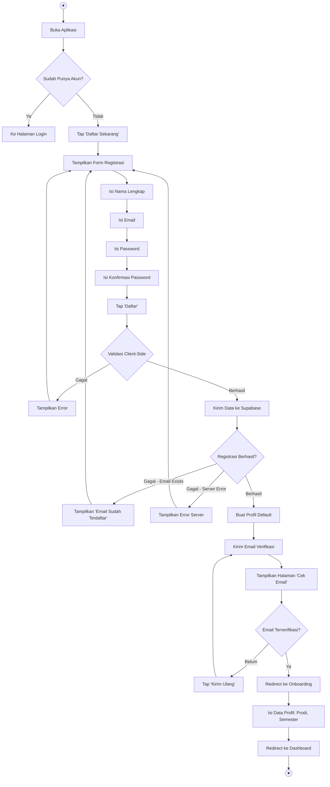

### 8.2 Activity Diagram — Tambah Tugas

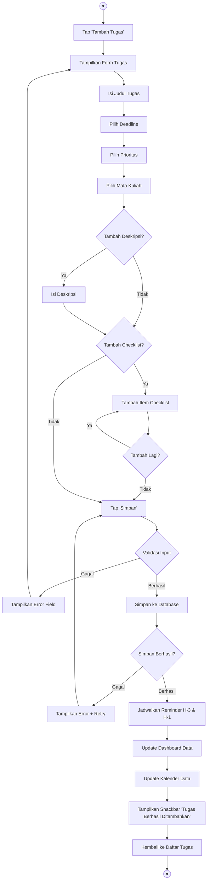

### 8.3 Activity Diagram — Login

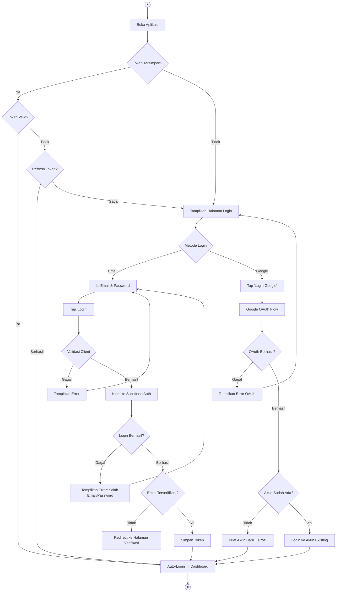

---

## 9. Sequence Diagram

### 9.1 Sequence Diagram — Login Email

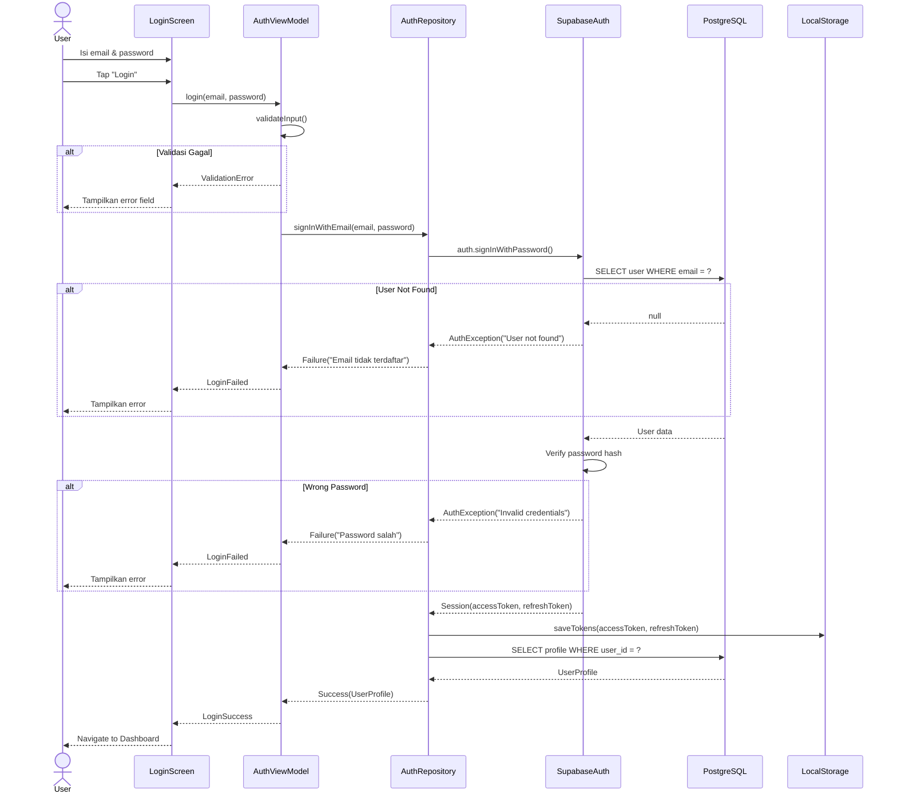

### 9.2 Sequence Diagram — Tambah Tugas

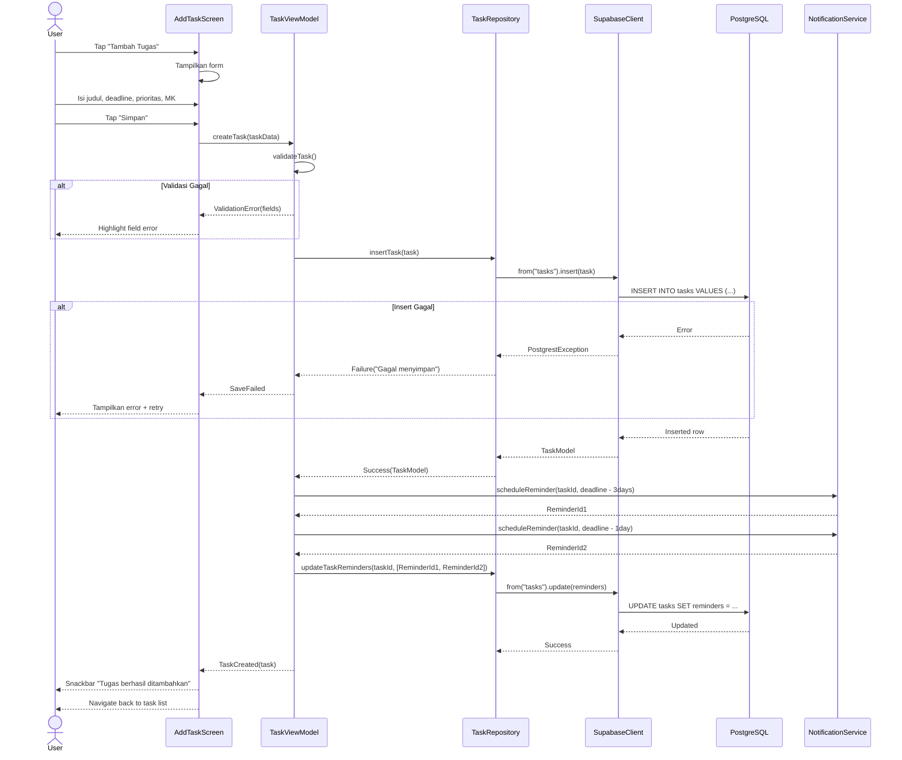

### 9.3 Sequence Diagram — Upload Gambar ke Catatan

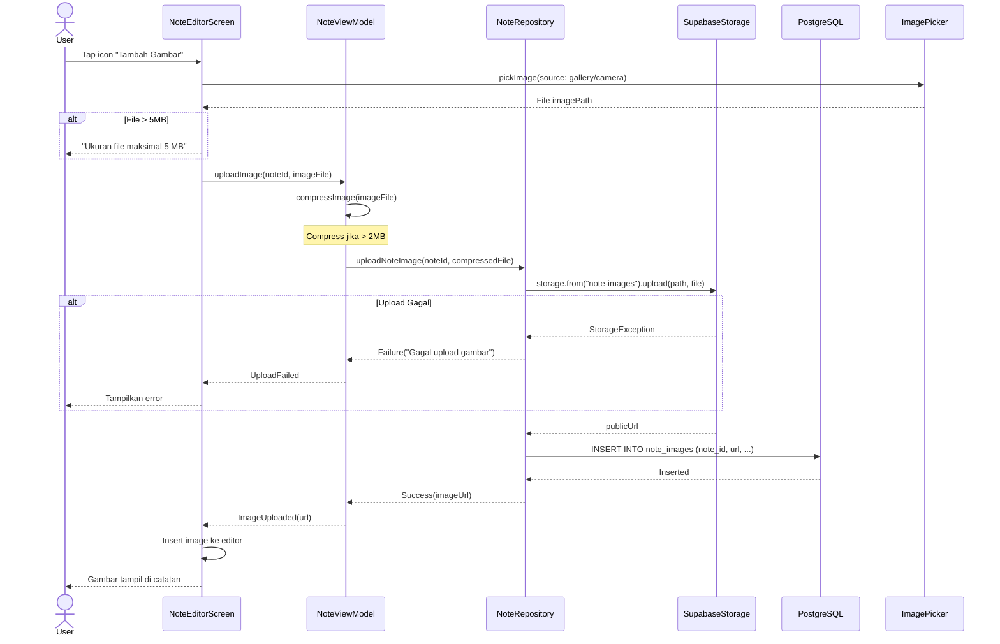

---

## 10. ERD (Entity Relationship Diagram)

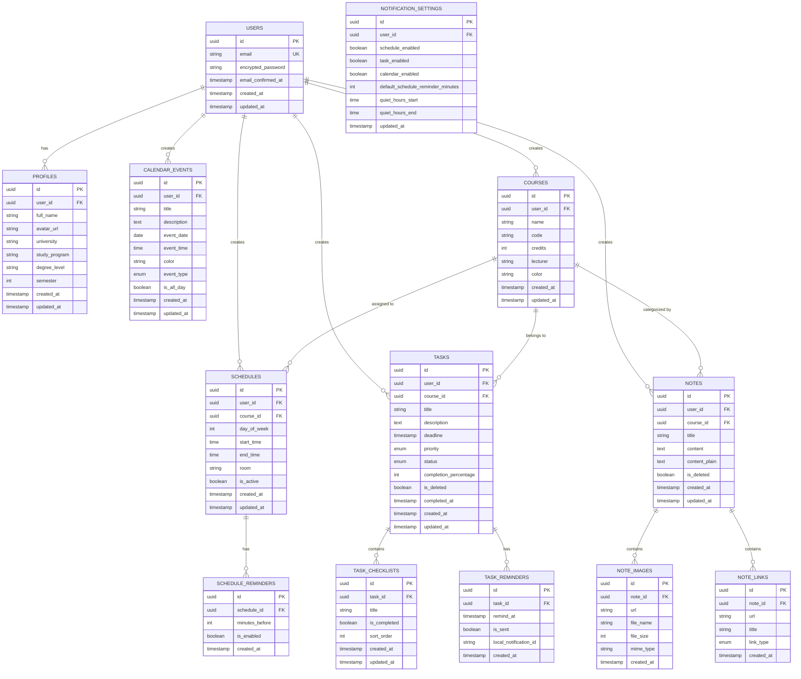

---

## 11. Database Schema

### 11.1 Tabel `profiles`

```sql
-- ====================================================
-- Tabel: profiles
-- Deskripsi: Data profil mahasiswa
-- RLS: Users hanya bisa akses profil sendiri
-- ====================================================
CREATE TABLE public.profiles (
    id UUID PRIMARY KEY DEFAULT gen_random_uuid(),
    user_id UUID NOT NULL REFERENCES auth.users(id) ON DELETE CASCADE,
    full_name VARCHAR(100) NOT NULL,
    avatar_url TEXT,
    university VARCHAR(200),
    study_program VARCHAR(200),
    degree_level VARCHAR(5) CHECK (degree_level IN ('D3', 'D4', 'S1')),
    semester INTEGER CHECK (semester >= 1 AND semester <= 14),
    created_at TIMESTAMPTZ NOT NULL DEFAULT NOW(),
    updated_at TIMESTAMPTZ NOT NULL DEFAULT NOW(),
    
    CONSTRAINT unique_user_profile UNIQUE (user_id)
);

-- Index
CREATE INDEX idx_profiles_user_id ON public.profiles(user_id);

-- RLS Policy
ALTER TABLE public.profiles ENABLE ROW LEVEL SECURITY;

CREATE POLICY "Users can view own profile"
    ON public.profiles FOR SELECT
    USING (auth.uid() = user_id);

CREATE POLICY "Users can insert own profile"
    ON public.profiles FOR INSERT
    WITH CHECK (auth.uid() = user_id);

CREATE POLICY "Users can update own profile"
    ON public.profiles FOR UPDATE
    USING (auth.uid() = user_id)
    WITH CHECK (auth.uid() = user_id);

-- Trigger: Auto-update updated_at
CREATE OR REPLACE FUNCTION update_updated_at_column()
RETURNS TRIGGER AS $$
BEGIN
    NEW.updated_at = NOW();
    RETURN NEW;
END;
$$ LANGUAGE plpgsql;

CREATE TRIGGER update_profiles_updated_at
    BEFORE UPDATE ON public.profiles
    FOR EACH ROW
    EXECUTE FUNCTION update_updated_at_column();

-- Trigger: Auto-create profile on user signup
CREATE OR REPLACE FUNCTION public.handle_new_user()
RETURNS TRIGGER AS $$
BEGIN
    INSERT INTO public.profiles (user_id, full_name)
    VALUES (NEW.id, COALESCE(NEW.raw_user_meta_data->>'full_name', ''));
    
    INSERT INTO public.notification_settings (user_id)
    VALUES (NEW.id);
    
    RETURN NEW;
END;
$$ LANGUAGE plpgsql SECURITY DEFINER;

CREATE TRIGGER on_auth_user_created
    AFTER INSERT ON auth.users
    FOR EACH ROW
    EXECUTE FUNCTION public.handle_new_user();
```

### 11.2 Tabel `courses`

```sql
-- ====================================================
-- Tabel: courses
-- Deskripsi: Data mata kuliah
-- ====================================================
CREATE TABLE public.courses (
    id UUID PRIMARY KEY DEFAULT gen_random_uuid(),
    user_id UUID NOT NULL REFERENCES auth.users(id) ON DELETE CASCADE,
    name VARCHAR(200) NOT NULL,
    code VARCHAR(20),
    credits INTEGER CHECK (credits >= 1 AND credits <= 6),
    lecturer VARCHAR(200),
    color VARCHAR(7) NOT NULL DEFAULT '#4A90D9',
    created_at TIMESTAMPTZ NOT NULL DEFAULT NOW(),
    updated_at TIMESTAMPTZ NOT NULL DEFAULT NOW()
);

CREATE INDEX idx_courses_user_id ON public.courses(user_id);

ALTER TABLE public.courses ENABLE ROW LEVEL SECURITY;

CREATE POLICY "Users can CRUD own courses"
    ON public.courses FOR ALL
    USING (auth.uid() = user_id)
    WITH CHECK (auth.uid() = user_id);

CREATE TRIGGER update_courses_updated_at
    BEFORE UPDATE ON public.courses
    FOR EACH ROW
    EXECUTE FUNCTION update_updated_at_column();
```

### 11.3 Tabel `schedules`

```sql
-- ====================================================
-- Tabel: schedules
-- Deskripsi: Jadwal kuliah mingguan
-- day_of_week: 1=Senin, 2=Selasa, ..., 7=Minggu
-- ====================================================
CREATE TABLE public.schedules (
    id UUID PRIMARY KEY DEFAULT gen_random_uuid(),
    user_id UUID NOT NULL REFERENCES auth.users(id) ON DELETE CASCADE,
    course_id UUID NOT NULL REFERENCES public.courses(id) ON DELETE CASCADE,
    day_of_week INTEGER NOT NULL CHECK (day_of_week >= 1 AND day_of_week <= 7),
    start_time TIME NOT NULL,
    end_time TIME NOT NULL,
    room VARCHAR(50),
    is_active BOOLEAN NOT NULL DEFAULT TRUE,
    created_at TIMESTAMPTZ NOT NULL DEFAULT NOW(),
    updated_at TIMESTAMPTZ NOT NULL DEFAULT NOW(),
    
    CONSTRAINT valid_time_range CHECK (start_time < end_time)
);

CREATE INDEX idx_schedules_user_id ON public.schedules(user_id);
CREATE INDEX idx_schedules_user_day ON public.schedules(user_id, day_of_week);
CREATE INDEX idx_schedules_course_id ON public.schedules(course_id);

ALTER TABLE public.schedules ENABLE ROW LEVEL SECURITY;

CREATE POLICY "Users can CRUD own schedules"
    ON public.schedules FOR ALL
    USING (auth.uid() = user_id)
    WITH CHECK (auth.uid() = user_id);

-- Fungsi deteksi jadwal bentrok
CREATE OR REPLACE FUNCTION check_schedule_conflict(
    p_user_id UUID,
    p_day_of_week INTEGER,
    p_start_time TIME,
    p_end_time TIME,
    p_exclude_id UUID DEFAULT NULL
)
RETURNS TABLE(conflicting_id UUID, course_name VARCHAR, start_time TIME, end_time TIME) AS $$
BEGIN
    RETURN QUERY
    SELECT s.id, c.name, s.start_time, s.end_time
    FROM public.schedules s
    JOIN public.courses c ON c.id = s.course_id
    WHERE s.user_id = p_user_id
      AND s.day_of_week = p_day_of_week
      AND s.is_active = TRUE
      AND (p_exclude_id IS NULL OR s.id != p_exclude_id)
      AND s.start_time < p_end_time
      AND s.end_time > p_start_time;
END;
$$ LANGUAGE plpgsql;

CREATE TRIGGER update_schedules_updated_at
    BEFORE UPDATE ON public.schedules
    FOR EACH ROW
    EXECUTE FUNCTION update_updated_at_column();
```

### 11.4 Tabel `schedule_reminders`

```sql
-- ====================================================
-- Tabel: schedule_reminders
-- Deskripsi: Reminder untuk jadwal kuliah
-- ====================================================
CREATE TABLE public.schedule_reminders (
    id UUID PRIMARY KEY DEFAULT gen_random_uuid(),
    schedule_id UUID NOT NULL REFERENCES public.schedules(id) ON DELETE CASCADE,
    minutes_before INTEGER NOT NULL DEFAULT 30 CHECK (minutes_before > 0),
    is_enabled BOOLEAN NOT NULL DEFAULT TRUE,
    created_at TIMESTAMPTZ NOT NULL DEFAULT NOW()
);

CREATE INDEX idx_schedule_reminders_schedule_id ON public.schedule_reminders(schedule_id);

ALTER TABLE public.schedule_reminders ENABLE ROW LEVEL SECURITY;

CREATE POLICY "Users can CRUD own schedule reminders"
    ON public.schedule_reminders FOR ALL
    USING (
        EXISTS (
            SELECT 1 FROM public.schedules s
            WHERE s.id = schedule_id AND s.user_id = auth.uid()
        )
    );
```

### 11.5 Tabel `tasks`

```sql
-- ====================================================
-- Tabel: tasks
-- Deskripsi: Tugas mahasiswa
-- ====================================================
CREATE TYPE task_priority AS ENUM ('low', 'medium', 'high', 'urgent');
CREATE TYPE task_status AS ENUM ('todo', 'in_progress', 'completed');

CREATE TABLE public.tasks (
    id UUID PRIMARY KEY DEFAULT gen_random_uuid(),
    user_id UUID NOT NULL REFERENCES auth.users(id) ON DELETE CASCADE,
    course_id UUID REFERENCES public.courses(id) ON DELETE SET NULL,
    title VARCHAR(300) NOT NULL,
    description TEXT,
    deadline TIMESTAMPTZ,
    priority task_priority NOT NULL DEFAULT 'medium',
    status task_status NOT NULL DEFAULT 'todo',
    completion_percentage INTEGER NOT NULL DEFAULT 0 CHECK (
        completion_percentage >= 0 AND completion_percentage <= 100
    ),
    is_deleted BOOLEAN NOT NULL DEFAULT FALSE,
    completed_at TIMESTAMPTZ,
    created_at TIMESTAMPTZ NOT NULL DEFAULT NOW(),
    updated_at TIMESTAMPTZ NOT NULL DEFAULT NOW()
);

CREATE INDEX idx_tasks_user_id ON public.tasks(user_id);
CREATE INDEX idx_tasks_user_status ON public.tasks(user_id, status) WHERE is_deleted = FALSE;
CREATE INDEX idx_tasks_user_deadline ON public.tasks(user_id, deadline) WHERE is_deleted = FALSE;
CREATE INDEX idx_tasks_course_id ON public.tasks(course_id);

ALTER TABLE public.tasks ENABLE ROW LEVEL SECURITY;

CREATE POLICY "Users can CRUD own tasks"
    ON public.tasks FOR ALL
    USING (auth.uid() = user_id)
    WITH CHECK (auth.uid() = user_id);

-- Auto-update completion_percentage from checklists
CREATE OR REPLACE FUNCTION update_task_completion()
RETURNS TRIGGER AS $$
DECLARE
    total_items INTEGER;
    completed_items INTEGER;
BEGIN
    SELECT COUNT(*), COUNT(*) FILTER (WHERE is_completed = TRUE)
    INTO total_items, completed_items
    FROM public.task_checklists
    WHERE task_id = COALESCE(NEW.task_id, OLD.task_id);
    
    IF total_items > 0 THEN
        UPDATE public.tasks
        SET completion_percentage = (completed_items * 100 / total_items),
            status = CASE
                WHEN completed_items = total_items THEN 'completed'::task_status
                WHEN completed_items > 0 THEN 'in_progress'::task_status
                ELSE 'todo'::task_status
            END,
            completed_at = CASE
                WHEN completed_items = total_items THEN NOW()
                ELSE NULL
            END
        WHERE id = COALESCE(NEW.task_id, OLD.task_id);
    END IF;
    
    RETURN COALESCE(NEW, OLD);
END;
$$ LANGUAGE plpgsql;

CREATE TRIGGER update_tasks_updated_at
    BEFORE UPDATE ON public.tasks
    FOR EACH ROW
    EXECUTE FUNCTION update_updated_at_column();
```

### 11.6 Tabel `task_checklists`

```sql
-- ====================================================
-- Tabel: task_checklists
-- Deskripsi: Sub-task / checklist item dalam tugas
-- ====================================================
CREATE TABLE public.task_checklists (
    id UUID PRIMARY KEY DEFAULT gen_random_uuid(),
    task_id UUID NOT NULL REFERENCES public.tasks(id) ON DELETE CASCADE,
    title VARCHAR(300) NOT NULL,
    is_completed BOOLEAN NOT NULL DEFAULT FALSE,
    sort_order INTEGER NOT NULL DEFAULT 0,
    created_at TIMESTAMPTZ NOT NULL DEFAULT NOW(),
    updated_at TIMESTAMPTZ NOT NULL DEFAULT NOW()
);

CREATE INDEX idx_task_checklists_task_id ON public.task_checklists(task_id);

ALTER TABLE public.task_checklists ENABLE ROW LEVEL SECURITY;

CREATE POLICY "Users can CRUD own task checklists"
    ON public.task_checklists FOR ALL
    USING (
        EXISTS (
            SELECT 1 FROM public.tasks t
            WHERE t.id = task_id AND t.user_id = auth.uid()
        )
    );

-- Trigger update task completion saat checklist berubah
CREATE TRIGGER on_checklist_change
    AFTER INSERT OR UPDATE OR DELETE ON public.task_checklists
    FOR EACH ROW
    EXECUTE FUNCTION update_task_completion();

CREATE TRIGGER update_task_checklists_updated_at
    BEFORE UPDATE ON public.task_checklists
    FOR EACH ROW
    EXECUTE FUNCTION update_updated_at_column();
```

### 11.7 Tabel `task_reminders`

```sql
-- ====================================================
-- Tabel: task_reminders
-- Deskripsi: Reminder untuk tugas
-- ====================================================
CREATE TABLE public.task_reminders (
    id UUID PRIMARY KEY DEFAULT gen_random_uuid(),
    task_id UUID NOT NULL REFERENCES public.tasks(id) ON DELETE CASCADE,
    remind_at TIMESTAMPTZ NOT NULL,
    is_sent BOOLEAN NOT NULL DEFAULT FALSE,
    local_notification_id VARCHAR(50),
    created_at TIMESTAMPTZ NOT NULL DEFAULT NOW()
);

CREATE INDEX idx_task_reminders_task_id ON public.task_reminders(task_id);
CREATE INDEX idx_task_reminders_remind_at ON public.task_reminders(remind_at) 
    WHERE is_sent = FALSE;

ALTER TABLE public.task_reminders ENABLE ROW LEVEL SECURITY;

CREATE POLICY "Users can CRUD own task reminders"
    ON public.task_reminders FOR ALL
    USING (
        EXISTS (
            SELECT 1 FROM public.tasks t
            WHERE t.id = task_id AND t.user_id = auth.uid()
        )
    );
```

### 11.8 Tabel `notes`

```sql
-- ====================================================
-- Tabel: notes
-- Deskripsi: Catatan mahasiswa
-- content: Rich text (HTML/Delta JSON)
-- content_plain: Plain text untuk pencarian
-- ====================================================
CREATE TABLE public.notes (
    id UUID PRIMARY KEY DEFAULT gen_random_uuid(),
    user_id UUID NOT NULL REFERENCES auth.users(id) ON DELETE CASCADE,
    course_id UUID REFERENCES public.courses(id) ON DELETE SET NULL,
    title VARCHAR(300) NOT NULL,
    content TEXT,
    content_plain TEXT,
    is_deleted BOOLEAN NOT NULL DEFAULT FALSE,
    created_at TIMESTAMPTZ NOT NULL DEFAULT NOW(),
    updated_at TIMESTAMPTZ NOT NULL DEFAULT NOW()
);

CREATE INDEX idx_notes_user_id ON public.notes(user_id);
CREATE INDEX idx_notes_user_course ON public.notes(user_id, course_id) WHERE is_deleted = FALSE;
-- Full-text search index
CREATE INDEX idx_notes_search ON public.notes 
    USING gin(to_tsvector('indonesian', COALESCE(title, '') || ' ' || COALESCE(content_plain, '')));

ALTER TABLE public.notes ENABLE ROW LEVEL SECURITY;

CREATE POLICY "Users can CRUD own notes"
    ON public.notes FOR ALL
    USING (auth.uid() = user_id)
    WITH CHECK (auth.uid() = user_id);

CREATE TRIGGER update_notes_updated_at
    BEFORE UPDATE ON public.notes
    FOR EACH ROW
    EXECUTE FUNCTION update_updated_at_column();
```

### 11.9 Tabel `note_images`

```sql
-- ====================================================
-- Tabel: note_images
-- Deskripsi: Gambar yang di-upload ke catatan
-- ====================================================
CREATE TABLE public.note_images (
    id UUID PRIMARY KEY DEFAULT gen_random_uuid(),
    note_id UUID NOT NULL REFERENCES public.notes(id) ON DELETE CASCADE,
    url TEXT NOT NULL,
    file_name VARCHAR(255),
    file_size INTEGER CHECK (file_size <= 5242880), -- Max 5MB
    mime_type VARCHAR(50) CHECK (mime_type IN ('image/jpeg', 'image/png', 'image/webp')),
    created_at TIMESTAMPTZ NOT NULL DEFAULT NOW()
);

CREATE INDEX idx_note_images_note_id ON public.note_images(note_id);

ALTER TABLE public.note_images ENABLE ROW LEVEL SECURITY;

CREATE POLICY "Users can CRUD own note images"
    ON public.note_images FOR ALL
    USING (
        EXISTS (
            SELECT 1 FROM public.notes n
            WHERE n.id = note_id AND n.user_id = auth.uid()
        )
    );
```

### 11.10 Tabel `note_links`

```sql
-- ====================================================
-- Tabel: note_links
-- Deskripsi: External links di catatan (Google Drive, etc.)
-- ====================================================
CREATE TYPE link_type AS ENUM ('google_drive', 'external', 'other');

CREATE TABLE public.note_links (
    id UUID PRIMARY KEY DEFAULT gen_random_uuid(),
    note_id UUID NOT NULL REFERENCES public.notes(id) ON DELETE CASCADE,
    url TEXT NOT NULL,
    title VARCHAR(300),
    link_type link_type NOT NULL DEFAULT 'other',
    created_at TIMESTAMPTZ NOT NULL DEFAULT NOW()
);

CREATE INDEX idx_note_links_note_id ON public.note_links(note_id);

ALTER TABLE public.note_links ENABLE ROW LEVEL SECURITY;

CREATE POLICY "Users can CRUD own note links"
    ON public.note_links FOR ALL
    USING (
        EXISTS (
            SELECT 1 FROM public.notes n
            WHERE n.id = note_id AND n.user_id = auth.uid()
        )
    );
```

### 11.11 Tabel `calendar_events`

```sql
-- ====================================================
-- Tabel: calendar_events
-- Deskripsi: Event kalender custom (di luar deadline tugas)
-- ====================================================
CREATE TYPE event_type AS ENUM ('academic', 'personal', 'organization', 'exam', 'holiday');

CREATE TABLE public.calendar_events (
    id UUID PRIMARY KEY DEFAULT gen_random_uuid(),
    user_id UUID NOT NULL REFERENCES auth.users(id) ON DELETE CASCADE,
    title VARCHAR(300) NOT NULL,
    description TEXT,
    event_date DATE NOT NULL,
    event_time TIME,
    color VARCHAR(7) DEFAULT '#4A90D9',
    event_type event_type NOT NULL DEFAULT 'personal',
    is_all_day BOOLEAN NOT NULL DEFAULT FALSE,
    created_at TIMESTAMPTZ NOT NULL DEFAULT NOW(),
    updated_at TIMESTAMPTZ NOT NULL DEFAULT NOW()
);

CREATE INDEX idx_calendar_events_user_id ON public.calendar_events(user_id);
CREATE INDEX idx_calendar_events_user_date ON public.calendar_events(user_id, event_date);

ALTER TABLE public.calendar_events ENABLE ROW LEVEL SECURITY;

CREATE POLICY "Users can CRUD own calendar events"
    ON public.calendar_events FOR ALL
    USING (auth.uid() = user_id)
    WITH CHECK (auth.uid() = user_id);

CREATE TRIGGER update_calendar_events_updated_at
    BEFORE UPDATE ON public.calendar_events
    FOR EACH ROW
    EXECUTE FUNCTION update_updated_at_column();
```

### 11.12 Tabel `notification_settings`

```sql
-- ====================================================
-- Tabel: notification_settings
-- Deskripsi: Preferensi notifikasi per user
-- ====================================================
CREATE TABLE public.notification_settings (
    id UUID PRIMARY KEY DEFAULT gen_random_uuid(),
    user_id UUID NOT NULL REFERENCES auth.users(id) ON DELETE CASCADE,
    schedule_enabled BOOLEAN NOT NULL DEFAULT TRUE,
    task_enabled BOOLEAN NOT NULL DEFAULT TRUE,
    calendar_enabled BOOLEAN NOT NULL DEFAULT TRUE,
    default_schedule_reminder_minutes INTEGER NOT NULL DEFAULT 30,
    quiet_hours_start TIME DEFAULT '22:00',
    quiet_hours_end TIME DEFAULT '07:00',
    updated_at TIMESTAMPTZ NOT NULL DEFAULT NOW(),
    
    CONSTRAINT unique_user_notification UNIQUE (user_id)
);

ALTER TABLE public.notification_settings ENABLE ROW LEVEL SECURITY;

CREATE POLICY "Users can CRUD own notification settings"
    ON public.notification_settings FOR ALL
    USING (auth.uid() = user_id)
    WITH CHECK (auth.uid() = user_id);
```

### 11.13 Supabase Storage Buckets

```sql
-- ====================================================
-- Storage Buckets Configuration
-- ====================================================

-- Bucket: avatars (foto profil)
INSERT INTO storage.buckets (id, name, public, file_size_limit, allowed_mime_types)
VALUES (
    'avatars',
    'avatars',
    TRUE,
    2097152, -- 2 MB
    ARRAY['image/jpeg', 'image/png', 'image/webp']
);

-- RLS: avatars
CREATE POLICY "Users can upload own avatar"
    ON storage.objects FOR INSERT
    WITH CHECK (
        bucket_id = 'avatars' AND 
        auth.uid()::text = (storage.foldername(name))[1]
    );

CREATE POLICY "Users can update own avatar"
    ON storage.objects FOR UPDATE
    USING (
        bucket_id = 'avatars' AND 
        auth.uid()::text = (storage.foldername(name))[1]
    );

CREATE POLICY "Avatar images are publicly accessible"
    ON storage.objects FOR SELECT
    USING (bucket_id = 'avatars');

CREATE POLICY "Users can delete own avatar"
    ON storage.objects FOR DELETE
    USING (
        bucket_id = 'avatars' AND 
        auth.uid()::text = (storage.foldername(name))[1]
    );

-- Bucket: note-images (gambar di catatan)
INSERT INTO storage.buckets (id, name, public, file_size_limit, allowed_mime_types)
VALUES (
    'note-images',
    'note-images',
    FALSE,
    5242880, -- 5 MB
    ARRAY['image/jpeg', 'image/png', 'image/webp']
);

-- RLS: note-images
CREATE POLICY "Users can upload own note images"
    ON storage.objects FOR INSERT
    WITH CHECK (
        bucket_id = 'note-images' AND 
        auth.uid()::text = (storage.foldername(name))[1]
    );

CREATE POLICY "Users can view own note images"
    ON storage.objects FOR SELECT
    USING (
        bucket_id = 'note-images' AND 
        auth.uid()::text = (storage.foldername(name))[1]
    );

CREATE POLICY "Users can delete own note images"
    ON storage.objects FOR DELETE
    USING (
        bucket_id = 'note-images' AND 
        auth.uid()::text = (storage.foldername(name))[1]
    );
```

---

## 12. API Requirement

### 12.1 Arsitektur API

CampusMate menggunakan **Supabase Client SDK** untuk Flutter, yang berkomunikasi langsung dengan Supabase Backend (PostgREST + GoTrue + Realtime + Storage). Tidak ada custom backend server terpisah.

```
┌─────────────┐      HTTPS/WSS       ┌─────────────────────┐
│   Flutter    │ ◄──────────────────► │   Supabase Cloud    │
│   App        │                      │                     │
│              │  ┌─────────────────┐ │  ┌───────────────┐  │
│  supabase_   │  │ Auth (GoTrue)   │ │  │ PostgreSQL    │  │
│  flutter     │  │ REST (PostgREST)│ │  │ + RLS         │  │
│  package     │  │ Storage         │ │  │               │  │
│              │  │ Realtime        │ │  │               │  │
│              │  └─────────────────┘ │  └───────────────┘  │
└─────────────┘                       └─────────────────────┘
```

### 12.2 Authentication API

| Operasi | Method | Supabase SDK Call | Request | Response |
|---------|--------|------------------|---------|----------|
| Register | POST | `supabase.auth.signUp()` | `{email, password, data: {full_name}}` | `AuthResponse(user, session)` |
| Login Email | POST | `supabase.auth.signInWithPassword()` | `{email, password}` | `AuthResponse(user, session)` |
| Login Google | POST | `supabase.auth.signInWithOAuth()` | `{provider: 'google'}` | `AuthResponse(user, session)` |
| Logout | POST | `supabase.auth.signOut()` | — | `void` |
| Reset Password | POST | `supabase.auth.resetPasswordForEmail()` | `{email}` | `void` |
| Update Password | PUT | `supabase.auth.updateUser()` | `{password}` | `UserResponse` |
| Get Session | GET | `supabase.auth.currentSession` | — | `Session?` |
| Refresh Token | POST | `supabase.auth.refreshSession()` | — | `AuthResponse` |
| Resend Verification | POST | `supabase.auth.resend()` | `{type: 'signup', email}` | `void` |

### 12.3 Profile API

| Operasi | Method | Endpoint / SDK Call | Request Body | Response |
|---------|--------|---------------------|-------------|----------|
| Get Profile | GET | `from('profiles').select().eq('user_id', uid).single()` | — | `ProfileModel` |
| Update Profile | PATCH | `from('profiles').update(data).eq('user_id', uid)` | `{full_name?, university?, study_program?, degree_level?, semester?}` | `ProfileModel` |
| Upload Avatar | POST | `storage.from('avatars').upload(path, file)` | `File` | `String (publicUrl)` |
| Get Avatar URL | GET | `storage.from('avatars').getPublicUrl(path)` | — | `String` |

### 12.4 Courses API

| Operasi | Method | SDK Call | Request Body | Response |
|---------|--------|---------|-------------|----------|
| List Courses | GET | `from('courses').select().eq('user_id', uid).order('name')` | — | `List<CourseModel>` |
| Get Course | GET | `from('courses').select().eq('id', courseId).single()` | — | `CourseModel` |
| Create Course | POST | `from('courses').insert(data).select().single()` | `{name, code?, credits?, lecturer?, color?}` | `CourseModel` |
| Update Course | PATCH | `from('courses').update(data).eq('id', courseId).select().single()` | Partial `CourseModel` | `CourseModel` |
| Delete Course | DELETE | `from('courses').delete().eq('id', courseId)` | — | `void` |

### 12.5 Schedules API

| Operasi | Method | SDK Call | Request Body | Response |
|---------|--------|---------|-------------|----------|
| List Schedules | GET | `from('schedules').select('*, courses(*)').eq('user_id', uid).order('day_of_week').order('start_time')` | — | `List<ScheduleModel>` |
| Get Today's Schedule | GET | `from('schedules').select('*, courses(*)').eq('user_id', uid).eq('day_of_week', todayDow).eq('is_active', true).order('start_time')` | — | `List<ScheduleModel>` |
| Create Schedule | POST | `from('schedules').insert(data).select('*, courses(*)').single()` | `{course_id, day_of_week, start_time, end_time, room?}` | `ScheduleModel` |
| Update Schedule | PATCH | `from('schedules').update(data).eq('id', id).select('*, courses(*)').single()` | Partial fields | `ScheduleModel` |
| Delete Schedule | DELETE | `from('schedules').delete().eq('id', id)` | — | `void` |
| Check Conflict | RPC | `supabase.rpc('check_schedule_conflict', params)` | `{p_user_id, p_day_of_week, p_start_time, p_end_time, p_exclude_id?}` | `List<ConflictModel>` |

### 12.6 Tasks API

| Operasi | Method | SDK Call | Request Body | Response |
|---------|--------|---------|-------------|----------|
| List Tasks | GET | `from('tasks').select('*, courses(*), task_checklists(*)').eq('user_id', uid).eq('is_deleted', false).order('deadline')` | — | `List<TaskModel>` |
| List Tasks by Status | GET | `...eq('status', status)` | — | `List<TaskModel>` |
| Get Upcoming Deadlines | GET | `...gte('deadline', now).order('deadline').limit(5)` | — | `List<TaskModel>` |
| Get Overdue Tasks | GET | `...lt('deadline', now).neq('status', 'completed').eq('is_deleted', false)` | — | `List<TaskModel>` |
| Create Task | POST | `from('tasks').insert(data).select('*, courses(*)').single()` | `{title, description?, deadline?, priority, course_id?}` | `TaskModel` |
| Update Task | PATCH | `from('tasks').update(data).eq('id', id).select().single()` | Partial fields | `TaskModel` |
| Complete Task | PATCH | `from('tasks').update({status: 'completed', completed_at: now}).eq('id', id)` | — | `TaskModel` |
| Soft Delete Task | PATCH | `from('tasks').update({is_deleted: true}).eq('id', id)` | — | `void` |
| Get Task Stats | RPC | `supabase.rpc('get_task_statistics', {p_user_id: uid})` | — | `TaskStatsModel` |

### 12.7 Task Checklists API

| Operasi | Method | SDK Call | Request Body | Response |
|---------|--------|---------|-------------|----------|
| List Checklists | GET | `from('task_checklists').select().eq('task_id', taskId).order('sort_order')` | — | `List<ChecklistModel>` |
| Create Checklist | POST | `from('task_checklists').insert(data).select().single()` | `{task_id, title, sort_order}` | `ChecklistModel` |
| Toggle Checklist | PATCH | `from('task_checklists').update({is_completed}).eq('id', id)` | `{is_completed}` | `ChecklistModel` |
| Reorder Checklists | PATCH | Batch update `sort_order` | `[{id, sort_order}]` | `void` |
| Delete Checklist | DELETE | `from('task_checklists').delete().eq('id', id)` | — | `void` |

### 12.8 Notes API

| Operasi | Method | SDK Call | Request Body | Response |
|---------|--------|---------|-------------|----------|
| List Notes | GET | `from('notes').select('*, courses(*)').eq('user_id', uid).eq('is_deleted', false).order('updated_at', ascending: false)` | — | `List<NoteModel>` |
| List by Course | GET | `...eq('course_id', courseId)` | — | `List<NoteModel>` |
| Search Notes | GET | `...textSearch('title_content', query)` | — | `List<NoteModel>` |
| Get Note | GET | `from('notes').select('*, note_images(*), note_links(*)').eq('id', id).single()` | — | `NoteDetailModel` |
| Create Note | POST | `from('notes').insert(data).select().single()` | `{title, content, content_plain, course_id?}` | `NoteModel` |
| Update Note | PATCH | `from('notes').update(data).eq('id', id)` | Partial fields | `NoteModel` |
| Soft Delete Note | PATCH | `from('notes').update({is_deleted: true}).eq('id', id)` | — | `void` |
| Upload Image | POST | `storage.from('note-images').upload(path, file)` + `from('note_images').insert(data)` | `File` + metadata | `NoteImageModel` |
| Add Link | POST | `from('note_links').insert(data).select().single()` | `{note_id, url, title?, link_type}` | `NoteLinkModel` |

### 12.9 Calendar Events API

| Operasi | Method | SDK Call | Request Body | Response |
|---------|--------|---------|-------------|----------|
| Get Events by Month | GET | `from('calendar_events').select().eq('user_id', uid).gte('event_date', startOfMonth).lte('event_date', endOfMonth)` | — | `List<CalendarEventModel>` |
| Get Events by Date | GET | `...eq('event_date', date)` | — | `List<CalendarEventModel>` |
| Create Event | POST | `from('calendar_events').insert(data).select().single()` | `{title, event_date, event_time?, description?, color?, event_type, is_all_day}` | `CalendarEventModel` |
| Update Event | PATCH | `from('calendar_events').update(data).eq('id', id)` | Partial fields | `CalendarEventModel` |
| Delete Event | DELETE | `from('calendar_events').delete().eq('id', id)` | — | `void` |

### 12.10 Dashboard Aggregation API (RPC Functions)

```sql
-- Fungsi: Get task statistics
CREATE OR REPLACE FUNCTION get_task_statistics(p_user_id UUID)
RETURNS JSON AS $$
DECLARE
    result JSON;
BEGIN
    SELECT json_build_object(
        'total_active', COUNT(*) FILTER (WHERE status != 'completed' AND is_deleted = FALSE),
        'completed_total', COUNT(*) FILTER (WHERE status = 'completed' AND is_deleted = FALSE),
        'completed_this_week', COUNT(*) FILTER (
            WHERE status = 'completed' 
            AND is_deleted = FALSE
            AND completed_at >= date_trunc('week', NOW())
        ),
        'overdue', COUNT(*) FILTER (
            WHERE status != 'completed' 
            AND is_deleted = FALSE 
            AND deadline < NOW()
        ),
        'by_priority', json_build_object(
            'low', COUNT(*) FILTER (WHERE priority = 'low' AND status != 'completed' AND is_deleted = FALSE),
            'medium', COUNT(*) FILTER (WHERE priority = 'medium' AND status != 'completed' AND is_deleted = FALSE),
            'high', COUNT(*) FILTER (WHERE priority = 'high' AND status != 'completed' AND is_deleted = FALSE),
            'urgent', COUNT(*) FILTER (WHERE priority = 'urgent' AND status != 'completed' AND is_deleted = FALSE)
        )
    ) INTO result
    FROM public.tasks
    WHERE user_id = p_user_id;
    
    RETURN result;
END;
$$ LANGUAGE plpgsql SECURITY DEFINER;
```

### 12.11 Error Response Convention

| HTTP Status | Kode Error | Deskripsi | Contoh |
|-------------|-----------|-----------|--------|
| 400 | `validation_error` | Input tidak valid | Field required kosong |
| 401 | `unauthorized` | Token tidak valid/expired | Session expired |
| 403 | `forbidden` | Akses ditolak oleh RLS | Akses data user lain |
| 404 | `not_found` | Resource tidak ditemukan | Task ID tidak ada |
| 409 | `conflict` | Konflik data | Email sudah terdaftar |
| 422 | `unprocessable` | Input valid tapi tidak bisa diproses | Jadwal bentrok |
| 429 | `rate_limited` | Terlalu banyak request | > 100 req/menit |
| 500 | `server_error` | Error internal server | Database down |

---

## 13. Folder Structure Flutter

```
campusmate/
├── android/                          # Android native config
├── ios/                              # iOS native config (future)
├── assets/
│   ├── fonts/                        # Custom fonts
│   ├── icons/                        # App icons & SVG
│   ├── images/                       # Static images
│   └── lottie/                       # Lottie animations
├── lib/
│   ├── main.dart                     # Entry point
│   ├── app.dart                      # MaterialApp configuration
│   │
│   ├── core/                         # ═══ CORE LAYER ═══
│   │   ├── constants/
│   │   │   ├── app_colors.dart       # Color palette
│   │   │   ├── app_fonts.dart        # Typography
│   │   │   ├── app_sizes.dart        # Spacing & sizing
│   │   │   ├── app_strings.dart      # Static strings / i18n keys
│   │   │   └── supabase_constants.dart # Supabase keys & table names
│   │   ├── enums/
│   │   │   ├── task_priority.dart
│   │   │   ├── task_status.dart
│   │   │   ├── day_of_week.dart
│   │   │   ├── degree_level.dart
│   │   │   ├── event_type.dart
│   │   │   └── link_type.dart
│   │   ├── errors/
│   │   │   ├── exceptions.dart       # Custom exceptions
│   │   │   └── failures.dart         # Failure classes
│   │   ├── extensions/
│   │   │   ├── context_extensions.dart
│   │   │   ├── date_extensions.dart
│   │   │   ├── string_extensions.dart
│   │   │   └── widget_extensions.dart
│   │   ├── network/
│   │   │   ├── supabase_client.dart  # Supabase initialization
│   │   │   └── network_info.dart     # Connectivity checker
│   │   ├── router/
│   │   │   ├── app_router.dart       # GoRouter configuration
│   │   │   └── route_names.dart      # Route name constants
│   │   ├── theme/
│   │   │   ├── app_theme.dart        # ThemeData (light & dark)
│   │   │   ├── color_scheme.dart     # Material 3 color scheme
│   │   │   └── text_theme.dart       # Text styles
│   │   ├── utils/
│   │   │   ├── date_formatter.dart   # Tanggal format Indonesia
│   │   │   ├── validators.dart       # Input validation helpers
│   │   │   ├── image_compressor.dart # Image compression utility
│   │   │   └── notification_helper.dart
│   │   └── widgets/                  # Shared/global widgets
│   │       ├── app_bar_widget.dart
│   │       ├── bottom_nav_bar.dart
│   │       ├── loading_widget.dart
│   │       ├── error_widget.dart
│   │       ├── empty_state_widget.dart
│   │       ├── confirmation_dialog.dart
│   │       └── custom_snackbar.dart
│   │
│   ├── features/                     # ═══ FEATURE MODULES ═══
│   │   │
│   │   ├── auth/                     # ── Authentication ──
│   │   │   ├── data/
│   │   │   │   ├── datasources/
│   │   │   │   │   ├── auth_remote_datasource.dart
│   │   │   │   │   └── auth_local_datasource.dart
│   │   │   │   ├── models/
│   │   │   │   │   └── user_model.dart
│   │   │   │   └── repositories/
│   │   │   │       └── auth_repository_impl.dart
│   │   │   ├── domain/
│   │   │   │   ├── entities/
│   │   │   │   │   └── user_entity.dart
│   │   │   │   ├── repositories/
│   │   │   │   │   └── auth_repository.dart
│   │   │   │   └── usecases/
│   │   │   │       ├── sign_up_usecase.dart
│   │   │   │       ├── sign_in_usecase.dart
│   │   │   │       ├── sign_in_google_usecase.dart
│   │   │   │       ├── sign_out_usecase.dart
│   │   │   │       ├── reset_password_usecase.dart
│   │   │   │       └── verify_email_usecase.dart
│   │   │   └── presentation/
│   │   │       ├── providers/
│   │   │       │   ├── auth_provider.dart
│   │   │       │   └── auth_state.dart
│   │   │       ├── screens/
│   │   │       │   ├── login_screen.dart
│   │   │       │   ├── register_screen.dart
│   │   │       │   ├── forgot_password_screen.dart
│   │   │       │   └── email_verification_screen.dart
│   │   │       └── widgets/
│   │   │           ├── auth_form_field.dart
│   │   │           ├── social_login_button.dart
│   │   │           └── password_strength_indicator.dart
│   │   │
│   │   ├── dashboard/                # ── Dashboard ──
│   │   │   ├── data/
│   │   │   │   ├── datasources/
│   │   │   │   │   └── dashboard_remote_datasource.dart
│   │   │   │   ├── models/
│   │   │   │   │   └── dashboard_stats_model.dart
│   │   │   │   └── repositories/
│   │   │   │       └── dashboard_repository_impl.dart
│   │   │   ├── domain/
│   │   │   │   ├── entities/
│   │   │   │   │   └── dashboard_stats_entity.dart
│   │   │   │   ├── repositories/
│   │   │   │   │   └── dashboard_repository.dart
│   │   │   │   └── usecases/
│   │   │   │       ├── get_today_schedule_usecase.dart
│   │   │   │       ├── get_upcoming_deadlines_usecase.dart
│   │   │   │       └── get_task_statistics_usecase.dart
│   │   │   └── presentation/
│   │   │       ├── providers/
│   │   │       │   └── dashboard_provider.dart
│   │   │       ├── screens/
│   │   │       │   └── dashboard_screen.dart
│   │   │       └── widgets/
│   │   │           ├── greeting_header.dart
│   │   │           ├── today_schedule_card.dart
│   │   │           ├── upcoming_deadline_card.dart
│   │   │           ├── task_progress_widget.dart
│   │   │           ├── task_stats_widget.dart
│   │   │           └── quick_action_grid.dart
│   │   │
│   │   ├── schedule/                 # ── Jadwal Kuliah ──
│   │   │   ├── data/
│   │   │   │   ├── datasources/
│   │   │   │   │   └── schedule_remote_datasource.dart
│   │   │   │   ├── models/
│   │   │   │   │   ├── schedule_model.dart
│   │   │   │   │   └── course_model.dart
│   │   │   │   └── repositories/
│   │   │   │       └── schedule_repository_impl.dart
│   │   │   ├── domain/
│   │   │   │   ├── entities/
│   │   │   │   │   ├── schedule_entity.dart
│   │   │   │   │   └── course_entity.dart
│   │   │   │   ├── repositories/
│   │   │   │   │   └── schedule_repository.dart
│   │   │   │   └── usecases/
│   │   │   │       ├── get_weekly_schedule_usecase.dart
│   │   │   │       ├── create_schedule_usecase.dart
│   │   │   │       ├── update_schedule_usecase.dart
│   │   │   │       ├── delete_schedule_usecase.dart
│   │   │   │       └── check_conflict_usecase.dart
│   │   │   └── presentation/
│   │   │       ├── providers/
│   │   │       │   ├── schedule_provider.dart
│   │   │       │   └── course_provider.dart
│   │   │       ├── screens/
│   │   │       │   ├── schedule_screen.dart
│   │   │       │   ├── add_schedule_screen.dart
│   │   │       │   ├── edit_schedule_screen.dart
│   │   │       │   └── course_management_screen.dart
│   │   │       └── widgets/
│   │   │           ├── weekly_timetable.dart
│   │   │           ├── schedule_card.dart
│   │   │           ├── time_slot_picker.dart
│   │   │           ├── color_picker_widget.dart
│   │   │           └── conflict_warning_dialog.dart
│   │   │
│   │   ├── task/                     # ── Manajemen Tugas ──
│   │   │   ├── data/
│   │   │   │   ├── datasources/
│   │   │   │   │   └── task_remote_datasource.dart
│   │   │   │   ├── models/
│   │   │   │   │   ├── task_model.dart
│   │   │   │   │   └── checklist_model.dart
│   │   │   │   └── repositories/
│   │   │   │       └── task_repository_impl.dart
│   │   │   ├── domain/
│   │   │   │   ├── entities/
│   │   │   │   │   ├── task_entity.dart
│   │   │   │   │   └── checklist_entity.dart
│   │   │   │   ├── repositories/
│   │   │   │   │   └── task_repository.dart
│   │   │   │   └── usecases/
│   │   │   │       ├── get_tasks_usecase.dart
│   │   │   │       ├── create_task_usecase.dart
│   │   │   │       ├── update_task_usecase.dart
│   │   │   │       ├── delete_task_usecase.dart
│   │   │   │       ├── complete_task_usecase.dart
│   │   │   │       ├── manage_checklist_usecase.dart
│   │   │   │       └── get_overdue_tasks_usecase.dart
│   │   │   └── presentation/
│   │   │       ├── providers/
│   │   │       │   ├── task_provider.dart
│   │   │       │   ├── task_filter_provider.dart
│   │   │       │   └── checklist_provider.dart
│   │   │       ├── screens/
│   │   │       │   ├── task_list_screen.dart
│   │   │       │   ├── add_task_screen.dart
│   │   │       │   ├── edit_task_screen.dart
│   │   │       │   └── task_detail_screen.dart
│   │   │       └── widgets/
│   │   │           ├── task_card.dart
│   │   │           ├── task_filter_chip.dart
│   │   │           ├── priority_badge.dart
│   │   │           ├── deadline_indicator.dart
│   │   │           ├── checklist_tile.dart
│   │   │           └── task_sort_bottom_sheet.dart
│   │   │
│   │   ├── note/                     # ── Catatan ──
│   │   │   ├── data/
│   │   │   │   ├── datasources/
│   │   │   │   │   └── note_remote_datasource.dart
│   │   │   │   ├── models/
│   │   │   │   │   ├── note_model.dart
│   │   │   │   │   ├── note_image_model.dart
│   │   │   │   │   └── note_link_model.dart
│   │   │   │   └── repositories/
│   │   │   │       └── note_repository_impl.dart
│   │   │   ├── domain/
│   │   │   │   ├── entities/
│   │   │   │   │   ├── note_entity.dart
│   │   │   │   │   ├── note_image_entity.dart
│   │   │   │   │   └── note_link_entity.dart
│   │   │   │   ├── repositories/
│   │   │   │   │   └── note_repository.dart
│   │   │   │   └── usecases/
│   │   │   │       ├── get_notes_usecase.dart
│   │   │   │       ├── create_note_usecase.dart
│   │   │   │       ├── update_note_usecase.dart
│   │   │   │       ├── delete_note_usecase.dart
│   │   │   │       ├── upload_image_usecase.dart
│   │   │   │       ├── add_link_usecase.dart
│   │   │   │       └── search_notes_usecase.dart
│   │   │   └── presentation/
│   │   │       ├── providers/
│   │   │       │   └── note_provider.dart
│   │   │       ├── screens/
│   │   │       │   ├── note_list_screen.dart
│   │   │       │   ├── note_editor_screen.dart
│   │   │       │   └── note_detail_screen.dart
│   │   │       └── widgets/
│   │   │           ├── note_card.dart
│   │   │           ├── rich_text_toolbar.dart
│   │   │           ├── image_picker_button.dart
│   │   │           └── link_input_dialog.dart
│   │   │
│   │   ├── calendar/                 # ── Kalender ──
│   │   │   ├── data/
│   │   │   │   ├── datasources/
│   │   │   │   │   └── calendar_remote_datasource.dart
│   │   │   │   ├── models/
│   │   │   │   │   └── calendar_event_model.dart
│   │   │   │   └── repositories/
│   │   │   │       └── calendar_repository_impl.dart
│   │   │   ├── domain/
│   │   │   │   ├── entities/
│   │   │   │   │   └── calendar_event_entity.dart
│   │   │   │   ├── repositories/
│   │   │   │   │   └── calendar_repository.dart
│   │   │   │   └── usecases/
│   │   │   │       ├── get_events_by_month_usecase.dart
│   │   │   │       ├── get_events_by_date_usecase.dart
│   │   │   │       ├── create_event_usecase.dart
│   │   │   │       └── delete_event_usecase.dart
│   │   │   └── presentation/
│   │   │       ├── providers/
│   │   │       │   └── calendar_provider.dart
│   │   │       ├── screens/
│   │   │       │   └── calendar_screen.dart
│   │   │       └── widgets/
│   │   │           ├── calendar_grid.dart
│   │   │           ├── event_dot_indicator.dart
│   │   │           ├── day_detail_sheet.dart
│   │   │           └── add_event_dialog.dart
│   │   │
│   │   └── profile/                  # ── Profil ──
│   │       ├── data/
│   │       │   ├── datasources/
│   │       │   │   └── profile_remote_datasource.dart
│   │       │   ├── models/
│   │       │   │   └── profile_model.dart
│   │       │   └── repositories/
│   │       │       └── profile_repository_impl.dart
│   │       ├── domain/
│   │       │   ├── entities/
│   │       │   │   └── profile_entity.dart
│   │       │   ├── repositories/
│   │       │   │   └── profile_repository.dart
│   │       │   └── usecases/
│   │       │       ├── get_profile_usecase.dart
│   │       │       ├── update_profile_usecase.dart
│   │       │       ├── upload_avatar_usecase.dart
│   │       │       ├── change_password_usecase.dart
│   │       │       └── delete_account_usecase.dart
│   │       └── presentation/
│   │           ├── providers/
│   │           │   └── profile_provider.dart
│   │           ├── screens/
│   │           │   ├── profile_screen.dart
│   │           │   ├── edit_profile_screen.dart
│   │           │   ├── change_password_screen.dart
│   │           │   └── notification_settings_screen.dart
│   │           └── widgets/
│   │               ├── profile_header.dart
│   │               ├── profile_menu_item.dart
│   │               └── avatar_picker.dart
│   │
│   └── services/                     # ═══ CROSS-CUTTING SERVICES ═══
│       ├── notification_service.dart  # Flutter Local Notifications
│       ├── image_service.dart         # Image picking & compression
│       └── storage_service.dart       # Supabase Storage wrapper
│
├── test/                             # ═══ TESTS ═══
│   ├── unit/
│   │   ├── core/
│   │   ├── features/
│   │   │   ├── auth/
│   │   │   ├── task/
│   │   │   └── ...
│   │   └── services/
│   ├── widget/
│   │   └── features/
│   └── integration/
│       └── ...
│
├── pubspec.yaml                      # Dependencies
├── analysis_options.yaml             # Lint rules
├── .env                              # Environment variables (gitignored)
├── .env.example                      # Template env
└── README.md
```

---

## 14. Clean Architecture

### 14.1 Layer Architecture Overview

```
┌─────────────────────────────────────────────────────────────────┐
│                     PRESENTATION LAYER                          │
│  ┌──────────┐  ┌──────────┐  ┌────────────────┐               │
│  │ Screens  │  │ Widgets  │  │ Providers/     │               │
│  │ (Views)  │  │          │  │ ViewModels     │               │
│  └──────────┘  └──────────┘  │ (Riverpod)     │               │
│                               └────────────────┘               │
│       │                              │                          │
│       ▼                              ▼                          │
│  ┌─────────────────────────────────────────┐                   │
│  │           Use Cases (Interactors)        │                   │
│  └─────────────────────────────────────────┘                   │
├─────────────────────────────────────────────────────────────────┤
│                      DOMAIN LAYER                               │
│  ┌──────────────┐  ┌───────────────────┐  ┌──────────────┐    │
│  │   Entities   │  │   Repositories    │  │  Use Cases   │    │
│  │  (Business   │  │  (Abstractions/   │  │  (Business   │    │
│  │   Objects)   │  │   Interfaces)     │  │   Logic)     │    │
│  └──────────────┘  └───────────────────┘  └──────────────┘    │
├─────────────────────────────────────────────────────────────────┤
│                       DATA LAYER                                │
│  ┌──────────────┐  ┌───────────────────┐  ┌──────────────┐    │
│  │   Models     │  │   Repository      │  │ DataSources  │    │
│  │ (Data        │  │   Implementations │  │ (Remote/     │    │
│  │  Transfer)   │  │                   │  │  Local)      │    │
│  └──────────────┘  └───────────────────┘  └──────────────┘    │
│                                                  │              │
│                                                  ▼              │
│                                   ┌──────────────────────┐     │
│                                   │  Supabase SDK        │     │
│                                   │  (Auth, DB, Storage) │     │
│                                   └──────────────────────┘     │
└─────────────────────────────────────────────────────────────────┘
```

### 14.2 Dependency Rule

```
Presentation ──depends on──► Domain ◄──depends on── Data

✅ Presentation → Domain (allowed)
✅ Data → Domain (allowed)
❌ Domain → Presentation (NOT allowed)
❌ Domain → Data (NOT allowed)
❌ Presentation → Data (NOT allowed, except DI registration)
```

### 14.3 MVVM Pattern dalam Clean Architecture

```
┌──────────────────────────────────────────────┐
│                   VIEW (Screen)               │
│  • Stateless Widget                           │
│  • Hanya menampilkan UI                       │
│  • Membaca state dari ViewModel               │
│  • Memanggil method ViewModel untuk action    │
│                                               │
│  Widget build(context, ref) {                 │
│    final state = ref.watch(taskProvider);      │
│    return state.when(                          │
│      loading: () => LoadingWidget(),           │
│      data: (tasks) => TaskListView(tasks),     │
│      error: (e) => ErrorWidget(e),             │
│    );                                          │
│  }                                             │
└──────────────┬───────────────────────────────┘
               │ ref.watch / ref.read
               ▼
┌──────────────────────────────────────────────┐
│              VIEWMODEL (Provider)             │
│  • Riverpod StateNotifier / AsyncNotifier     │
│  • Mengelola UI state                         │
│  • Memanggil Use Cases                        │
│  • Mengubah data ke bentuk yang UI butuhkan   │
│                                               │
│  class TaskNotifier extends AsyncNotifier {    │
│    Future<void> createTask(data) async {       │
│      state = AsyncLoading();                   │
│      final result = await _createTaskUC(data); │
│      result.fold(                              │
│        (failure) => state = AsyncError(failure),│
│        (task) => state = AsyncData(updated),   │
│      );                                        │
│    }                                           │
│  }                                             │
└──────────────┬───────────────────────────────┘
               │ calls
               ▼
┌──────────────────────────────────────────────┐
│              USE CASE (Interactor)            │
│  • Satu use case = satu aksi bisnis           │
│  • Tidak bergantung pada framework            │
│  • Mengorkestrasi repository                  │
│                                               │
│  class CreateTaskUseCase {                    │
│    final TaskRepository _repo;                │
│    Future<Either<Failure, Task>> call(p) {    │
│      return _repo.createTask(p);              │
│    }                                          │
│  }                                            │
└──────────────┬───────────────────────────────┘
               │ calls (via interface)
               ▼
┌──────────────────────────────────────────────┐
│          REPOSITORY (Implementation)          │
│  • Mengimplementasikan interface dari Domain  │
│  • Mengelola data sources                     │
│  • Error handling & mapping                   │
│                                               │
│  class TaskRepositoryImpl implements TaskRepo {│
│    final TaskRemoteDataSource _remote;        │
│    Future<Either<Failure, Task>> createTask() {│
│      try {                                    │
│        final model = await _remote.insert();  │
│        return Right(model.toEntity());        │
│      } catch (e) {                            │
│        return Left(ServerFailure(e.message)); │
│      }                                        │
│    }                                          │
│  }                                            │
└──────────────┬───────────────────────────────┘
               │ calls
               ▼
┌──────────────────────────────────────────────┐
│           DATA SOURCE (Remote/Local)          │
│  • Komunikasi langsung dengan Supabase        │
│  • Return raw data (Model, JSON)              │
│                                               │
│  class TaskRemoteDataSource {                 │
│    final SupabaseClient _client;              │
│    Future<TaskModel> insertTask(data) {       │
│      final response = await _client           │
│        .from('tasks').insert(data)            │
│        .select().single();                    │
│      return TaskModel.fromJson(response);     │
│    }                                          │
│  }                                            │
└──────────────────────────────────────────────┘
```

### 14.4 Dependency Injection dengan Riverpod

```dart
// ═══════════════════════════════════════════════
// Dependency Injection Tree (Riverpod Providers)
// ═══════════════════════════════════════════════

// 1. External Dependencies
final supabaseClientProvider = Provider<SupabaseClient>((ref) {
  return Supabase.instance.client;
});

// 2. Data Sources
final taskRemoteDataSourceProvider = Provider<TaskRemoteDataSource>((ref) {
  return TaskRemoteDataSource(ref.watch(supabaseClientProvider));
});

// 3. Repositories  
final taskRepositoryProvider = Provider<TaskRepository>((ref) {
  return TaskRepositoryImpl(ref.watch(taskRemoteDataSourceProvider));
});

// 4. Use Cases
final createTaskUseCaseProvider = Provider<CreateTaskUseCase>((ref) {
  return CreateTaskUseCase(ref.watch(taskRepositoryProvider));
});

final getTasksUseCaseProvider = Provider<GetTasksUseCase>((ref) {
  return GetTasksUseCase(ref.watch(taskRepositoryProvider));
});

// 5. ViewModels (State Notifiers)
final taskListProvider = AsyncNotifierProvider<TaskListNotifier, List<TaskEntity>>(() {
  return TaskListNotifier();
});
```

### 14.5 Key Flutter Dependencies (pubspec.yaml)

| Package | Versi (Min) | Tujuan |
|---------|-------------|--------|
| `flutter_riverpod` | ^2.4.0 | State management |
| `riverpod_annotation` | ^2.3.0 | Code generation untuk Riverpod |
| `supabase_flutter` | ^2.3.0 | Supabase SDK |
| `go_router` | ^13.0.0 | Navigation/routing |
| `flutter_local_notifications` | ^17.0.0 | Local notifications |
| `flutter_quill` | ^9.0.0 | Rich text editor |
| `table_calendar` | ^3.0.0 | Calendar widget |
| `image_picker` | ^1.0.0 | Pick gambar |
| `image_cropper` | ^5.0.0 | Crop gambar |
| `flutter_image_compress` | ^2.1.0 | Compress gambar |
| `google_sign_in` | ^6.1.0 | Google OAuth |
| `dartz` | ^0.10.1 | Either type (functional) |
| `equatable` | ^2.0.0 | Value equality |
| `json_annotation` | ^4.8.0 | JSON serialization |
| `build_runner` | ^2.4.0 | Code generation |
| `json_serializable` | ^6.7.0 | JSON code gen |
| `flutter_secure_storage` | ^9.0.0 | Secure token storage |
| `connectivity_plus` | ^5.0.0 | Network status |
| `cached_network_image` | ^3.3.0 | Image caching |
| `shimmer` | ^3.0.0 | Loading skeleton |
| `fl_chart` | ^0.65.0 | Charts (dashboard) |
| `flutter_svg` | ^2.0.0 | SVG rendering |
| `url_launcher` | ^6.2.0 | Open URLs |
| `intl` | ^0.19.0 | Internationalization / date format |
| `permission_handler` | ^11.0.0 | Runtime permissions |
| `mocktail` | ^1.0.0 | Testing (mocks) |

---

## 15. User Flow

### 15.1 First Time User Flow (Onboarding)

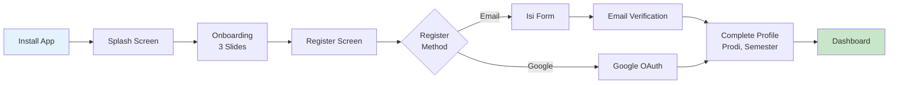

### 15.2 Returning User Flow

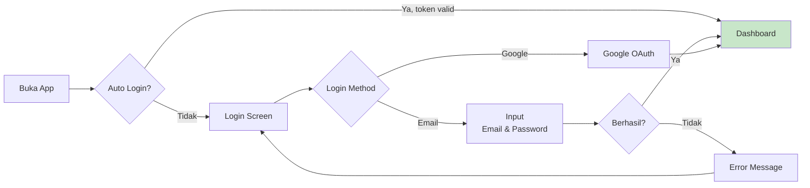

### 15.3 Core Task Flow

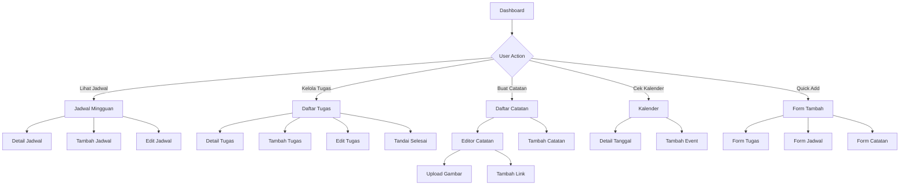

---

## 16. Business Flow

### 16.1 Siklus Hidup Tugas (Task Lifecycle)

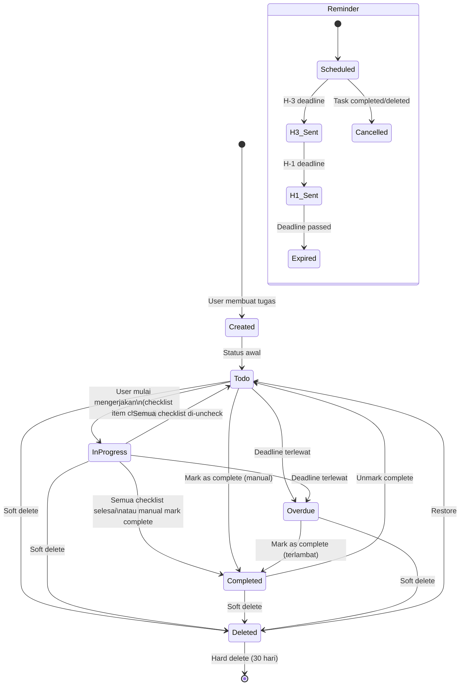

### 16.2 Business Rules

| ID | Rule | Deskripsi |
|----|------|-----------|
| BR-01 | Auto-Completion | Jika semua checklist items dalam tugas di-check, task status otomatis menjadi `completed` |
| BR-02 | Auto-Progress | `completion_percentage` dihitung otomatis dari checklist: `completed_items / total_items × 100` |
| BR-03 | Overdue Detection | Tugas dengan `deadline < NOW()` dan `status != completed` otomatis berlabel "Overdue" |
| BR-04 | Reminder Logic | Reminder H-3 dan H-1 hanya terkirim jika tugas belum selesai |
| BR-05 | Schedule Conflict | Jadwal baru tidak boleh overlap jam pada hari yang sama (warning, bukan block) |
| BR-06 | Soft Delete | Semua penghapusan tugas dan catatan adalah soft delete (`is_deleted = true`) |
| BR-07 | Profile Auto-Create | Profil dibuat otomatis saat user register |
| BR-08 | Email Required | Fitur utama tidak bisa diakses sampai email terverifikasi |
| BR-09 | Token Refresh | Token otomatis di-refresh sebelum expired |
| BR-10 | Quiet Hours | Notifikasi tidak dikirim selama quiet hours (default 22:00-07:00) |
| BR-11 | Image Compression | Gambar > 2MB otomatis dikompresi sebelum upload |
| BR-12 | MK Sync | Daftar mata kuliah di modul tugas dan catatan otomatis sync dari modul jadwal |

---

## 17. Navigation Flow

### 17.1 Navigation Architecture

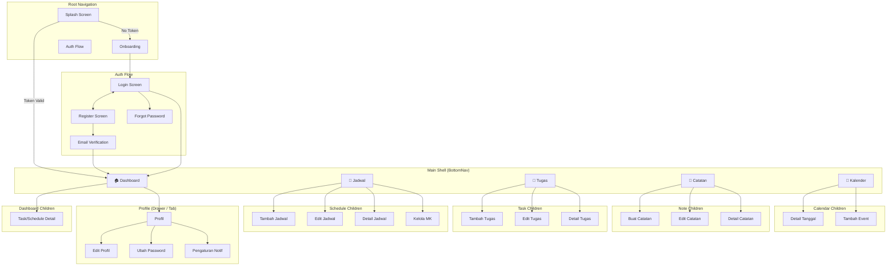

### 17.2 Bottom Navigation Structure

| Index | Icon | Label | Route | Screen |
|-------|------|-------|-------|--------|
| 0 | 🏠 | Beranda | `/dashboard` | DashboardScreen |
| 1 | 📅 | Jadwal | `/schedule` | ScheduleScreen |
| 2 | 📝 | Tugas | `/tasks` | TaskListScreen |
| 3 | 📒 | Catatan | `/notes` | NoteListScreen |
| 4 | 📆 | Kalender | `/calendar` | CalendarScreen |

### 17.3 GoRouter Configuration

| Route | Path | Screen | Type |
|-------|------|--------|------|
| splash | `/` | SplashScreen | Initial |
| onboarding | `/onboarding` | OnboardingScreen | Push |
| login | `/login` | LoginScreen | Push Replacement |
| register | `/register` | RegisterScreen | Push |
| forgotPassword | `/forgot-password` | ForgotPasswordScreen | Push |
| emailVerification | `/verify-email` | EmailVerificationScreen | Push |
| dashboard | `/dashboard` | DashboardScreen | Shell Branch |
| schedule | `/schedule` | ScheduleScreen | Shell Branch |
| addSchedule | `/schedule/add` | AddScheduleScreen | Push |
| editSchedule | `/schedule/edit/:id` | EditScheduleScreen | Push |
| courses | `/schedule/courses` | CourseManagementScreen | Push |
| tasks | `/tasks` | TaskListScreen | Shell Branch |
| addTask | `/tasks/add` | AddTaskScreen | Push |
| editTask | `/tasks/edit/:id` | EditTaskScreen | Push |
| taskDetail | `/tasks/:id` | TaskDetailScreen | Push |
| notes | `/notes` | NoteListScreen | Shell Branch |
| addNote | `/notes/add` | NoteEditorScreen | Push |
| editNote | `/notes/edit/:id` | NoteEditorScreen | Push |
| noteDetail | `/notes/:id` | NoteDetailScreen | Push |
| calendar | `/calendar` | CalendarScreen | Shell Branch |
| addEvent | `/calendar/add` | AddEventDialog | Dialog |
| profile | `/profile` | ProfileScreen | Push |
| editProfile | `/profile/edit` | EditProfileScreen | Push |
| changePassword | `/profile/password` | ChangePasswordScreen | Push |
| notifSettings | `/profile/notifications` | NotifSettingsScreen | Push |

---

## 18. Validation Rules

### 18.1 Authentication Validation

| Field | Rules | Error Message |
|-------|-------|---------------|
| **Nama Lengkap** | Required, 2-100 karakter, hanya huruf & spasi | "Nama harus diisi", "Nama minimal 2 karakter", "Nama hanya boleh mengandung huruf dan spasi" |
| **Email** | Required, format email valid (regex), max 254 karakter | "Email harus diisi", "Format email tidak valid" |
| **Password** | Required, min 8 karakter, harus mengandung: 1 huruf besar, 1 huruf kecil, 1 angka | "Password harus diisi", "Password minimal 8 karakter", "Password harus mengandung huruf besar, huruf kecil, dan angka" |
| **Konfirmasi Password** | Required, harus sama dengan password | "Konfirmasi password harus diisi", "Konfirmasi password tidak cocok" |

### 18.2 Profile Validation

| Field | Rules | Error Message |
|-------|-------|---------------|
| **Nama Lengkap** | Required, 2-100 karakter | "Nama harus diisi" |
| **Universitas** | Optional, max 200 karakter | "Nama universitas terlalu panjang" |
| **Program Studi** | Optional, max 200 karakter | "Nama program studi terlalu panjang" |
| **Jenjang** | Optional, enum: D3, D4, S1 | "Pilih jenjang yang valid" |
| **Semester** | Optional, integer 1-14 | "Semester harus antara 1-14" |
| **Foto Profil** | Max 2 MB, format: JPG/PNG/WebP | "Ukuran foto maksimal 2 MB", "Format foto tidak didukung" |

### 18.3 Schedule Validation

| Field | Rules | Error Message |
|-------|-------|---------------|
| **Mata Kuliah** | Required (pilih dari courses) | "Pilih mata kuliah" |
| **Hari** | Required, enum: Senin-Minggu | "Pilih hari" |
| **Jam Mulai** | Required, format HH:MM, 06:00-23:00 | "Jam mulai harus diisi", "Jam mulai tidak valid" |
| **Jam Selesai** | Required, format HH:MM, harus > Jam Mulai | "Jam selesai harus diisi", "Jam selesai harus setelah jam mulai" |
| **Ruangan** | Optional, max 50 karakter | "Nama ruangan terlalu panjang" |
| **Nama MK** (saat tambah MK) | Required, 2-200 karakter | "Nama mata kuliah harus diisi" |
| **Kode MK** | Optional, max 20 karakter | — |
| **SKS** | Optional, integer 1-6 | "SKS harus antara 1-6" |
| **Dosen** | Optional, max 200 karakter | — |
| **Warna** | Required, format hex #RRGGBB | Default color jika tidak dipilih |

### 18.4 Task Validation

| Field | Rules | Error Message |
|-------|-------|---------------|
| **Judul Tugas** | Required, 1-300 karakter | "Judul tugas harus diisi", "Judul terlalu panjang (max 300 karakter)" |
| **Deskripsi** | Optional, max 5000 karakter | "Deskripsi terlalu panjang" |
| **Deadline** | Optional, harus ≥ sekarang (saat create) | "Deadline harus di masa depan" |
| **Prioritas** | Required, enum: low/medium/high/urgent | Default: medium |
| **Mata Kuliah** | Optional, reference ke courses | "Mata kuliah tidak valid" |
| **Checklist Item** | Required (jika ada), 1-300 karakter per item, max 50 items | "Item checklist harus diisi", "Maksimal 50 item checklist" |

### 18.5 Note Validation

| Field | Rules | Error Message |
|-------|-------|---------------|
| **Judul** | Required, 1-300 karakter | "Judul catatan harus diisi" |
| **Konten** | Optional, max 50.000 karakter (rich text) | "Konten terlalu panjang" |
| **Mata Kuliah** | Optional, reference ke courses | — |
| **Gambar** | Max 5 MB per file, format: JPG/PNG/WebP, max 20 gambar per catatan | "Ukuran gambar maksimal 5 MB", "Format gambar tidak didukung", "Maksimal 20 gambar per catatan" |
| **Link** | Optional, URL format valid | "Format URL tidak valid" |
| **Link Google Drive** | Harus match pattern: `drive.google.com/*` atau `docs.google.com/*` | "URL Google Drive tidak valid" |

### 18.6 Calendar Event Validation

| Field | Rules | Error Message |
|-------|-------|---------------|
| **Judul** | Required, 1-300 karakter | "Judul event harus diisi" |
| **Tanggal** | Required, format date | "Tanggal harus diisi" |
| **Waktu** | Optional (jika bukan all-day), format HH:MM | "Format waktu tidak valid" |
| **Deskripsi** | Optional, max 2000 karakter | "Deskripsi terlalu panjang" |
| **Tipe Event** | Required, enum: academic/personal/organization/exam/holiday | Default: personal |

### 18.7 Validation Implementation Pattern

```
┌──────────────────────────────────────────────────────────────┐
│                    Validation Strategy                        │
├──────────────────────────────────────────────────────────────┤
│                                                              │
│  Layer 1: Client-Side (Flutter)                              │
│  ├── Real-time validation (on field change)                  │
│  ├── Form validation (on submit)                             │
│  └── Tujuan: UX responsif, feedback cepat                    │
│                                                              │
│  Layer 2: ViewModel (Business Logic)                         │
│  ├── Cross-field validation                                  │
│  ├── Business rule validation                                │
│  └── Tujuan: Enforce business rules                          │
│                                                              │
│  Layer 3: Server-Side (PostgreSQL)                           │
│  ├── CHECK constraints                                       │
│  ├── NOT NULL constraints                                    │
│  ├── UNIQUE constraints                                      │
│  ├── Foreign key constraints                                 │
│  └── Tujuan: Data integrity guarantee                        │
│                                                              │
│  Layer 4: RLS Policies (Supabase)                            │
│  ├── Row-level access control                                │
│  └── Tujuan: Authorization enforcement                       │
│                                                              │
└──────────────────────────────────────────────────────────────┘
```

---

## 19. Security Requirement

### 19.1 Authentication Security

| ID | Requirement | Implementasi | Prioritas |
|----|-------------|-------------|-----------|
| SEC-AUTH-01 | Password Hashing | bcrypt (Supabase default, cost factor 10) | Kritis |
| SEC-AUTH-02 | JWT Token | Access token (1 jam), Refresh token (30 hari) | Kritis |
| SEC-AUTH-03 | Token Storage | `flutter_secure_storage` (Android Keystore) | Kritis |
| SEC-AUTH-04 | OAuth 2.0 | PKCE flow untuk Google Sign-In | Tinggi |
| SEC-AUTH-05 | Brute Force Protection | Rate limit 5 attempts / 15 menit per IP (Supabase) | Tinggi |
| SEC-AUTH-06 | Password Reset | One-time link, valid 1 jam, invalidate setelah digunakan | Tinggi |
| SEC-AUTH-07 | Session Invalidation | Force logout di semua device saat ubah password | Sedang |

### 19.2 Data Security

| ID | Requirement | Implementasi | Prioritas |
|----|-------------|-------------|-----------|
| SEC-DATA-01 | Encryption in Transit | TLS 1.3 (semua komunikasi HTTPS) | Kritis |
| SEC-DATA-02 | Encryption at Rest | AES-256 (Supabase PostgreSQL) | Kritis |
| SEC-DATA-03 | Row Level Security | RLS di SEMUA tabel, user hanya akses data sendiri | Kritis |
| SEC-DATA-04 | Input Sanitization | Escape HTML/SQL di semua input (Supabase PostgREST) | Kritis |
| SEC-DATA-05 | File Upload Validation | Validasi MIME type + file size + extension | Tinggi |
| SEC-DATA-06 | Storage Access | Private bucket untuk note images, public hanya avatar | Tinggi |
| SEC-DATA-07 | PII Protection | Tidak menyimpan data sensitif di logs/crash reports | Tinggi |

### 19.3 Application Security

| ID | Requirement | Implementasi | Prioritas |
|----|-------------|-------------|-----------|
| SEC-APP-01 | Certificate Pinning | SSL pinning untuk Supabase endpoint (Phase 2) | Sedang |
| SEC-APP-02 | Root/Jailbreak Detection | Warning jika device rooted (tidak block) | Rendah |
| SEC-APP-03 | Code Obfuscation | ProGuard/R8 untuk Android release build | Tinggi |
| SEC-APP-04 | API Key Protection | Supabase keys di `.env`, tidak di source code | Kritis |
| SEC-APP-05 | Debug Mode | Disable debug logging & inspector di release | Tinggi |
| SEC-APP-06 | Deep Link Security | Validasi scheme & host untuk deep links | Sedang |
| SEC-APP-07 | Screenshot Prevention | Disable screenshot pada halaman sensitif (opsional) | Rendah |

### 19.4 OWASP Mobile Top 10 Compliance

| OWASP | Risk | Mitigasi CampusMate |
|-------|------|---------------------|
| M1 | Improper Platform Usage | Mengikuti Android security guidelines, proper permission usage |
| M2 | Insecure Data Storage | flutter_secure_storage, no plaintext tokens, encrypted DB |
| M3 | Insecure Communication | TLS 1.3, no HTTP, certificate validation |
| M4 | Insecure Authentication | Supabase Auth (proven), JWT, token refresh, rate limiting |
| M5 | Insufficient Cryptography | bcrypt passwords, AES-256 at rest, TLS 1.3 in transit |
| M6 | Insecure Authorization | RLS on every table, server-side validation |
| M7 | Client Code Quality | Static analysis, lint rules, code review, testing |
| M8 | Code Tampering | APK signing, ProGuard obfuscation |
| M9 | Reverse Engineering | ProGuard/R8, env var separation |
| M10 | Extraneous Functionality | Remove debug logs, test accounts, hidden endpoints in release |

### 19.5 Privacy & Compliance

| Aspek | Implementasi |
|-------|-------------|
| Data Minimization | Hanya collect data yang dibutuhkan |
| Right to Delete | Fitur hapus akun (grace period 30 hari) |
| Data Export | (Phase 2) User bisa export data mereka |
| Privacy Policy | Wajib ada sebelum publish ke Play Store |
| Terms of Service | Wajib ada sebelum publish ke Play Store |
| Data Retention | Soft-deleted data dihapus setelah 30 hari |
| Third-Party | Google OAuth — consent screen jelas |

---

## 20. Roadmap MVP

### 20.1 Timeline Overview

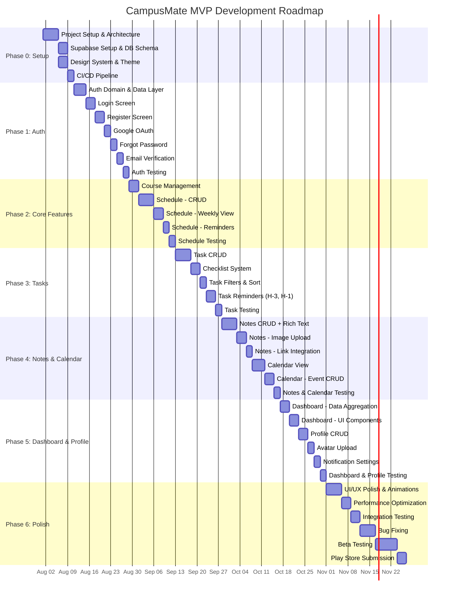

### 20.2 Phase Detail

| Phase | Durasi | Sprint | Deliverables |
|-------|--------|--------|-------------|
| **Phase 0: Setup** | 2 minggu | Sprint 0 | Project skeleton, Supabase project, DB schema, theme, CI/CD |
| **Phase 1: Auth** | 2.5 minggu | Sprint 1 | Login, Register, Google OAuth, Forgot Password, Email Verification |
| **Phase 2: Core** | 2.5 minggu | Sprint 2 | Course management, Jadwal CRUD, Weekly view, Reminder jadwal |
| **Phase 3: Tasks** | 2.5 minggu | Sprint 3 | Task CRUD, Checklist, Filter/Sort, Reminder H-3/H-1 |
| **Phase 4: Notes & Calendar** | 3 minggu | Sprint 4-5 | Notes CRUD, Rich text, Image upload, Calendar view, Events |
| **Phase 5: Dashboard & Profile** | 2.5 minggu | Sprint 5-6 | Dashboard aggregation, Profile CRUD, Avatar, Notification settings |
| **Phase 6: Polish** | 3.5 minggu | Sprint 6-7 | UI polish, Performance, Integration testing, Beta, Play Store |

**Total Estimasi: ~18 minggu (4.5 bulan)**

### 20.3 Milestone

| Milestone | Target Date | Kriteria |
|-----------|-------------|----------|
| M1: Foundation | Minggu 2 | Project setup, DB schema live, theme siap |
| M2: Auth Complete | Minggu 4.5 | Semua flow auth berfungsi end-to-end |
| M3: Core Features | Minggu 7 | Jadwal kuliah + mata kuliah lengkap |
| M4: Task Management | Minggu 9.5 | Task management lengkap dengan checklist & reminder |
| M5: Content Features | Minggu 12.5 | Notes + Calendar lengkap |
| M6: MVP Complete | Minggu 15 | Dashboard + Profil, semua fitur terintegrasi |
| M7: Beta Release | Minggu 17 | Internal beta, bug fixing |
| M8: Production Release | Minggu 18 | Play Store live |

---

## 21. Future Feature

### 21.1 Phase 1.5 — Quick Wins (Post-MVP)

| Fitur | Deskripsi | Effort | Impact |
|-------|-----------|--------|--------|
| Push Notification (FCM) | Remote push notification via Firebase | Sedang | Tinggi |
| Offline Mode (Basic) | Cache data utama untuk akses offline | Sedang | Tinggi |
| Widget Android | Home screen widget untuk jadwal & deadline | Sedang | Sedang |
| Dark Mode Polish | Penyempurnaan dark mode theme | Rendah | Sedang |
| Onboarding Tutorial | Interactive walkthrough saat pertama kali | Rendah | Sedang |

### 21.2 Phase 2 — Enhanced Features

| Fitur | Deskripsi | Effort | Impact |
|-------|-----------|--------|--------|
| Berbagi Catatan | Share catatan antar mahasiswa | Tinggi | Tinggi |
| Forum Diskusi | Forum per mata kuliah | Tinggi | Tinggi |
| Gamifikasi | Badges, streaks, leaderboard | Sedang | Sedang |
| Pomodoro Timer | Timer belajar terintegrasi | Rendah | Sedang |
| Export PDF | Export catatan ke PDF | Sedang | Sedang |
| iOS Version | Deploy ke iOS | Tinggi | Tinggi |
| Web Version | Progressive Web App | Tinggi | Sedang |
| Multi-Language | English, Bahasa Indonesia | Sedang | Sedang |
| Tema Kustom | User bisa customisasi warna tema | Rendah | Rendah |
| Recurring Tasks | Tugas berulang (mingguan/bulanan) | Sedang | Sedang |

### 21.3 Phase 3 — Platform Features

| Fitur | Deskripsi | Effort | Impact |
|-------|-----------|--------|--------|
| Integrasi SIAKAD | Sync dengan sistem akademik kampus | Sangat Tinggi | Sangat Tinggi |
| Absensi Digital | QR-based attendance system | Tinggi | Tinggi |
| KRS Planning | Perencanaan kartu rencana studi | Tinggi | Tinggi |
| Marketplace Buku | Jual beli buku antar mahasiswa | Tinggi | Sedang |
| Chat System | Direct messaging & group chat | Sangat Tinggi | Tinggi |
| Event Platform | Platform kegiatan kampus | Tinggi | Tinggi |
| AI Study Assistant | AI-powered study helper | Sangat Tinggi | Tinggi |
| Analytics Dashboard | Insight belajar (study analytics) | Sedang | Sedang |

### 21.4 Future Feature Prioritization Matrix

```
                    IMPACT
              Low         High
         ┌──────────┬──────────┐
    Low  │ Tema     │ Widget   │  ← DO LATER / NICE TO HAVE
         │ Kustom   │ Android  │
EFFORT   ├──────────┼──────────┤
         │ AI       │ Share    │  ← STRATEGIC / PLAN CAREFULLY
   High  │ Study    │ Catatan  │
         │ SIAKAD   │ Offline  │
         └──────────┴──────────┘
```

---

## 22. Risk Analysis

### 22.1 Risk Register

| ID | Risk | Probabilitas | Impact | Severity | Mitigasi | Contingency |
|----|------|:---:|:---:|:---:|---------|------------|
| R-01 | **Supabase Downtime** — Backend tidak bisa diakses | Rendah | Tinggi | 🟡 Sedang | Monitor Supabase status page, implementasi retry mechanism | Tampilkan cached data, queue operasi untuk sync nanti |
| R-02 | **Performance Issue** — App lambat di device low-end | Sedang | Tinggi | 🔴 Tinggi | Profiling awal, lazy loading, pagination, image compression | Optimisasi bertahap, set minimum device requirement lebih tinggi |
| R-03 | **Data Loss** — Kehilangan data user | Rendah | Kritis | 🔴 Tinggi | Daily backup Supabase, soft delete pattern, RLS enforcement | Restore dari backup, incident response procedure |
| R-04 | **Security Breach** — Akses tidak sah ke data | Rendah | Kritis | 🔴 Tinggi | RLS, JWT, encrypted storage, input validation, OWASP compliance | Force password reset, revoke sessions, incident investigation |
| R-05 | **Scope Creep** — Fitur terus bertambah saat development | Tinggi | Sedang | 🟡 Sedang | Strict MVP scope, sprint planning, feature freeze di Phase 6 | Tunda fitur non-kritis ke post-MVP |
| R-06 | **Notifikasi Tidak Terkirim** — Local notification gagal | Sedang | Tinggi | 🔴 Tinggi | Testing di berbagai device & OS version, battery optimization handling | Fallback ke in-app notification, user guide untuk battery settings |
| R-07 | **Google OAuth Rejection** — Google menolak OAuth consent | Rendah | Sedang | 🟡 Sedang | Ikuti semua Google OAuth guidelines, siapkan privacy policy | Temporarily disable Google login, hanya email login |
| R-08 | **Play Store Rejection** — APK ditolak Google Play | Sedang | Sedang | 🟡 Sedang | Ikuti Play Store guidelines, privacy policy, proper permissions | Fix issues, re-submit, appeal jika perlu |
| R-09 | **Library Breaking Change** — Update package merusak app | Sedang | Sedang | 🟡 Sedang | Version pinning di pubspec.yaml, renovate bot, changelog monitoring | Pin ke versi stable, delay update, fork jika critical |
| R-10 | **Low User Adoption** — User tidak tertarik | Sedang | Tinggi | 🔴 Tinggi | User research, beta testing, iterasi berdasarkan feedback | Pivot fitur, intensifkan marketing, partnership kampus |
| R-11 | **Supabase Free Tier Limit** — Melebihi quota gratis | Sedang | Sedang | 🟡 Sedang | Monitor usage, optimasi query, image compression | Upgrade ke Pro plan ($25/bulan), optimasi storage |
| R-12 | **Rich Text Editor Bugs** — flutter_quill tidak stabil | Sedang | Sedang | 🟡 Sedang | Extensive testing, pin ke versi stabil, auto-save | Fallback ke plain text editor, evaluasi alternatif library |
| R-13 | **Concurrency Issue** — Data conflict saat multi-device | Rendah | Sedang | 🟢 Rendah | Last-write-wins strategy, timestamp-based conflict resolution | Manual refresh, conflict notification ke user |
| R-14 | **Developer Burnout** — Burnout pada tim kecil | Sedang | Tinggi | 🔴 Tinggi | Realistic timeline, sprint buffer, clear scope | Extend timeline, reduce MVP scope, outsource non-critical |

### 22.2 Risk Matrix

```
              IMPACT
        Low       Medium      High       Critical
   ┌──────────┬──────────┬──────────┬──────────┐
H  │          │ R-05     │ R-10     │          │
i  │          │ Scope    │ Low      │          │
g  │          │ Creep    │ Adoption │          │
h  │          │          │ R-14     │          │
   ├──────────┼──────────┼──────────┼──────────┤
M  │          │ R-08     │ R-02     │          │
e  │          │ Play     │ Perf     │          │
d  │          │ Store    │ R-06     │          │
   │          │ R-09     │ Notif    │          │
   │          │ R-11     │ R-12     │          │
P  ├──────────┼──────────┼──────────┼──────────┤
R  │          │ R-07     │ R-01     │ R-03     │
O  │          │ OAuth    │ Downtime │ Data Loss│
B  │ R-13     │          │          │ R-04     │
   │ Concur.  │          │          │ Security │
L  │          │          │          │          │
   └──────────┴──────────┴──────────┴──────────┘
```

### 22.3 Risk Response Strategy Summary

| Strategy | Risiko yang Diterapkan |
|----------|----------------------|
| **Avoid** (Hindari) | R-03: Implementasi backup otomatis, soft delete |
| **Mitigate** (Kurangi) | R-02, R-04, R-05, R-06, R-11: Proaktif dengan testing, monitoring, scope control |
| **Transfer** (Alihkan) | R-01: Supabase SLA 99.9%, R-08: Ikuti Google guidelines |
| **Accept** (Terima) | R-13: Last-write-wins acceptable untuk MVP single-user focus |

---

## Lampiran

### A. Glossary

| Istilah | Definisi |
|---------|----------|
| Clean Architecture | Arsitektur software yang memisahkan concerns ke dalam layer independen |
| MVVM | Model-View-ViewModel, pola arsitektur yang memisahkan business logic dari UI |
| Riverpod | State management solution untuk Flutter yang type-safe dan testable |
| RLS | Row Level Security — fitur PostgreSQL untuk membatasi akses data per baris |
| PostgREST | Server yang otomatis menghasilkan REST API dari PostgreSQL schema |
| GoTrue | Service authentication dari Supabase |
| Soft Delete | Menandai data sebagai dihapus tanpa menghapus dari database |
| PKCE | Proof Key for Code Exchange — OAuth 2.0 flow yang aman untuk mobile apps |

### B. Approval Sign-off

| Role | Nama | Tanggal | Tanda Tangan |
|------|------|---------|-------------|
| Product Owner | _________________ | ____/____/________ | _________________ |
| Technical Lead | _________________ | ____/____/________ | _________________ |
| UI/UX Designer | _________________ | ____/____/________ | _________________ |
| QA Lead | _________________ | ____/____/________ | _________________ |

### C. Document History

| Versi | Tanggal | Penulis | Perubahan |
|-------|---------|---------|-----------|
| 1.0.0 | 26 Juli 2026 | Software Architect | Initial draft — semua 22 section |

---

> **Catatan**: Dokumen ini adalah living document yang akan diperbarui seiring perkembangan project. Semua perubahan harus melalui proses review dan mendapat approval dari stakeholder terkait.
