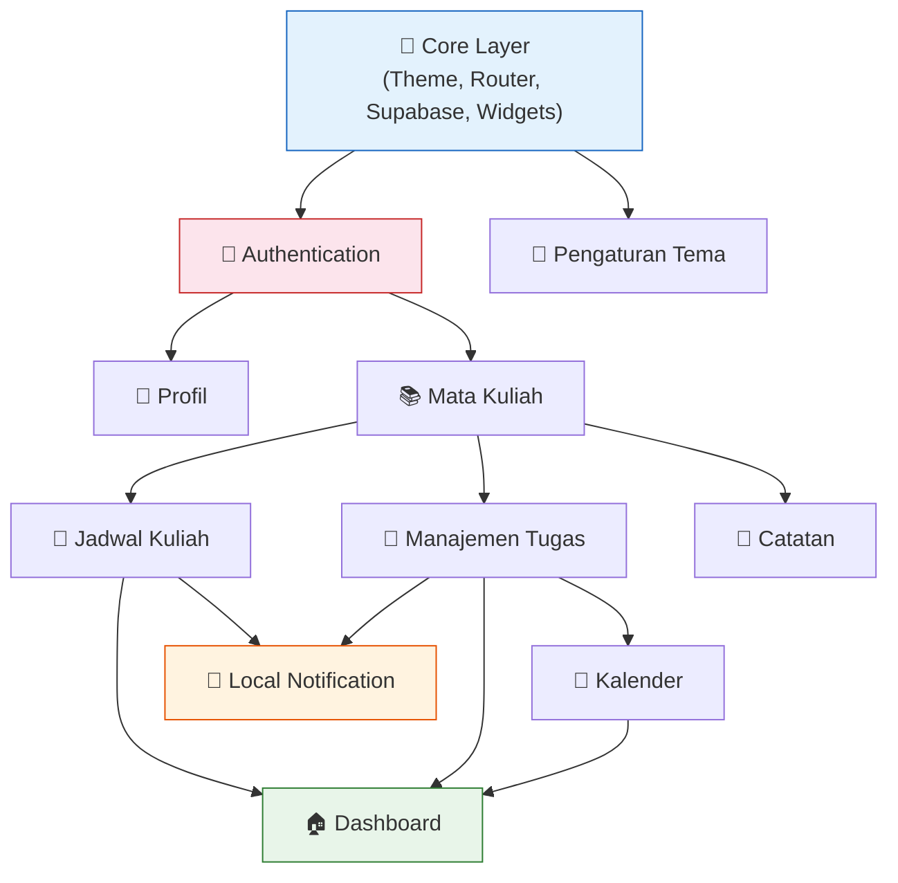
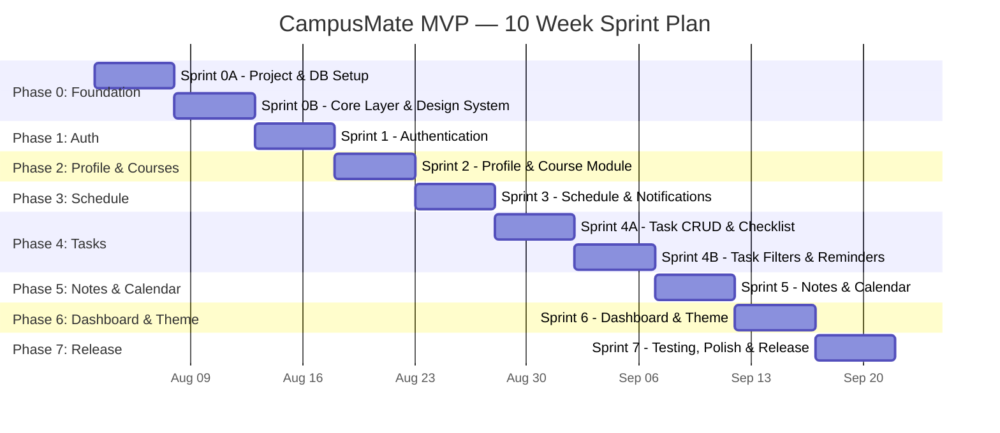
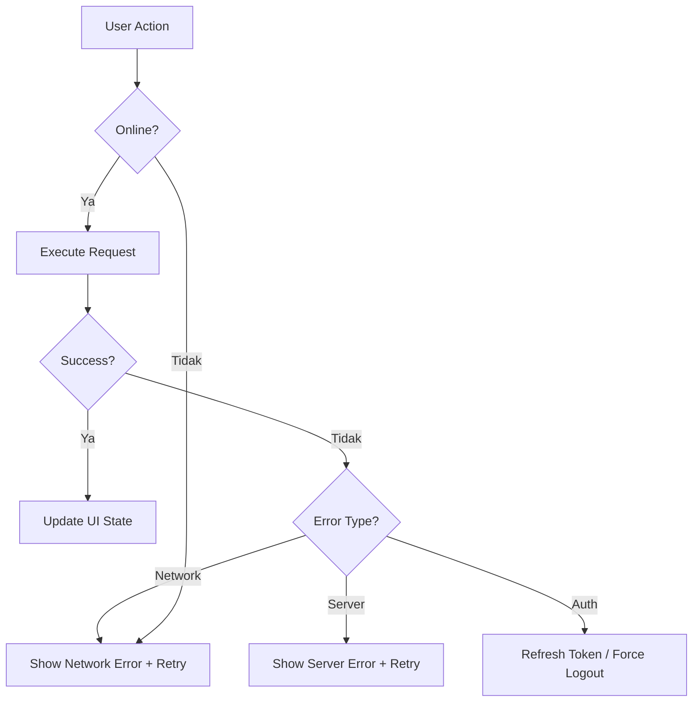

# 🗂️ CampusMate — Master Implementation Plan

> **Versi:** 1.0.0  
> **Tanggal:** 26 Juli 2026  
> **Referensi:** [CampusMate SRS v1.0.0](./01_SRS.md)  
> **Durasi Target:** 10 Minggu (Solo Developer)  
> **Status:** Approved  

---

## Daftar Isi

1. [Ringkasan Strategi Implementasi](#1-ringkasan-strategi-implementasi)
2. [Daftar Asumsi Teknis](#2-daftar-asumsi-teknis)
3. [Scope MVP dan Out-of-Scope](#3-scope-mvp-dan-out-of-scope)
4. [Dependency Map Antarfitur](#4-dependency-map-antarfitur)
5. [Urutan Fase Implementasi](#5-urutan-fase-implementasi)
6. [Breakdown Sprint per Minggu](#6-breakdown-sprint-per-minggu)
7. [Objective Setiap Sprint](#7-objective-setiap-sprint)
8. [Daftar Task Teknis Setiap Sprint](#8-daftar-task-teknis-setiap-sprint)
9. [Deliverable Setiap Sprint](#9-deliverable-setiap-sprint)
10. [Acceptance Criteria Setiap Fitur](#10-acceptance-criteria-setiap-fitur)
11. [Definition of Ready](#11-definition-of-ready)
12. [Definition of Done](#12-definition-of-done)
13. [Database Migration Order](#13-database-migration-order)
14. [Urutan Pembuatan Tabel Supabase](#14-urutan-pembuatan-tabel-supabase)
15. [Urutan Implementasi Flutter Feature Module](#15-urutan-implementasi-flutter-feature-module)
16. [Daftar Shared Component](#16-daftar-shared-component)
17. [Daftar Core Service](#17-daftar-core-service)
18. [State Management Plan dengan Riverpod](#18-state-management-plan-dengan-riverpod)
19. [Navigation Plan dengan GoRouter](#19-navigation-plan-dengan-gorouter)
20. [Error Handling Strategy](#20-error-handling-strategy)
21. [Offline dan Connectivity Strategy](#21-offline-dan-connectivity-strategy)
22. [Notification Implementation Plan](#22-notification-implementation-plan)
23. [Security dan RLS Implementation Plan](#23-security-dan-rls-implementation-plan)
24. [Testing Strategy](#24-testing-strategy)
25. [Seed Data dan Development Environment](#25-seed-data-dan-development-environment)
26. [CI/CD Plan Sederhana](#26-cicd-plan-sederhana)
27. [Risiko Implementasi dan Mitigasi](#27-risiko-implementasi-dan-mitigasi)
28. [Checklist Sebelum Mulai Coding](#28-checklist-sebelum-mulai-coding)
29. [Checklist Sebelum Setiap Sprint Selesai](#29-checklist-sebelum-setiap-sprint-selesai)
30. [Final MVP Release Checklist](#30-final-mvp-release-checklist)

---

## 1. Ringkasan Strategi Implementasi

### Filosofi

**"Vertical Slice First, Polish Later."**

Setiap fitur dibangun end-to-end (database → data layer → domain → presentation) sebelum berpindah ke fitur berikutnya. Ini memastikan setiap sprint menghasilkan fitur yang bisa dijalankan dan diuji, bukan potongan-potongan yang belum terhubung.

### Prinsip Utama

| # | Prinsip | Alasan |
|---|---------|--------|
| 1 | **Bottom-Up Build** | Database & RLS → Data Layer → Domain → UI. Setiap layer solid sebelum naik. |
| 2 | **Feature-by-Feature** | Satu modul selesai end-to-end sebelum mulai modul lain. Menghindari half-done features. |
| 3 | **Core First** | Theme, router, Supabase client, shared widgets selesai di minggu 1. Semua fitur memakai fondasi yang sama. |
| 4 | **Test As You Go** | Unit test untuk repository & use case ditulis bersamaan dengan kode, bukan di akhir. |
| 5 | **Pragmatic Architecture** | Clean Architecture dipakai, tetapi jangan over-abstract. Jika sebuah use case hanya memanggil satu method repository tanpa logic tambahan, boleh dipanggil langsung dari provider. |
| 6 | **Single Source of Truth** | SRS adalah rujukan utama. Setiap deviasi dicatat di bagian [USULAN PERUBAHAN]. |

### Strategi Kompresi Timeline

> [!IMPORTANT]
> SRS mengestimasikan 18 minggu. Target implementation plan ini adalah **10 minggu**. Kompresi dicapai melalui:

| Strategi | Detail |
|----------|--------|
| Simplified Testing | Fokus pada unit test repository + integration test flow kritis. Kurangi widget test pada MVP. |
| Parallel DB Setup | Semua tabel dibuat sekaligus di Sprint 0, bukan bertahap per fase. |
| Lean Rich Text | Gunakan `flutter_quill` out-of-the-box tanpa custom toolbar extension pada MVP. |
| Reduced Polish | Animasi dan micro-interaction minimal pada MVP. Polish di post-release update. |
| Combined Sprints | Notes & Calendar digabung dalam 1 sprint. Dashboard dibangun setelah semua data source tersedia. |

---

## 2. Daftar Asumsi Teknis

| ID | Asumsi | Dampak jika Salah |
|----|--------|-------------------|
| A-01 | Developer memiliki Flutter SDK 3.x terinstall dan berfungsi | Perlu setup environment terlebih dahulu (tambah 1-2 hari) |
| A-02 | Developer memiliki akun Supabase (free tier) | Perlu sign-up dan verifikasi |
| A-03 | Android device/emulator tersedia untuk testing | Perlu install Android Studio + emulator |
| A-04 | Koneksi internet stabil selama development | Offline development tidak dimungkinkan untuk Supabase testing |
| A-05 | Developer familiar dengan Dart/Flutter dasar | Jika tidak, tambahkan 1 minggu learning curve |
| A-06 | Google Cloud Console tersedia untuk OAuth setup | Google Sign-In tidak bisa diimplementasikan tanpa ini |
| A-07 | Supabase free tier cukup untuk MVP (500 MB DB, 1 GB storage, 50K monthly active users) | Jika melebihi, upgrade ke Pro ($25/bulan) |
| A-08 | Satu developer bekerja full-time (~6-8 jam/hari) | Jika part-time, timeline perlu dikalikan 1.5-2x |
| A-09 | Tidak ada perubahan major requirement selama development | Scope creep akan menggeser timeline |
| A-10 | OS development: Windows | Beberapa tool mungkin perlu penyesuaian path |

---

## 3. Scope MVP dan Out-of-Scope

### ✅ In Scope MVP

| # | Modul | Fitur Inti |
|---|-------|------------|
| 1 | **Authentication** | Register email, Login email, Login Google, Logout, Lupa password, Email verification, Session management |
| 2 | **Profil Mahasiswa** | Lihat profil, Edit profil (nama, prodi, semester, universitas), Upload foto profil, Ubah password |
| 3 | **Mata Kuliah** | CRUD mata kuliah (nama, kode, SKS, dosen, warna) |
| 4 | **Jadwal Kuliah** | CRUD jadwal mingguan, Tampilan weekly timetable, Deteksi bentrok, Warna per MK |
| 5 | **Manajemen Tugas** | CRUD tugas, Deadline & prioritas, Checklist/sub-task, Filter & sort, Mark complete, Overdue detection |
| 6 | **Reminder Lokal** | Reminder jadwal kuliah (30 min sebelum), Reminder tugas H-3 & H-1 |
| 7 | **Dashboard** | Jadwal hari ini, Deadline terdekat (5), Progress tugas, Statistik tugas, Quick actions, Greeting |
| 8 | **Catatan** | CRUD catatan, Rich text (flutter_quill basic), Catatan per MK, Upload gambar, Link Google Drive |
| 9 | **Kalender** | Tampilan bulanan, Dot indicator deadline, Detail per tanggal, Tambah event custom |
| 10 | **Pengaturan Tema** | Light/Dark mode toggle, Persist preferensi |

### ❌ Out of Scope MVP

| Fitur | Alasan Eksklusi |
|-------|----------------|
| AI Study Assistant | Kompleksitas tinggi, scope Phase 3 |
| Organisasi Kampus | Fitur kolaborasi, butuh role management |
| Marketplace Buku | Fitur e-commerce, di luar core academic |
| Presensi QR | Butuh integrasi kampus |
| Sertifikat | Fitur tambahan non-kritis |
| Beasiswa & Lomba | Data external, bukan self-managed |
| Pembayaran | Fitur finansial, regulasi kompleks |
| Chat/Messaging | Real-time system, kompleksitas tinggi |
| Fitur Dosen | Role & permission system berbeda |
| Push Notification (FCM) | Local notification cukup untuk MVP |
| Offline Mode | Signifikan menambah kompleksitas sync |
| iOS Build | Fokus Android dahulu |
| Multi-language | Bahasa Indonesia saja |
| Recurring Tasks | Kompleksitas scheduler, post-MVP |
| Export PDF | Nice-to-have, post-MVP |
| Widget Android | Nice-to-have, post-MVP |
| Notification Settings (advanced) | Toggle dasar on/off saja di MVP |
| Hapus Akun | Post-MVP (Play Store grace period masih ok untuk early launch) |

> [!NOTE]
> **[USULAN PERUBAHAN] — Pengaturan Notifikasi Disederhanakan**
> - **Keputusan lama (SRS):** Tabel `notification_settings` lengkap dengan quiet hours, per-category toggle, default reminder minutes.
> - **Keputusan baru:** MVP hanya menyimpan `theme_mode` (light/dark) di shared preferences. Notification settings dihardcode (jadwal: 30 menit sebelum, tugas: H-3 & H-1). Tabel `notification_settings` tetap dibuat di database untuk forward-compatibility, tetapi UI settings-nya minimal.
> - **Alasan:** Mengurangi satu screen dan satu CRUD flow yang tidak kritis. User masih mendapat reminder, hanya belum bisa customize timing.
> - **Dampak:** Satu screen dan satu provider berkurang. Tabel DB tetap ada untuk Phase 1.5.

> [!NOTE]
> **[USULAN PERUBAHAN] — Hapus Akun Ditunda ke Post-MVP**
> - **Keputusan lama (SRS):** PROF-06, fitur hapus akun dengan grace period.
> - **Keputusan baru:** Ditunda ke post-MVP update (sebelum app memiliki >1000 user).
> - **Alasan:** Flow kompleks (soft delete → hard delete scheduler), bukan blocker untuk Play Store initial launch jika userbase masih kecil. Google Play memperbolehkan data deletion request via email sebagai alternatif sementara.
> - **Dampak:** Satu screen, satu use case, satu cron job berkurang.

> [!NOTE]
> **[USULAN PERUBAHAN] — Simplifikasi Use Case Layer**
> - **Keputusan lama (SRS):** Setiap operasi memiliki dedicated UseCase class.
> - **Keputusan baru:** UseCase class **hanya dibuat** jika ada business logic di dalamnya (validasi, transformasi, orchestrasi multiple repos). Jika use case hanya memanggil 1 method repository tanpa logic, provider bisa memanggil repository langsung.
> - **Alasan:** Menghindari boilerplate class kosong yang hanya pass-through. Solo developer perlu pragmatis.
> - **Dampak:** Lebih sedikit file, lebih cepat development. Architecture tetap clean karena domain layer (entities, repository interfaces) tetap ada. UseCase ditambahkan saat logic bertambah.

---

## 4. Dependency Map Antarfitur



**Jalur kritis (critical path):**

```
Core → Auth → Course → Schedule → Task → Dashboard
                  ↓          ↓
                 Note      Calendar
```

**Artinya:**
- Auth **harus** selesai sebelum semua fitur lain
- Course **harus** selesai sebelum Schedule, Task, dan Note
- Dashboard dibangun **terakhir** karena mengagregasi data dari Schedule, Task, dan Calendar
- Note dan Calendar bisa dikerjakan **paralel** (jika ada 2 developer), tetapi untuk solo developer dikerjakan berurutan
- Notification Service bisa dibangun bersamaan dengan Schedule (first consumer)

---

## 5. Urutan Fase Implementasi

| Fase | Minggu | Nama | Isi | Alasan Urutan |
|------|--------|------|-----|---------------|
| **Phase 0** | 1-2 | Foundation | Project setup, Supabase, semua tabel DB, core layer, design system, shared widgets | Fondasi harus kokoh sebelum fitur apapun |
| **Phase 1** | 3 | Authentication | Register, Login, Google OAuth, Forgot Password, Email Verification, Session | Gate keeper — semua fitur butuh user terautentikasi |
| **Phase 2** | 4 | Profile & Courses | Profil mahasiswa, CRUD mata kuliah | Courses menjadi dependency untuk Schedule, Task, Note |
| **Phase 3** | 5 | Schedule & Notifications | CRUD jadwal, weekly timetable, conflict detection, local notification service, schedule reminder | First feature yang menggunakan notification |
| **Phase 4** | 6-7 | Task Management | CRUD tugas, checklist, filter/sort, prioritas, deadline, overdue, task reminder | Fitur terbesar dan paling kaya logic |
| **Phase 5** | 8 | Notes & Calendar | CRUD catatan, rich text editor, image upload, links, kalender bulanan, events | Content features yang melengkapi ekosistem |
| **Phase 6** | 9 | Dashboard & Theme | Dashboard aggregation, semua widget dashboard, theme switcher | Terakhir karena mengagregasi data semua modul |
| **Phase 7** | 10 | Testing, Polish & Release | Integration testing, bug fix, UI polish, Play Store submission | Final quality gate |

---

## 6. Breakdown Sprint per Minggu



---

## 7. Objective Setiap Sprint

| Sprint | Minggu | Objective | Key Result |
|--------|--------|-----------|------------|
| **Sprint 0A** | 1 | Project skeleton siap, database deployed | Flutter project berjalan di emulator, semua tabel Supabase ter-create dengan RLS |
| **Sprint 0B** | 2 | Core layer lengkap, design system siap | Theme (light/dark), router, Supabase client, shared widgets tersedia dan reusable |
| **Sprint 1** | 3 | User bisa register, login, dan logout | Auth flow end-to-end berjalan, session persist di restart app |
| **Sprint 2** | 4 | User bisa kelola profil dan mata kuliah | Profil tersimpan, foto uploaded, CRUD mata kuliah berfungsi |
| **Sprint 3** | 5 | User bisa kelola jadwal dan mendapat reminder | Jadwal weekly view berfungsi, conflict detection bekerja, reminder notifikasi muncul |
| **Sprint 4A** | 6 | User bisa CRUD tugas dengan checklist | Tugas tersimpan, checklist toggle berfungsi, progress auto-calculate |
| **Sprint 4B** | 7 | Tugas bisa difilter, di-sort, dan ada reminder | Filter/sort bekerja, reminder H-3/H-1 terjadwal, overdue detection aktif |
| **Sprint 5** | 8 | User bisa membuat catatan dan melihat kalender | Rich text note tersimpan, gambar ter-upload, kalender menampilkan deadline |
| **Sprint 6** | 9 | Dashboard menampilkan ringkasan lengkap, theme bisa diswitch | Semua widget dashboard berisi data real, dark mode berfungsi |
| **Sprint 7** | 10 | APK siap rilis ke Play Store | Semua critical bugs fixed, integration test pass, signed APK disubmit |

---

## 8. Daftar Task Teknis Setiap Sprint

### Sprint 0A — Project & Database Setup (Minggu 1)

| Task ID | Nama Task | Tujuan | Dependensi | Kompleksitas | Output | Acceptance Criteria |
|---------|-----------|--------|------------|:---:|--------|---------------------|
| T-001 | Inisialisasi Flutter Project | Membuat project Flutter baru dengan nama `campusmate` | — | S | Project Flutter berjalan di emulator | `flutter run` sukses, splash screen muncul |
| T-002 | Konfigurasi pubspec.yaml | Menambahkan semua dependencies yang dibutuhkan | T-001 | S | pubspec.yaml lengkap | `flutter pub get` sukses, zero error |
| T-003 | Konfigurasi analysis_options.yaml | Mengatur lint rules Dart | T-001 | S | analysis_options.yaml | `flutter analyze` zero warnings/errors |
| T-004 | Setup .env dan .env.example | Environment variable untuk Supabase credentials | T-001 | S | File .env (gitignored), .env.example | Variabel bisa dibaca dari kode |
| T-005 | Setup .gitignore | Mengabaikan file yang tidak perlu di-track | T-001 | S | .gitignore lengkap | `.env`, `build/`, `*.g.dart` ter-exclude |
| T-006 | Buat Supabase Project | Membuat project di Supabase Dashboard | — | S | Supabase project ID, URL, anon key | Dashboard accessible, API keys tersedia |
| T-007 | Buat fungsi helper `update_updated_at` | Trigger function untuk auto-update timestamp | T-006 | S | SQL function deployed | Function terlihat di Supabase SQL Editor |
| T-008 | Buat tabel `profiles` + RLS + trigger | Tabel profil mahasiswa | T-007 | M | Tabel `profiles` di Supabase | Insert/select/update bekerja, RLS enforced |
| T-009 | Buat tabel `courses` + RLS | Tabel mata kuliah | T-007 | S | Tabel `courses` di Supabase | CRUD bekerja, user hanya akses data sendiri |
| T-010 | Buat tabel `schedules` + RLS + conflict function | Tabel jadwal kuliah | T-009 | M | Tabel `schedules` + `check_schedule_conflict()` | Insert bekerja, conflict function bisa dipanggil via RPC |
| T-011 | Buat tabel `schedule_reminders` + RLS | Tabel reminder jadwal | T-010 | S | Tabel `schedule_reminders` | CRUD bekerja |
| T-012 | Buat enum types + tabel `tasks` + RLS | Tabel tugas mahasiswa | T-007 | M | Enum types + tabel `tasks` | Insert dengan enum bekerja, index tersedia |
| T-013 | Buat tabel `task_checklists` + RLS + trigger | Tabel sub-task dengan auto-completion | T-012 | M | Tabel `task_checklists` + `update_task_completion()` | Toggle checklist → task completion_percentage auto-update |
| T-014 | Buat tabel `task_reminders` + RLS | Tabel reminder tugas | T-012 | S | Tabel `task_reminders` | CRUD bekerja |
| T-015 | Buat tabel `notes` + RLS + FTS index | Tabel catatan dengan full-text search | T-007 | M | Tabel `notes` dengan GIN index | Full-text search query berfungsi |
| T-016 | Buat tabel `note_images` + `note_links` + RLS | Tabel gambar dan link catatan | T-015 | S | Kedua tabel | Insert/select bekerja |
| T-017 | Buat enum + tabel `calendar_events` + RLS | Tabel event kalender | T-007 | S | Tabel `calendar_events` | CRUD bekerja |
| T-018 | Buat tabel `notification_settings` + RLS | Tabel preferensi notifikasi | T-007 | S | Tabel `notification_settings` | Auto-insert saat user signup (trigger) |
| T-019 | Buat trigger `handle_new_user` | Auto-create profile + notification_settings saat signup | T-008, T-018 | M | Trigger on `auth.users` | Register user baru → profile & notif_settings otomatis terbuat |
| T-020 | Buat RPC `get_task_statistics` | Fungsi agregasi statistik tugas untuk dashboard | T-012 | M | SQL function | Mereturn JSON dengan total, completed, overdue, by_priority |
| T-021 | Setup Supabase Storage Buckets | Bucket `avatars` (public) dan `note-images` (private) | T-006 | S | 2 storage buckets dengan RLS | Upload/download file bekerja sesuai policy |
| T-022 | Konfigurasi Google OAuth di Supabase | Setup Google provider di Supabase Auth | T-006 | M | Google OAuth enabled | Test OAuth flow di Supabase dashboard berhasil |
| T-023 | Setup Google Cloud Console | Buat OAuth Client ID untuk Android | — | M | Client ID + SHA-1 configured | OAuth consent screen approved |

### Sprint 0B — Core Layer & Design System (Minggu 2)

| Task ID | Nama Task | Tujuan | Dependensi | Kompleksitas | Output | Acceptance Criteria |
|---------|-----------|--------|------------|:---:|--------|---------------------|
| T-024 | Buat folder structure | Implementasi Clean Architecture folder structure sesuai SRS | T-001 | S | Semua folder tercipta | Struktur sesuai Section 13 SRS |
| T-025 | Konfigurasi Supabase Client | Inisialisasi Supabase di `main.dart` | T-004, T-006 | S | `supabase_client.dart` | `Supabase.instance.client` berfungsi |
| T-026 | Buat `app_colors.dart` | Definisi color palette (light & dark) | T-024 | S | Color constants | Warna tersedia untuk semua komponen |
| T-027 | Buat `app_fonts.dart` | Typography system dengan Google Fonts | T-024 | S | Font constants + Google Fonts setup | Font ter-render di app |
| T-028 | Buat `app_sizes.dart` | Spacing, sizing, border radius constants | T-024 | S | Size constants | Konsisten di seluruh app |
| T-029 | Buat `app_theme.dart` | ThemeData untuk light dan dark mode | T-026, T-027, T-028 | M | Light + Dark ThemeData | Toggle theme berfungsi, konsisten |
| T-030 | Buat Enum classes | Semua enum: TaskPriority, TaskStatus, DayOfWeek, DegreeLevel, EventType, LinkType | T-024 | S | 6 enum files | Enum <-> string conversion bekerja |
| T-031 | Buat Failure & Exception classes | Error handling base classes | T-024 | S | `failures.dart`, `exceptions.dart` | Extend Equatable, bisa dicompare di test |
| T-032 | Buat Extension classes | Context, Date, String, Widget extensions | T-024 | S | 4 extension files | Date formatting Indonesia bekerja |
| T-033 | Buat `validators.dart` | Semua validation rules dari SRS Section 18 | T-024 | M | Static validator methods | Email, password, nama, dll validasi benar |
| T-034 | Buat `date_formatter.dart` | Formatter tanggal/waktu dalam Bahasa Indonesia | T-024 | S | Date formatting utility | "Senin, 26 Juli 2026", "07:30", relative time bekerja |
| T-035 | Konfigurasi GoRouter | Setup router dengan semua routes dari SRS Section 17.3 | T-024, T-025 | M | `app_router.dart` + `route_names.dart` | Navigasi antar placeholder screen berfungsi |
| T-036 | Buat `app.dart` | MaterialApp.router dengan theme & router | T-029, T-035 | S | Root widget | App berjalan dengan tema dan routing |
| T-037 | Buat `bottom_nav_bar.dart` | Bottom Navigation Bar (5 tab) | T-035 | M | Reusable BottomNavBar widget | Tap tab → pindah halaman, state preserved |
| T-038 | Buat `loading_widget.dart` | Loading indicator (shimmer + spinner) | T-029 | S | Loading widget | Animasi berjalan smooth |
| T-039 | Buat `error_widget.dart` | Error state widget dengan retry button | T-029 | S | Error widget | Menampilkan pesan + tombol retry |
| T-040 | Buat `empty_state_widget.dart` | Empty state dengan ilustrasi | T-029 | S | Empty state widget | Menampilkan pesan + optional action button |
| T-041 | Buat `confirmation_dialog.dart` | Dialog konfirmasi reusable (hapus, logout, dll) | T-029 | S | Dialog widget | Judul, pesan, 2 tombol (cancel/confirm) |
| T-042 | Buat `custom_snackbar.dart` | Snackbar sukses/error/warning | T-029 | S | Snackbar helper | 3 varian warna, auto-dismiss |
| T-043 | Buat `network_info.dart` | Connectivity checker | T-024 | S | NetworkInfo class | `isConnected` getter berfungsi |
| T-044 | Setup `flutter_local_notifications` | Inisialisasi notification channel Android | T-001 | M | NotificationService class | Bisa schedule & show notification di emulator |
| T-045 | Buat placeholder screens (semua) | Placeholder screen untuk setiap route | T-035 | S | ~15 placeholder screens | Navigasi berfungsi ke semua route |

### Sprint 1 — Authentication (Minggu 3)

| Task ID | Nama Task | Tujuan | Dependensi | Kompleksitas | Output | Acceptance Criteria |
|---------|-----------|--------|------------|:---:|--------|---------------------|
| T-046 | Buat `UserEntity` | Domain entity untuk User | T-030 | S | `user_entity.dart` | Immutable, extends Equatable |
| T-047 | Buat `UserModel` | Data model dengan fromJson/toJson | T-046 | S | `user_model.dart` | Serialize/deserialize benar, `toEntity()` berfungsi |
| T-048 | Buat `AuthRepository` (interface) | Abstraksi repository di domain layer | T-046 | S | `auth_repository.dart` (abstract) | Semua method auth terdefinisi |
| T-049 | Buat `AuthRemoteDataSource` | Data source yang memanggil Supabase Auth | T-025, T-047 | M | `auth_remote_datasource.dart` | signUp, signIn, signInGoogle, signOut, resetPassword bekerja |
| T-050 | Buat `AuthLocalDataSource` | Penyimpanan token lokal (flutter_secure_storage) | T-024 | S | `auth_local_datasource.dart` | Save/get/delete token bekerja |
| T-051 | Buat `AuthRepositoryImpl` | Implementasi repository | T-048, T-049, T-050 | M | `auth_repository_impl.dart` | Error handling, return Either<Failure, T> |
| T-052 | Buat Auth Riverpod Providers | Provider tree untuk auth state | T-051 | M | `auth_provider.dart`, `auth_state.dart` | State: initial, loading, authenticated, unauthenticated, error |
| T-053 | Buat `LoginScreen` | UI halaman login | T-037, T-052 | M | `login_screen.dart` | Form email/password, validasi, tombol Google, link register, link lupa password |
| T-054 | Buat `RegisterScreen` | UI halaman register | T-052 | M | `register_screen.dart` | Form nama/email/password/confirm, validasi real-time, strength indicator |
| T-055 | Buat `ForgotPasswordScreen` | UI halaman lupa password | T-052 | S | `forgot_password_screen.dart` | Input email, kirim link reset, success message |
| T-056 | Buat `EmailVerificationScreen` | UI halaman verifikasi email | T-052 | S | `email_verification_screen.dart` | Instruksi cek email, tombol resend, auto-detect verification |
| T-057 | Buat auth form widgets | AuthFormField, SocialLoginButton, PasswordStrengthIndicator | T-029 | M | 3 widget files | Reusable, styled sesuai theme |
| T-058 | Implement auth redirect logic | GoRouter redirect berdasarkan auth state | T-052, T-035 | M | Updated `app_router.dart` | Unauth → login, auth → dashboard, unverified → verify screen |
| T-059 | Buat Splash Screen | Splash screen dengan logo + auto-login check | T-058 | S | `splash_screen.dart` | Logo muncul → check token → redirect tepat |
| T-060 | Unit test Auth Repository | Test signUp, signIn, signOut, error cases | T-051 | M | Test file | Min 10 test cases, semua pass |

### Sprint 2 — Profile & Course Module (Minggu 4)

| Task ID | Nama Task | Tujuan | Dependensi | Kompleksitas | Output | Acceptance Criteria |
|---------|-----------|--------|------------|:---:|--------|---------------------|
| T-061 | Buat `ProfileEntity` | Domain entity untuk Profile | T-030 | S | `profile_entity.dart` | Immutable, extends Equatable |
| T-062 | Buat `ProfileModel` | Data model profile | T-061 | S | `profile_model.dart` | fromJson/toJson/toEntity bekerja |
| T-063 | Buat `ProfileRepository` (interface) | Abstraksi repository profile | T-061 | S | Abstract class | getProfile, updateProfile, uploadAvatar |
| T-064 | Buat `ProfileRemoteDataSource` | Supabase calls untuk profile | T-062, T-025 | M | Data source class | CRUD profile + storage upload |
| T-065 | Buat `ProfileRepositoryImpl` | Implementasi repository profile | T-063, T-064 | M | Impl class | Error handling lengkap |
| T-066 | Buat `ProfileProvider` | Riverpod provider untuk profile | T-065 | S | Provider file | State management profile |
| T-067 | Buat `ProfileScreen` | UI halaman profil | T-066 | M | Screen file | Tampil foto, nama, email, prodi, semester, tombol edit/logout |
| T-068 | Buat `EditProfileScreen` | UI form edit profil | T-066 | M | Screen file | Pre-fill data, validasi, save |
| T-069 | Buat `ChangePasswordScreen` | UI form ubah password | T-052, T-066 | S | Screen file | Password lama, baru, konfirmasi |
| T-070 | Buat `ImageService` | Utility pick + compress + crop gambar | T-024 | M | `image_service.dart` | Pick dari gallery/camera, compress >2MB, crop circle |
| T-071 | Buat `StorageService` | Wrapper Supabase Storage | T-025 | S | `storage_service.dart` | Upload file, get public URL, delete file |
| T-072 | Buat profile widgets | ProfileHeader, ProfileMenuItem, AvatarPicker | T-067 | S | 3 widget files | Reusable |
| T-073 | Buat `CourseEntity` | Domain entity untuk Course | T-030 | S | `course_entity.dart` | Immutable |
| T-074 | Buat `CourseModel` | Data model course | T-073 | S | `course_model.dart` | fromJson/toJson/toEntity |
| T-075 | Buat `CourseRepository` (interface) | Abstraksi repository courses | T-073 | S | Abstract class | CRUD operations |
| T-076 | Buat `CourseRemoteDataSource` | Supabase calls untuk courses | T-074, T-025 | S | Data source class | CRUD bekerja |
| T-077 | Buat `CourseRepositoryImpl` | Implementasi repository courses | T-075, T-076 | S | Impl class | Error handling |
| T-078 | Buat `CourseProvider` | Riverpod provider untuk courses | T-077 | S | Provider file | State list courses |
| T-079 | Buat `CourseManagementScreen` | UI CRUD mata kuliah | T-078 | M | Screen file | List MK, tambah/edit/hapus, color picker |
| T-080 | Buat `ColorPickerWidget` | Widget pemilih warna MK | T-029 | S | Widget file | 12+ pilihan warna, selectable |
| T-081 | Unit test Profile & Course Repository | Test CRUD operations + error handling | T-065, T-077 | M | Test files | Min 12 test cases |

### Sprint 3 — Schedule & Notifications (Minggu 5)

| Task ID | Nama Task | Tujuan | Dependensi | Kompleksitas | Output | Acceptance Criteria |
|---------|-----------|--------|------------|:---:|--------|---------------------|
| T-082 | Buat `ScheduleEntity` | Domain entity untuk Schedule | T-073 | S | `schedule_entity.dart` | Immutable, includes CourseEntity |
| T-083 | Buat `ScheduleModel` | Data model schedule | T-082 | S | `schedule_model.dart` | fromJson handles nested course |
| T-084 | Buat `ScheduleRepository` (interface) | Abstraksi repository schedule | T-082 | S | Abstract class | CRUD + getTodaySchedule + checkConflict |
| T-085 | Buat `ScheduleRemoteDataSource` | Supabase calls dengan join courses | T-083, T-025 | M | Data source class | Select with `*, courses(*)` bekerja |
| T-086 | Buat `ScheduleRepositoryImpl` | Implementasi repository schedule | T-084, T-085 | M | Impl class | Conflict check via RPC |
| T-087 | Buat `CheckScheduleConflictUseCase` | Business logic cek jadwal bentrok | T-086 | S | Use case class | Memanggil RPC, return list conflicts |
| T-088 | Buat `ScheduleProvider` | Riverpod provider untuk schedule | T-086, T-087 | M | Provider file | State: weekly schedule grouped by day |
| T-089 | Buat `ScheduleScreen` | UI tampilan jadwal mingguan | T-088 | L | Screen file | Weekly timetable grid, tap untuk detail |
| T-090 | Buat `WeeklyTimetable` widget | Grid jadwal Senin-Sabtu, 07:00-21:00 | T-089 | L | Widget file | Blok warna per MK, tap → detail, scroll horizontal |
| T-091 | Buat `AddScheduleScreen` | UI form tambah jadwal | T-088, T-078 | M | Screen file | Pilih MK, hari, jam mulai/selesai, ruangan |
| T-092 | Buat `EditScheduleScreen` | UI form edit jadwal | T-088 | M | Screen file | Pre-fill, validasi, conflict check |
| T-093 | Buat `ConflictWarningDialog` | Dialog peringatan jadwal bentrok | T-087 | S | Widget file | Tampilkan MK yang bentrok, konfirmasi/batal |
| T-094 | Buat `TimeSlotPicker` widget | Custom time picker untuk jadwal | T-029 | S | Widget file | Interval 5 menit, 06:00-23:00 |
| T-095 | Implement Schedule Reminder | Jadwalkan notifikasi recurring mingguan | T-044, T-088 | L | Updated NotificationService | Notifikasi 30 menit sebelum kuliah, setiap minggu |
| T-096 | Buat schedule card widgets | ScheduleCard, ScheduleDetailSheet | T-089 | S | 2 widget files | Info MK, dosen, ruangan, waktu |
| T-097 | Unit test Schedule Repository & Conflict | Test CRUD + conflict detection | T-086 | M | Test file | Min 10 test cases, conflict edge cases |

### Sprint 4A — Task CRUD & Checklist (Minggu 6)

| Task ID | Nama Task | Tujuan | Dependensi | Kompleksitas | Output | Acceptance Criteria |
|---------|-----------|--------|------------|:---:|--------|---------------------|
| T-098 | Buat `TaskEntity` + `ChecklistEntity` | Domain entities | T-073 | S | 2 entity files | Immutable, includes course reference |
| T-099 | Buat `TaskModel` + `ChecklistModel` | Data models | T-098 | S | 2 model files | fromJson handles nested checklist & course |
| T-100 | Buat `TaskRepository` (interface) | Abstraksi repository tasks | T-098 | S | Abstract class | CRUD + complete + filter + stats |
| T-101 | Buat `TaskRemoteDataSource` | Supabase calls untuk tasks | T-099, T-025 | M | Data source class | CRUD dengan join, filter query builder |
| T-102 | Buat `TaskRepositoryImpl` | Implementasi repository tasks | T-100, T-101 | M | Impl class | Error handling, soft delete |
| T-103 | Buat `ManageChecklistUseCase` | Business logic: toggle checklist → auto update task progress | T-102 | M | Use case class | Toggle → DB update → recalculate percentage |
| T-104 | Buat `TaskProvider` + `TaskFilterProvider` | Riverpod providers | T-102, T-103 | M | 2 provider files | List tasks, filtered tasks, current filter state |
| T-105 | Buat `TaskListScreen` | UI daftar tugas | T-104 | M | Screen file | List with cards, FAB tambah, filter chips |
| T-106 | Buat `AddTaskScreen` | UI form tambah tugas | T-104, T-078 | M | Screen file | Judul, deadline, prioritas, MK, deskripsi, checklist |
| T-107 | Buat `TaskDetailScreen` | UI detail tugas | T-104 | M | Screen file | Semua info, checklist toggleable, edit/hapus button |
| T-108 | Buat `EditTaskScreen` | UI form edit tugas | T-104 | M | Screen file | Pre-fill, edit semua field |
| T-109 | Buat task widgets | TaskCard, PriorityBadge, DeadlineIndicator, ChecklistTile | T-105 | M | 4 widget files | Indikator warna prioritas, countdown deadline |
| T-110 | Implement swipe-to-complete | Swipe gesture untuk mark complete | T-105 | S | Updated TaskCard | Swipe kanan → complete, undo snackbar |
| T-111 | Unit test Task Repository & Checklist | Test CRUD + completion logic | T-102, T-103 | M | Test file | Min 12 test cases |

### Sprint 4B — Task Filters & Reminders (Minggu 7)

| Task ID | Nama Task | Tujuan | Dependensi | Kompleksitas | Output | Acceptance Criteria |
|---------|-----------|--------|------------|:---:|--------|---------------------|
| T-112 | Implement Filter by Status | Filter: semua, aktif, selesai, overdue | T-104 | S | Updated provider + UI | Filter chips berfungsi, list update |
| T-113 | Implement Filter by Priority | Filter per level prioritas | T-104 | S | Updated provider + UI | Multiple filter combine bekerja |
| T-114 | Implement Filter by Course | Filter per mata kuliah | T-104, T-078 | S | Updated provider + UI | Dropdown MK, filter bekerja |
| T-115 | Implement Sort Options | Sort: deadline, prioritas, created, name | T-104 | S | `TaskSortBottomSheet` + updated provider | Bottom sheet sort, persistent preference |
| T-116 | Implement Overdue Detection | Auto-label tugas yang melewati deadline | T-104 | S | Updated TaskCard + provider | Badge "Terlambat" muncul otomatis |
| T-117 | Implement Task Reminder (H-3, H-1) | Jadwalkan notifikasi lokal saat task dibuat | T-044, T-102 | M | Updated NotificationService + TaskProvider | Notifikasi muncul tepat H-3 dan H-1 |
| T-118 | Cancel Reminder on Complete | Batalkan reminder jika tugas selesai | T-117 | S | Updated complete task flow | Reminder dibatalkan saat task completed |
| T-119 | Implement Soft Delete + Undo | Hapus tugas dengan opsi undo 5 detik | T-102 | S | Updated delete flow | Snackbar "Undo" muncul, restore bekerja |
| T-120 | Integration test Task Flow | Test end-to-end: create → checklist → complete → filter | T-111 | M | Integration test file | Full flow berjalan tanpa error |

### Sprint 5 — Notes & Calendar (Minggu 8)

| Task ID | Nama Task | Tujuan | Dependensi | Kompleksitas | Output | Acceptance Criteria |
|---------|-----------|--------|------------|:---:|--------|---------------------|
| T-121 | Buat `NoteEntity` + related entities | Domain entities: Note, NoteImage, NoteLink | T-073 | S | 3 entity files | Immutable |
| T-122 | Buat `NoteModel` + related models | Data models | T-121 | S | 3 model files | fromJson/toJson |
| T-123 | Buat `NoteRepository` (interface) | Abstraksi repository notes | T-121 | S | Abstract class | CRUD + search + uploadImage + addLink |
| T-124 | Buat `NoteRemoteDataSource` | Supabase calls untuk notes | T-122, T-025, T-071 | M | Data source class | CRUD + storage upload + FTS search |
| T-125 | Buat `NoteRepositoryImpl` | Implementasi repository notes | T-123, T-124 | M | Impl class | Error handling |
| T-126 | Buat `NoteProvider` | Riverpod provider untuk notes | T-125 | S | Provider file | State list notes, auto-save state |
| T-127 | Buat `NoteListScreen` | UI daftar catatan | T-126 | M | Screen file | List, search bar, filter per MK |
| T-128 | Buat `NoteEditorScreen` | UI editor catatan dengan flutter_quill | T-126 | L | Screen file | Rich text editor, toolbar, auto-save |
| T-129 | Buat `NoteDetailScreen` | UI read-only view catatan | T-126 | S | Screen file | Render rich text, gambar, links |
| T-130 | Implement Image Upload di Note | Pick + compress + upload + embed di editor | T-070, T-071, T-128 | M | Updated editor | Gambar muncul inline di catatan |
| T-131 | Implement Google Drive Link | Input + validasi URL Drive + simpan | T-125 | S | LinkInputDialog widget | URL Drive tersimpan, clickable |
| T-132 | Buat note widgets | NoteCard, RichTextToolbar, ImagePickerButton | T-127 | S | 3 widget files | Preview konten, toolbar fungsional |
| T-133 | Buat `CalendarEventEntity` | Domain entity untuk event | T-030 | S | Entity file | Immutable |
| T-134 | Buat `CalendarEventModel` | Data model event | T-133 | S | Model file | fromJson/toJson |
| T-135 | Buat `CalendarRepository` (interface) | Abstraksi repository kalender | T-133 | S | Abstract class | getByMonth, getByDate, CRUD event |
| T-136 | Buat `CalendarRemoteDataSource` | Supabase calls untuk calendar | T-134, T-025 | S | Data source class | Query by date range |
| T-137 | Buat `CalendarRepositoryImpl` | Implementasi repository calendar | T-135, T-136 | S | Impl class | Error handling |
| T-138 | Buat `CalendarProvider` | Riverpod provider untuk kalender | T-137, T-104 | M | Provider file | Month events + task deadlines merged |
| T-139 | Buat `CalendarScreen` | UI kalender dengan table_calendar | T-138 | M | Screen file | Monthly view, dot indicators, day detail |
| T-140 | Buat calendar widgets | CalendarGrid, EventDotIndicator, DayDetailSheet, AddEventDialog | T-139 | M | 4 widget files | Tap tanggal → sheet detail, tambah event |
| T-141 | Unit test Note & Calendar Repositories | Test CRUD + search + date queries | T-125, T-137 | M | Test files | Min 10 test cases |

### Sprint 6 — Dashboard & Theme (Minggu 9)

| Task ID | Nama Task | Tujuan | Dependensi | Kompleksitas | Output | Acceptance Criteria |
|---------|-----------|--------|------------|:---:|--------|---------------------|
| T-142 | Buat `DashboardStatsEntity` | Domain entity untuk statistik dashboard | T-098 | S | Entity file | Total, completed, overdue, by_priority |
| T-143 | Buat `DashboardStatsModel` | Data model dari RPC function | T-142 | S | Model file | Parse JSON dari `get_task_statistics` |
| T-144 | Buat `DashboardRepository` (interface) | Abstraksi repository dashboard | T-142 | S | Abstract class | getTodaySchedule, getUpcomingDeadlines, getStats |
| T-145 | Buat `DashboardRemoteDataSource` | Data source yang mengkombinasikan query | T-143, T-025 | M | Data source class | 3 query: schedule hari ini, 5 deadline terdekat, stats RPC |
| T-146 | Buat `DashboardRepositoryImpl` | Implementasi repository dashboard | T-144, T-145 | M | Impl class | Error handling per section |
| T-147 | Buat `DashboardProvider` | Riverpod provider untuk dashboard | T-146 | M | Provider file | Combined state: schedules + deadlines + stats |
| T-148 | Buat `DashboardScreen` | UI halaman utama dashboard | T-147 | L | Screen file | ScrollView dengan semua widget sections |
| T-149 | Buat `GreetingHeader` widget | Sapaan + tanggal hari ini | T-034 | S | Widget file | "Selamat Pagi, Andi" + "Senin, 26 Juli 2026" |
| T-150 | Buat `TodayScheduleCard` widget | Kartu jadwal hari ini | T-148 | M | Widget file | List kuliah hari ini, highlight sedang berlangsung |
| T-151 | Buat `UpcomingDeadlineCard` widget | Kartu 5 deadline terdekat | T-148 | M | Widget file | Warna indikator: merah/kuning/hijau, tap → detail |
| T-152 | Buat `TaskProgressWidget` | Circular progress indicator | T-148 | S | Widget file | Persentase selesai, animasi |
| T-153 | Buat `TaskStatsWidget` | Statistik tugas (cards/chips) | T-148 | S | Widget file | Total aktif, selesai minggu ini, overdue |
| T-154 | Buat `QuickActionGrid` widget | Grid tombol shortcut | T-148 | S | Widget file | 4 tombol: Tugas, Jadwal, Catatan, Kalender |
| T-155 | Implement Pull-to-Refresh | Refresh seluruh dashboard | T-147 | S | Updated DashboardScreen | Gesture refresh, loading indicator |
| T-156 | Implement Theme Switcher | Toggle light/dark mode, persist ke SharedPreferences | T-029 | M | ThemeProvider + UI toggle di Profile | Theme berubah instant, persist di restart |
| T-157 | Unit test Dashboard Repository | Test aggregasi + edge cases (no data, error) | T-146 | S | Test file | Min 6 test cases |

### Sprint 7 — Testing, Polish & Release (Minggu 10)

| Task ID | Nama Task | Tujuan | Dependensi | Kompleksitas | Output | Acceptance Criteria |
|---------|-----------|--------|------------|:---:|--------|---------------------|
| T-158 | Integration test: Auth Flow | Test register → verify → login → dashboard → logout | All auth | M | Test file | Full flow pass |
| T-159 | Integration test: Task Flow | Test create → checklist → filter → complete → delete | All task | M | Test file | Full flow pass |
| T-160 | Integration test: Schedule Flow | Test create → conflict → reminder → edit → delete | All schedule | M | Test file | Full flow pass |
| T-161 | Bug fixing pass #1 | Fix semua known bugs dari sprint sebelumnya | All | L | Updated codebase | Bug list berkurang >80% |
| T-162 | UI polish: spacing & alignment | Review semua screen, perbaiki spacing, padding, alignment | All | M | Updated screens | Konsisten di semua screen |
| T-163 | UI polish: loading & error states | Pastikan semua screen handle loading, error, empty state | All | M | Updated screens | Tidak ada uncaught exception di UI |
| T-164 | UI polish: animasi transisi | Page transition, hero animation, list animation | All | S | Updated navigator + screens | Transisi smooth, tidak laggy |
| T-165 | Performance check | Profile app di device nyata, fix jank | All | M | Performance report | ≥ 60 FPS scroll, cold start < 3 detik |
| T-166 | Buat app icon & splash | Design dan set app icon + native splash | — | S | Icon files + config | Icon muncul di launcher, splash muncul saat buka app |
| T-167 | Konfigurasi release build | Signing key, ProGuard, build.gradle release config | — | M | Signed APK | `flutter build apk --release` sukses |
| T-168 | Buat Privacy Policy | Halaman web privacy policy (bisa static page) | — | S | URL privacy policy | Accessible via URL |
| T-169 | Play Store listing preparation | Screenshots, description, feature graphic | — | M | Play Store assets | Sesuai Play Store requirements |
| T-170 | Internal testing | Test di 3+ device berbeda (low/mid/high-end) | T-167 | M | Bug report | Tidak ada critical bug |
| T-171 | Submit ke Play Store | Upload AAB ke Google Play Console | T-167, T-168, T-169 | S | App submitted | Status "In review" di Play Console |

---

## 9. Deliverable Setiap Sprint

| Sprint | Deliverables | Verifiable Output |
|--------|-------------|-------------------|
| **Sprint 0A** | ✅ Flutter project running<br>✅ Semua 12 tabel Supabase deployed<br>✅ RLS policies aktif<br>✅ Storage buckets configured<br>✅ Google OAuth configured | `flutter run` sukses, Supabase table editor menampilkan semua tabel, RLS test pass |
| **Sprint 0B** | ✅ Design system lengkap (theme, colors, fonts, sizes)<br>✅ GoRouter configured<br>✅ Semua shared widgets tersedia<br>✅ Notification service initialized<br>✅ Semua placeholder screens navigable | App berjalan dengan bottom nav, theme toggle dummy, placeholder screens accessible |
| **Sprint 1** | ✅ Register + Email Verification flow<br>✅ Login Email flow<br>✅ Login Google flow<br>✅ Forgot Password flow<br>✅ Session persistence<br>✅ Auth redirect logic<br>✅ 10+ unit tests | Bisa register → verify → login → sampai dashboard → restart app → masih login → logout |
| **Sprint 2** | ✅ Profil lengkap (view + edit + avatar)<br>✅ Change password<br>✅ CRUD mata kuliah + warna<br>✅ 12+ unit tests | Profil tersimpan, foto ter-upload, MK bisa ditambah/edit/hapus |
| **Sprint 3** | ✅ CRUD jadwal kuliah<br>✅ Weekly timetable view<br>✅ Conflict detection<br>✅ Schedule reminder (local notification)<br>✅ 10+ unit tests | Jadwal tampil di grid, bentrok terdeteksi, notifikasi muncul sebelum kuliah |
| **Sprint 4A** | ✅ CRUD tugas<br>✅ Checklist system<br>✅ Auto-completion<br>✅ Priority & deadline<br>✅ 12+ unit tests | Tugas CRUD berfungsi, checklist toggle → progress update, priority badge tampil |
| **Sprint 4B** | ✅ Filter & sort tugas<br>✅ Overdue detection<br>✅ Task reminder H-3 H-1<br>✅ Soft delete + undo<br>✅ Integration test task flow | Filter/sort bekerja, reminder muncul, overdue badge tampil, undo berfungsi |
| **Sprint 5** | ✅ CRUD catatan + rich text<br>✅ Image upload di catatan<br>✅ Google Drive link<br>✅ Kalender bulanan<br>✅ Deadline di kalender<br>✅ CRUD event kalender<br>✅ 10+ unit tests | Rich text disimpan & rendered, gambar muncul di catatan, kalender menampilkan deadline & event |
| **Sprint 6** | ✅ Dashboard lengkap (6 sections)<br>✅ Pull-to-refresh<br>✅ Light/Dark theme toggle<br>✅ 6+ unit tests | Dashboard menampilkan data real dari semua modul, theme switch instan & persistent |
| **Sprint 7** | ✅ 3 integration tests pass<br>✅ All critical bugs fixed<br>✅ UI polish complete<br>✅ Signed release APK<br>✅ Play Store submitted | APK di-install di device tanpa crash, Play Store listing submitted |

---

## 10. Acceptance Criteria Setiap Fitur

### Authentication

| Kriteria | Test Method |
|----------|------------|
| User bisa register dengan email, nama, password yang valid | Manual + Unit test |
| Validasi form real-time: email format, password strength, match confirm | Manual |
| Setelah register, email verifikasi terkirim | Manual (cek inbox) |
| User tidak bisa akses fitur utama sebelum verifikasi email | Manual + Integration test |
| User bisa login dengan email & password yang benar | Manual + Unit test |
| Login gagal menampilkan error yang jelas ("Email tidak terdaftar" / "Password salah") | Manual |
| User bisa login dengan Google | Manual |
| Login Google membuat akun baru jika belum ada | Manual |
| User bisa request reset password, link dikirim ke email | Manual |
| Session persist setelah app restart (auto-login) | Manual |
| Logout menghapus session dan redirect ke login | Manual + Integration test |

### Profil & Mata Kuliah

| Kriteria | Test Method |
|----------|------------|
| Profil menampilkan: foto, nama, email, prodi, semester, universitas | Manual |
| Semua field profil bisa diedit dan tersimpan | Manual + Unit test |
| Foto profil bisa diupload dari galeri, di-crop circle, max 2 MB | Manual |
| Password bisa diubah dengan validasi lama + baru + confirm | Manual |
| Mata kuliah bisa ditambah, diedit, dihapus | Manual + Unit test |
| Setiap MK memiliki warna yang bisa dipilih | Manual |
| Hapus MK menampilkan konfirmasi dialog | Manual |

### Jadwal Kuliah

| Kriteria | Test Method |
|----------|------------|
| Weekly timetable menampilkan jadwal Senin-Sabtu dalam grid | Manual |
| Blok jadwal berwarna sesuai warna MK | Manual |
| Jadwal bisa ditambah: pilih MK, hari, jam mulai, jam selesai, ruangan | Manual |
| Validasi: jam mulai < jam selesai | Manual + Unit test |
| Deteksi jadwal bentrok menampilkan warning dengan info MK yang bentrok | Manual + Unit test |
| Jadwal bisa diedit dan dihapus | Manual |
| Reminder notifikasi muncul 30 menit sebelum kuliah | Manual (set jadwal dekat untuk test) |

### Manajemen Tugas

| Kriteria | Test Method |
|----------|------------|
| Tugas bisa ditambah: judul, deadline, prioritas, MK, deskripsi | Manual |
| Checklist items bisa ditambah, toggle complete, reorder | Manual |
| completion_percentage auto-update saat checklist berubah | Manual + Unit test |
| Task auto-complete saat semua checklist selesai | Unit test |
| Filter bekerja: status, prioritas, MK | Manual |
| Sort bekerja: deadline, prioritas, created, nama | Manual |
| Tugas overdue menampilkan badge merah | Manual |
| Reminder muncul H-3 dan H-1 sebelum deadline | Manual |
| Reminder dibatalkan saat tugas selesai | Manual |
| Soft delete + undo (snackbar 5 detik) bekerja | Manual |

### Catatan

| Kriteria | Test Method |
|----------|------------|
| Catatan bisa dibuat dengan judul dan konten rich text | Manual |
| Rich text: bold, italic, underline, heading, list, code block bekerja | Manual |
| Catatan bisa dikelompokkan per MK | Manual |
| Gambar bisa diupload, di-compress, ditampilkan inline | Manual |
| Link Google Drive bisa ditambahkan dan diklik | Manual |
| Search catatan berdasarkan judul/konten bekerja | Manual |
| Auto-save berfungsi (atau manual save) | Manual |

### Kalender

| Kriteria | Test Method |
|----------|------------|
| Kalender menampilkan tampilan bulanan | Manual |
| Dot indicator pada tanggal yang memiliki deadline/event | Manual |
| Tap tanggal menampilkan detail event + deadline | Manual |
| Deadline tugas otomatis muncul di kalender | Manual + Integration test |
| Event custom bisa ditambah dan dihapus | Manual |
| Navigasi antar bulan berfungsi | Manual |

### Dashboard

| Kriteria | Test Method |
|----------|------------|
| Greeting sesuai waktu hari ("Selamat Pagi/Siang/Sore/Malam") | Manual |
| Jadwal hari ini menampilkan kuliah hari ini berurutan | Manual |
| Deadline terdekat menampilkan max 5 tugas, warna sesuai sisa waktu | Manual |
| Progress tugas menampilkan persentase yang benar | Manual + Unit test |
| Statistik tugas: total aktif, selesai, overdue tepat | Manual + Unit test |
| Quick action navigasi ke form yang benar | Manual |
| Pull-to-refresh memperbarui semua data | Manual |

### Pengaturan Tema

| Kriteria | Test Method |
|----------|------------|
| Toggle light/dark mode berfungsi di profile screen | Manual |
| Theme berubah instan tanpa restart | Manual |
| Preferensi tema persist setelah restart app | Manual |
| Semua screen terlihat baik di kedua mode | Manual |

---

## 11. Definition of Ready

Sebuah task siap dikerjakan jika memenuhi **semua** kriteria berikut:

| # | Kriteria | Cara Verifikasi |
|---|---------|----------------|
| 1 | Task memiliki ID, nama, dan tujuan yang jelas | Task terdaftar di implementation plan |
| 2 | Semua dependency task sudah berstatus **Done** | Cek task dependency di kolom "Dependensi" |
| 3 | Acceptance criteria sudah terdefinisi | Ada di kolom "Acceptance Criteria" task atau Section 10 |
| 4 | Database table/function yang dibutuhkan sudah exist di Supabase | Cek Supabase Table Editor |
| 5 | Design reference tersedia (wireframe, SRS section, atau contoh UI) | SRS Section terkait |
| 6 | Tidak ada blocker teknis yang belum terselesaikan | Tidak ada open question |

---

## 12. Definition of Done

Sebuah task dianggap **Done** jika memenuhi **semua** kriteria berikut:

| # | Kriteria | Cara Verifikasi |
|---|---------|----------------|
| 1 | Kode tertulis sesuai arsitektur (Clean Architecture + MVVM) | Code review checklist |
| 2 | Semua acceptance criteria terpenuhi | Manual testing |
| 3 | `flutter analyze` menghasilkan zero warnings/errors | Run command |
| 4 | Unit test tertulis dan pass (untuk repository/use case tasks) | `flutter test` pass |
| 5 | Tidak ada hardcoded string (gunakan constants) | Code scan |
| 6 | Error handling terimplementasi (loading, error, empty states) | Manual testing |
| 7 | Kode menggunakan existing shared widgets dan theme | Code review |
| 8 | Tidak ada print() debugging statements tertinggal | Code scan |
| 9 | Fitur berfungsi di emulator Android | Manual testing |

---

## 13. Database Migration Order

Semua tabel dibuat sekaligus di **Sprint 0A** untuk menghindari migration dependency issue. Urutan eksekusi SQL penting karena ada foreign key references.

```
Execution Order (top to bottom):
──────────────────────────────────
1. Helper Function
   └── update_updated_at_column()

2. Independent Tables (no FK to other custom tables)
   ├── profiles (FK → auth.users)
   └── notification_settings (FK → auth.users)

3. Trigger on auth.users
   └── handle_new_user() → inserts into profiles + notification_settings

4. Course table
   └── courses (FK → auth.users)

5. Tables that reference courses
   ├── schedules (FK → auth.users, courses)
   ├── tasks (FK → auth.users, courses)
   └── notes (FK → auth.users, courses)

6. Child tables
   ├── schedule_reminders (FK → schedules)
   ├── task_checklists (FK → tasks)
   ├── task_reminders (FK → tasks)
   ├── note_images (FK → notes)
   └── note_links (FK → notes)

7. Standalone enum + table
   └── calendar_events (FK → auth.users)

8. Triggers
   ├── update_task_completion() trigger on task_checklists
   └── All updated_at triggers

9. RPC Functions
   ├── check_schedule_conflict()
   └── get_task_statistics()

10. Storage Buckets
    ├── avatars (public)
    └── note-images (private)
```

---

## 14. Urutan Pembuatan Tabel Supabase

| Urutan | Tabel | Tipe | FK Ke | Task ID |
|:---:|-------|------|-------|---------|
| 1 | `update_updated_at_column()` | Function | — | T-007 |
| 2 | `profiles` | Table + RLS + Trigger | `auth.users` | T-008 |
| 3 | `notification_settings` | Table + RLS | `auth.users` | T-018 |
| 4 | `handle_new_user()` | Trigger on `auth.users` | → `profiles`, `notification_settings` | T-019 |
| 5 | `courses` | Table + RLS + Trigger | `auth.users` | T-009 |
| 6 | `schedules` | Table + RLS + Trigger | `auth.users`, `courses` | T-010 |
| 7 | `schedule_reminders` | Table + RLS | `schedules` | T-011 |
| 8 | `task_priority` enum | Type | — | T-012 |
| 9 | `task_status` enum | Type | — | T-012 |
| 10 | `tasks` | Table + RLS + Trigger | `auth.users`, `courses` | T-012 |
| 11 | `task_checklists` | Table + RLS + Trigger | `tasks` | T-013 |
| 12 | `update_task_completion()` | Function + Trigger | — | T-013 |
| 13 | `task_reminders` | Table + RLS | `tasks` | T-014 |
| 14 | `notes` | Table + RLS + Trigger + GIN Index | `auth.users`, `courses` | T-015 |
| 15 | `note_images` | Table + RLS | `notes` | T-016 |
| 16 | `link_type` enum | Type | — | T-016 |
| 17 | `note_links` | Table + RLS | `notes` | T-016 |
| 18 | `event_type` enum | Type | — | T-017 |
| 19 | `calendar_events` | Table + RLS + Trigger | `auth.users` | T-017 |
| 20 | `check_schedule_conflict()` | Function | — | T-010 |
| 21 | `get_task_statistics()` | Function | — | T-020 |
| 22 | `avatars` bucket | Storage | — | T-021 |
| 23 | `note-images` bucket | Storage | — | T-021 |

---

## 15. Urutan Implementasi Flutter Feature Module

Setiap module diimplementasi **bottom-up** dalam urutan:

```
1. Entity (domain/entities/)
2. Model (data/models/)  
3. Repository Interface (domain/repositories/)
4. Remote Data Source (data/datasources/)
5. Repository Implementation (data/repositories/)
6. Use Case — hanya jika ada business logic (domain/usecases/)
7. Provider / ViewModel (presentation/providers/)
8. Widgets (presentation/widgets/)
9. Screens (presentation/screens/)
10. Unit Tests (test/)
```

**Urutan per module:**

| Urutan | Module | Sprint | Alasan |
|:---:|--------|--------|--------|
| 1 | `core/` | Sprint 0B | Fondasi untuk semua module |
| 2 | `services/` | Sprint 0B | NotificationService, ImageService, StorageService |
| 3 | `features/auth/` | Sprint 1 | Gate keeper |
| 4 | `features/profile/` | Sprint 2 | Setelah auth, user perlu profil |
| 5 | `features/schedule/` (termasuk course) | Sprint 2-3 | Course di-embed dalam schedule module, atau sebagai sub-module |
| 6 | `features/task/` | Sprint 4A-4B | Fitur terbesar |
| 7 | `features/note/` | Sprint 5 | Content feature |
| 8 | `features/calendar/` | Sprint 5 | Aggregasi deadline |
| 9 | `features/dashboard/` | Sprint 6 | Aggregasi semua data |

---

## 16. Daftar Shared Component

| Component | File | Digunakan Di | Sprint Dibuat |
|-----------|------|-------------|---------------|
| `AppBarWidget` | `core/widgets/app_bar_widget.dart` | Semua screen | Sprint 0B |
| `BottomNavBar` | `core/widgets/bottom_nav_bar.dart` | Shell route | Sprint 0B |
| `LoadingWidget` | `core/widgets/loading_widget.dart` | Semua screen (loading state) | Sprint 0B |
| `AppErrorWidget` | `core/widgets/error_widget.dart` | Semua screen (error state) | Sprint 0B |
| `EmptyStateWidget` | `core/widgets/empty_state_widget.dart` | List screens (no data) | Sprint 0B |
| `ConfirmationDialog` | `core/widgets/confirmation_dialog.dart` | Delete, logout, conflict warning | Sprint 0B |
| `CustomSnackbar` | `core/widgets/custom_snackbar.dart` | Success/error feedback | Sprint 0B |
| `ColorPickerWidget` | `features/schedule/presentation/widgets/color_picker_widget.dart` | Course add/edit | Sprint 2 |
| `PriorityBadge` | `features/task/presentation/widgets/priority_badge.dart` | Task cards, detail, dashboard | Sprint 4A |
| `DeadlineIndicator` | `features/task/presentation/widgets/deadline_indicator.dart` | Task cards, dashboard | Sprint 4A |

---

## 17. Daftar Core Service

| Service | File | Tanggung Jawab | Dependencies | Sprint |
|---------|------|---------------|--------------|--------|
| `SupabaseClient` | `core/network/supabase_client.dart` | Inisialisasi dan akses Supabase | `supabase_flutter` | Sprint 0B |
| `NetworkInfo` | `core/network/network_info.dart` | Cek koneksi internet | `connectivity_plus` | Sprint 0B |
| `NotificationService` | `services/notification_service.dart` | Schedule, show, cancel local notifications | `flutter_local_notifications` | Sprint 0B |
| `ImageService` | `services/image_service.dart` | Pick, compress, crop gambar | `image_picker`, `image_cropper`, `flutter_image_compress` | Sprint 2 |
| `StorageService` | `services/storage_service.dart` | Upload/download/delete file di Supabase Storage | `supabase_flutter` | Sprint 2 |
| `Validators` | `core/utils/validators.dart` | Semua validasi input (static methods) | — | Sprint 0B |
| `DateFormatter` | `core/utils/date_formatter.dart` | Format tanggal/waktu Bahasa Indonesia | `intl` | Sprint 0B |

---

## 18. State Management Plan dengan Riverpod

### Arsitektur Provider

```
┌──────────────────────────────────────────────────────┐
│                   PROVIDER TREE                       │
├──────────────────────────────────────────────────────┤
│                                                      │
│  [Infrastructure Providers] (Provider)               │
│  ├── supabaseClientProvider                          │
│  ├── networkInfoProvider                             │
│  ├── notificationServiceProvider                     │
│  ├── imageServiceProvider                            │
│  └── storageServiceProvider                          │
│         │                                            │
│         ▼                                            │
│  [DataSource Providers] (Provider)                   │
│  ├── authRemoteDataSourceProvider                    │
│  ├── authLocalDataSourceProvider                     │
│  ├── profileRemoteDataSourceProvider                 │
│  ├── courseRemoteDataSourceProvider                  │
│  ├── scheduleRemoteDataSourceProvider                │
│  ├── taskRemoteDataSourceProvider                    │
│  ├── noteRemoteDataSourceProvider                    │
│  ├── calendarRemoteDataSourceProvider                │
│  └── dashboardRemoteDataSourceProvider               │
│         │                                            │
│         ▼                                            │
│  [Repository Providers] (Provider)                   │
│  ├── authRepositoryProvider                          │
│  ├── profileRepositoryProvider                       │
│  ├── courseRepositoryProvider                         │
│  ├── scheduleRepositoryProvider                      │
│  ├── taskRepositoryProvider                          │
│  ├── noteRepositoryProvider                          │
│  ├── calendarRepositoryProvider                      │
│  └── dashboardRepositoryProvider                     │
│         │                                            │
│         ▼                                            │
│  [UseCase Providers] (Provider) — hanya yang punya   │
│  │  business logic                                   │
│  ├── checkScheduleConflictUseCaseProvider            │
│  └── manageChecklistUseCaseProvider                  │
│         │                                            │
│         ▼                                            │
│  [State Providers] (AsyncNotifierProvider /           │
│  │  StateNotifierProvider / StateProvider)            │
│  ├── authStateProvider (AsyncNotifier)               │
│  │     → AuthState: initial|loading|auth|unauth|error│
│  ├── profileProvider (AsyncNotifier)                 │
│  │     → AsyncValue<ProfileEntity>                   │
│  ├── courseListProvider (AsyncNotifier)               │
│  │     → AsyncValue<List<CourseEntity>>              │
│  ├── scheduleProvider (AsyncNotifier)                │
│  │     → AsyncValue<Map<int, List<ScheduleEntity>>>  │
│  ├── taskListProvider (AsyncNotifier)                │
│  │     → AsyncValue<List<TaskEntity>>                │
│  ├── taskFilterProvider (StateNotifier)               │
│  │     → TaskFilterState: status, priority, courseId  │
│  ├── noteListProvider (AsyncNotifier)                │
│  │     → AsyncValue<List<NoteEntity>>                │
│  ├── calendarProvider (AsyncNotifier)                │
│  │     → AsyncValue<CalendarState>                   │
│  ├── dashboardProvider (AsyncNotifier)               │
│  │     → AsyncValue<DashboardState>                  │
│  └── themeProvider (StateNotifier)                   │
│        → ThemeMode: light|dark|system                │
│                                                      │
└──────────────────────────────────────────────────────┘
```

### Provider Scoping

| Scope | Tipe | Contoh |
|-------|------|--------|
| **Global** | `Provider` (no state) | supabaseClientProvider, semua repository providers |
| **Global** | `AsyncNotifierProvider` | authStateProvider, themeProvider |
| **Per-Screen** | `AsyncNotifierProvider` | taskListProvider (auto-dispose when leaving) |
| **Per-Widget** | `StateProvider` | taskFilterProvider (lokal ke task list) |

### State Pattern

Semua feature providers menggunakan pola yang sama:

```dart
// Pattern untuk setiap feature provider
@riverpod
class TaskList extends _$TaskList {
  @override
  Future<List<TaskEntity>> build() async {
    // Auto-fetch saat provider pertama kali dibaca
    final repo = ref.watch(taskRepositoryProvider);
    final result = await repo.getTasks();
    return result.fold(
      (failure) => throw failure,
      (tasks) => tasks,
    );
  }
  
  Future<void> createTask(CreateTaskParams params) async {
    state = const AsyncLoading();
    final repo = ref.read(taskRepositoryProvider);
    final result = await repo.createTask(params);
    result.fold(
      (failure) => state = AsyncError(failure, StackTrace.current),
      (_) => ref.invalidateSelf(), // Re-fetch list
    );
  }
}
```

---

## 19. Navigation Plan dengan GoRouter

### Route Tree

```
/                           → SplashScreen (initial)
├── /onboarding             → OnboardingScreen
├── /login                  → LoginScreen
├── /register               → RegisterScreen
├── /forgot-password        → ForgotPasswordScreen
├── /verify-email           → EmailVerificationScreen
│
├── /shell                  → ShellRoute (BottomNavBar)
│   ├── /dashboard          → DashboardScreen         [Tab 0]
│   ├── /schedule           → ScheduleScreen          [Tab 1]
│   ├── /tasks              → TaskListScreen           [Tab 2]
│   ├── /notes              → NoteListScreen           [Tab 3]
│   └── /calendar           → CalendarScreen           [Tab 4]
│
├── /schedule/add           → AddScheduleScreen        [Push]
├── /schedule/edit/:id      → EditScheduleScreen       [Push]
├── /schedule/courses       → CourseManagementScreen   [Push]
├── /tasks/add              → AddTaskScreen            [Push]
├── /tasks/:id              → TaskDetailScreen         [Push]
├── /tasks/edit/:id         → EditTaskScreen           [Push]
├── /notes/add              → NoteEditorScreen         [Push]
├── /notes/:id              → NoteDetailScreen         [Push]
├── /notes/edit/:id         → NoteEditorScreen         [Push]
├── /calendar/add           → AddEventDialog           [Dialog]
├── /profile                → ProfileScreen            [Push]
├── /profile/edit           → EditProfileScreen        [Push]
└── /profile/password       → ChangePasswordScreen     [Push]
```

### Redirect Logic

```dart
redirect: (context, state) {
  final authState = ref.read(authStateProvider);
  final isAuthRoute = ['/login', '/register', '/forgot-password', '/verify-email']
      .contains(state.matchedLocation);
  final isSplash = state.matchedLocation == '/';
  
  // 1. Belum login → ke login (kecuali sudah di auth route)
  if (authState is Unauthenticated && !isAuthRoute && !isSplash) {
    return '/login';
  }
  
  // 2. Sudah login tapi belum verify → ke verify
  if (authState is Authenticated && !authState.isEmailVerified) {
    return '/verify-email';
  }
  
  // 3. Sudah login + verified tapi di auth route → ke dashboard
  if (authState is Authenticated && authState.isEmailVerified && isAuthRoute) {
    return '/dashboard';
  }
  
  return null; // No redirect
}
```

### Navigation Principles

| Prinsip | Detail |
|---------|--------|
| **ShellRoute** | Bottom nav hanya tampil di 5 main tabs. Push routes tidak menampilkan bottom nav. |
| **Deep Link Ready** | Semua route path meaningful dan bisa di-deep-link di masa depan. |
| **State Preservation** | Tab state preserved saat switch tab (StatefulShellRoute). |
| **Back Button** | Semua push routes support back button. Shell routes mengikuti standard bottom nav behavior. |

---

## 20. Error Handling Strategy

### Layer-by-Layer Error Handling

```
┌─────────────────────────────────────────────────────┐
│ LAYER           │ STRATEGY                          │
├─────────────────┼───────────────────────────────────┤
│ Data Source      │ Throw typed exceptions:           │
│                  │ - ServerException                 │
│                  │ - AuthException                   │
│                  │ - StorageException                │
│                  │ - NetworkException                │
├─────────────────┼───────────────────────────────────┤
│ Repository       │ Catch exceptions → return          │
│                  │ Either<Failure, T>                │
│                  │ - ServerFailure                   │
│                  │ - AuthFailure                     │
│                  │ - NetworkFailure                  │
│                  │ - CacheFailure                    │
│                  │ - ValidationFailure               │
├─────────────────┼───────────────────────────────────┤
│ Provider/VM      │ Consume Either:                   │
│                  │ - Left(failure) → AsyncError      │
│                  │ - Right(data) → AsyncData         │
│                  │ Map failure → user-friendly msg   │
├─────────────────┼───────────────────────────────────┤
│ UI (Screen)      │ Handle AsyncValue states:         │
│                  │ - loading → LoadingWidget         │
│                  │ - error → ErrorWidget + retry     │
│                  │ - data → render content           │
│                  │ Show snackbar for action errors   │
└─────────────────┴───────────────────────────────────┘
```

### Error Message Mapping

| Failure Type | User Message (ID) |
|-------------|-------------------|
| `NetworkFailure` | "Tidak ada koneksi internet. Periksa jaringan Anda." |
| `ServerFailure` | "Terjadi kesalahan pada server. Coba lagi nanti." |
| `AuthFailure("Invalid credentials")` | "Email atau password salah." |
| `AuthFailure("User not found")` | "Email tidak terdaftar." |
| `AuthFailure("Email already registered")` | "Email sudah terdaftar. Silakan login." |
| `ValidationFailure` | Pesan spesifik per field |
| `StorageFailure` | "Gagal mengupload file. Coba lagi." |
| `UnknownFailure` | "Terjadi kesalahan. Coba lagi." |

### Retry Strategy

| Skenario | Max Retry | Delay | User Action |
|----------|-----------|-------|-------------|
| Network error on fetch | 1 (auto) | 2 detik | Manual retry via button jika auto-retry gagal |
| Network error on submit | 0 (no auto) | — | User tap retry button / re-submit |
| Auth token expired | 1 (auto refresh) | 0 | Auto-refresh, force logout jika gagal |
| Server error (500) | 0 | — | Manual retry button |

---

## 21. Offline dan Connectivity Strategy

### MVP Strategy: **Online-First, Graceful Degradation**

> [!IMPORTANT]
> MVP **tidak** mengimplementasikan offline mode penuh. Ini adalah trade-off sadar untuk mengurangi kompleksitas. Offline-first direncanakan untuk Phase 1.5.

| Aspek | Implementasi MVP |
|-------|-----------------|
| **Connectivity Check** | `NetworkInfo` wrapper di atas `connectivity_plus`. Cek sebelum operasi write. |
| **No Connection Screen** | Jika fetch gagal karena network → `ErrorWidget` dengan tombol "Coba Lagi" dan pesan "Tidak ada koneksi internet". |
| **Cached Images** | `cached_network_image` untuk foto profil dan gambar catatan. Gambar yang sudah pernah di-load tersedia offline. |
| **Form Persistence** | Form data (tugas, catatan yang sedang diedit) di-persist di memory (provider state). Jika app di-kill saat editing, data hilang. Auto-save catatan ke server setiap 30 detik jika online. |
| **Token Persistence** | Auth token di-persist di `flutter_secure_storage`. Auto-login bekerja offline (tapi data tidak akan load sampai online). |
| **Optimistic UI** | Tidak diimplementasikan di MVP. Semua operasi menunggu server response sebelum update UI. |

### Connectivity Flow



---

## 22. Notification Implementation Plan

### Arsitektur

```
┌─────────────────────────────────────────────────┐
│             NotificationService                  │
│                                                  │
│  Responsibilities:                               │
│  1. Initialize notification channel              │
│  2. Schedule notification at specific DateTime    │
│  3. Schedule recurring weekly notification       │
│  4. Cancel notification by ID                    │
│  5. Handle notification tap (deep link)          │
│                                                  │
│  Dependencies:                                   │
│  - flutter_local_notifications                   │
│  - timezone (for scheduled notifications)        │
│                                                  │
│  Notification Channels:                          │
│  - campusmate_schedule: Reminder Jadwal          │
│  - campusmate_task: Reminder Tugas               │
│  - campusmate_general: Notifikasi Umum           │
└─────────────────────────────────────────────────┘
```

### Notification Types

| Tipe | Trigger | Waktu | Payload | Action on Tap |
|------|---------|-------|---------|---------------|
| **Schedule Reminder** | Saat jadwal dibuat/diaktifkan | 30 menit sebelum `start_time`, recurring mingguan | `{type: 'schedule', scheduleId: '...'}` | Navigate ke `/schedule` |
| **Task Reminder H-3** | Saat task dengan deadline dibuat | Deadline minus 3 hari, pukul 09:00 | `{type: 'task', taskId: '...'}` | Navigate ke `/tasks/:id` |
| **Task Reminder H-1** | Saat task dengan deadline dibuat | Deadline minus 1 hari, pukul 09:00 | `{type: 'task', taskId: '...'}` | Navigate ke `/tasks/:id` |

### Implementation Steps

| Step | Detail | Sprint |
|------|--------|--------|
| 1 | Inisialisasi `flutter_local_notifications` di `main.dart` | Sprint 0B |
| 2 | Buat `NotificationService` singleton | Sprint 0B |
| 3 | Request notification permission (Android 13+) | Sprint 0B |
| 4 | Setup timezone dengan `timezone` package | Sprint 0B |
| 5 | Implement `scheduleWeekly()` untuk jadwal kuliah | Sprint 3 |
| 6 | Implement `scheduleAt()` untuk task deadline | Sprint 4B |
| 7 | Implement `cancel()` saat task complete atau jadwal dihapus | Sprint 3 + 4B |
| 8 | Implement `onNotificationTap()` → GoRouter navigation | Sprint 3 |

### Notification ID Strategy

```
Schedule reminder: hash(scheduleId + dayOfWeek) → positive int
Task H-3 reminder: hash(taskId + 'h3') → positive int  
Task H-1 reminder: hash(taskId + 'h1') → positive int
```

> ID harus unique dan reproducible agar bisa di-cancel tanpa menyimpan ID di database.

---

## 23. Security dan RLS Implementation Plan

### RLS Implementation Checklist

| Tabel | SELECT | INSERT | UPDATE | DELETE | Verified |
|-------|:---:|:---:|:---:|:---:|:---:|
| `profiles` | `auth.uid() = user_id` | `auth.uid() = user_id` | `auth.uid() = user_id` | ❌ (no delete) | ☐ |
| `courses` | `auth.uid() = user_id` | `auth.uid() = user_id` | `auth.uid() = user_id` | `auth.uid() = user_id` | ☐ |
| `schedules` | `auth.uid() = user_id` | `auth.uid() = user_id` | `auth.uid() = user_id` | `auth.uid() = user_id` | ☐ |
| `schedule_reminders` | Via join schedules | Via join schedules | Via join schedules | Via join schedules | ☐ |
| `tasks` | `auth.uid() = user_id` | `auth.uid() = user_id` | `auth.uid() = user_id` | `auth.uid() = user_id` | ☐ |
| `task_checklists` | Via join tasks | Via join tasks | Via join tasks | Via join tasks | ☐ |
| `task_reminders` | Via join tasks | Via join tasks | Via join tasks | Via join tasks | ☐ |
| `notes` | `auth.uid() = user_id` | `auth.uid() = user_id` | `auth.uid() = user_id` | `auth.uid() = user_id` | ☐ |
| `note_images` | Via join notes | Via join notes | — | Via join notes | ☐ |
| `note_links` | Via join notes | Via join notes | — | Via join notes | ☐ |
| `calendar_events` | `auth.uid() = user_id` | `auth.uid() = user_id` | `auth.uid() = user_id` | `auth.uid() = user_id` | ☐ |
| `notification_settings` | `auth.uid() = user_id` | `auth.uid() = user_id` | `auth.uid() = user_id` | ❌ (no delete) | ☐ |

### Security Implementation Checklist

| # | Item | Sprint | Status |
|---|------|--------|--------|
| 1 | Supabase API keys di `.env`, NOT in source code | Sprint 0A | ☐ |
| 2 | `.env` di `.gitignore` | Sprint 0A | ☐ |
| 3 | `flutter_secure_storage` untuk token | Sprint 1 | ☐ |
| 4 | RLS enabled pada semua tabel | Sprint 0A | ☐ |
| 5 | RLS policies verified (tested via Supabase dashboard) | Sprint 0A | ☐ |
| 6 | Input validation client-side (validators.dart) | Sprint 0B | ☐ |
| 7 | Input validation server-side (CHECK constraints) | Sprint 0A | ☐ |
| 8 | File upload validation (MIME type + size) | Sprint 2 | ☐ |
| 9 | Storage bucket policies configured | Sprint 0A | ☐ |
| 10 | ProGuard/R8 enabled di release build | Sprint 7 | ☐ |
| 11 | No `print()` or debug logs in release | Sprint 7 | ☐ |
| 12 | HTTPS only (Supabase default) | Automatic | ☐ |

---

## 24. Testing Strategy

### Testing Pyramid (MVP)

```
         ┌───────────────┐
         │  Integration  │  3 tests (critical flows)
         │    Tests      │
         ├───────────────┤
         │  Widget Tests │  Minimal (hanya complex widgets)
         │               │  ~5 tests
         ├───────────────┤
         │  Unit Tests   │  Core of testing effort
         │               │  ~70 tests
         └───────────────┘
```

### Unit Test Plan

| Module | Test File | Test Cases | Sprint |
|--------|-----------|:---:|--------|
| `validators.dart` | `test/unit/core/validators_test.dart` | 15 | Sprint 0B |
| `date_formatter.dart` | `test/unit/core/date_formatter_test.dart` | 5 | Sprint 0B |
| `AuthRepositoryImpl` | `test/unit/features/auth/auth_repository_test.dart` | 10 | Sprint 1 |
| `ProfileRepositoryImpl` | `test/unit/features/profile/profile_repository_test.dart` | 6 | Sprint 2 |
| `CourseRepositoryImpl` | `test/unit/features/schedule/course_repository_test.dart` | 6 | Sprint 2 |
| `ScheduleRepositoryImpl` | `test/unit/features/schedule/schedule_repository_test.dart` | 8 | Sprint 3 |
| `CheckScheduleConflictUseCase` | `test/unit/features/schedule/check_conflict_test.dart` | 4 | Sprint 3 |
| `TaskRepositoryImpl` | `test/unit/features/task/task_repository_test.dart` | 8 | Sprint 4A |
| `ManageChecklistUseCase` | `test/unit/features/task/manage_checklist_test.dart` | 5 | Sprint 4A |
| `NoteRepositoryImpl` | `test/unit/features/note/note_repository_test.dart` | 6 | Sprint 5 |
| `CalendarRepositoryImpl` | `test/unit/features/calendar/calendar_repository_test.dart` | 4 | Sprint 5 |
| `DashboardRepositoryImpl` | `test/unit/features/dashboard/dashboard_repository_test.dart` | 6 | Sprint 6 |
| **Total** | | **~83** | |

### Widget Test Plan (Minimal MVP)

| Widget | Test File | Test Cases | Sprint |
|--------|-----------|:---:|--------|
| `TaskCard` | `test/widget/task_card_test.dart` | 3 | Sprint 4A |
| `WeeklyTimetable` | `test/widget/weekly_timetable_test.dart` | 2 | Sprint 3 |
| **Total** | | **~5** | |

### Integration Test Plan

| Flow | Test File | Sprint |
|------|-----------|--------|
| Auth: Register → Verify → Login → Dashboard → Logout | `test/integration/auth_flow_test.dart` | Sprint 7 |
| Task: Create → Add Checklist → Toggle → Complete → Delete | `test/integration/task_flow_test.dart` | Sprint 7 |
| Schedule: Create → Conflict Check → Edit → Delete | `test/integration/schedule_flow_test.dart` | Sprint 7 |

### Test Tooling

| Tool | Purpose |
|------|---------|
| `flutter_test` | Built-in test framework |
| `mocktail` | Mocking (lebih ringan dari mockito, no codegen) |
| `integration_test` | Integration testing package |

---

## 25. Seed Data dan Development Environment

### Development Environment Setup

| Item | Detail |
|------|--------|
| Flutter Channel | Stable |
| Dart Version | 3.x (sesuai Flutter stable) |
| IDE | VS Code / Android Studio |
| Emulator | Android API 34 (default), API 23 (min SDK test) |
| Supabase | Free tier project (development) |
| Git | Feature branch workflow: `main` → `dev` → `feature/xxx` |

### Seed Data Script

Seed data dibuat sebagai SQL script yang bisa dijalankan di Supabase SQL Editor untuk development.

| Data | Jumlah | Sprint |
|------|--------|--------|
| Test User (via Supabase Auth) | 1 | Sprint 0A |
| Courses | 6 mata kuliah | Sprint 2 |
| Schedules | 12 jadwal (2 per MK) | Sprint 3 |
| Tasks | 10 tugas (mix status & priority) | Sprint 4A |
| Task Checklists | 20 items (2 per tugas) | Sprint 4A |
| Notes | 5 catatan | Sprint 5 |
| Calendar Events | 5 events | Sprint 5 |

### Environment Variables (.env)

```
SUPABASE_URL=https://xxxxx.supabase.co
SUPABASE_ANON_KEY=eyJhbGci...
GOOGLE_WEB_CLIENT_ID=xxxxx.apps.googleusercontent.com
```

---

## 26. CI/CD Plan Sederhana

### MVP CI/CD: GitHub Actions (Minimal)

> [!NOTE]
> **[USULAN PERUBAHAN] — CI/CD Disederhanakan**
> - **Keputusan lama (SRS):** CI/CD Pipeline di Phase 0.
> - **Keputusan baru:** Untuk solo developer, CI/CD minimal: hanya `flutter analyze` + `flutter test` di GitHub Actions. Build dilakukan manual secara lokal. Full CI/CD (auto-build APK, auto-deploy) ditunda ke post-MVP.
> - **Alasan:** Setup CI/CD lengkap bisa memakan 1-2 hari. Untuk solo dev yang build lokal, manual build lebih efisien.
> - **Dampak:** Developer harus run tests dan build secara manual. Acceptable untuk tim 1 orang.

### GitHub Actions Workflow

```yaml
# .github/workflows/ci.yml
name: CI
on: [push, pull_request]
jobs:
  analyze-and-test:
    runs-on: ubuntu-latest
    steps:
      - uses: actions/checkout@v4
      - uses: subosito/flutter-action@v2
        with:
          channel: stable
      - run: flutter pub get
      - run: flutter analyze
      - run: flutter test
```

### Build & Release (Manual)

| Step | Command | Kapan |
|------|---------|-------|
| Debug APK | `flutter build apk --debug` | Setiap hari development |
| Release APK | `flutter build apk --release` | Sprint 7 |
| Release AAB | `flutter build appbundle --release` | Sprint 7 (untuk Play Store) |

---

## 27. Risiko Implementasi dan Mitigasi

| ID | Risiko | Probabilitas | Impact | Mitigasi | Contingency |
|:---:|--------|:---:|:---:|---------|------------|
| IR-01 | **flutter_quill compatibility** — Breaking changes atau bugs di rich text editor | Sedang | Sedang | Pin versi stabil, test di awal Sprint 5 | Fallback ke `TextField` dengan basic markdown |
| IR-02 | **Local notification unreliable** — Beberapa vendor Android (Xiaomi, Huawei) memblokir background notification | Tinggi | Tinggi | Test di device berbeda, tambah panduan user untuk battery optimization | Dokumentasikan cara whitelist app, tampilkan reminder di dashboard sebagai backup |
| IR-03 | **Google OAuth setup complexity** — SHA-1, consent screen, client ID bisa memakan waktu | Sedang | Sedang | Setup di Sprint 0A, jauh sebelum dibutuhkan di Sprint 1 | Prioritaskan email login, Google login bisa ditunda ke Sprint 2 jika bermasalah |
| IR-04 | **Supabase RPC function errors** — Trigger/function SQL tidak bekerja seperti expected | Rendah | Sedang | Test setiap function via Supabase SQL Editor segera setelah create | Pindahkan logic ke Dart code (client-side calculation) |
| IR-05 | **Timeline overrun** — Sprint 4 (Task) terlalu besar | Sedang | Tinggi | Task dipecah jadi 2 sprint (4A + 4B). Buffer 2 hari per sprint. | Drop task filter ke post-MVP, fokus CRUD + checklist + reminder |
| IR-06 | **Image compression issues** — `flutter_image_compress` tidak bekerja di semua device | Rendah | Rendah | Test di emulator + device nyata | Skip compression, set upload limit saja |
| IR-07 | **State management complexity** — Riverpod learning curve | Sedang | Sedang | Ikuti pola konsisten dari Sprint 1 ke semua module. Jangan mix pattern. | Gunakan `StateNotifierProvider` saja (avoid `AsyncNotifier` jika terlalu kompleks) |
| IR-08 | **Scope creep** — Keinginan menambah fitur di tengah sprint | Tinggi | Tinggi | Strict scope: jika tidak ada di task list, masuk backlog | Tunda semua fitur baru ke post-MVP |

---

## 28. Checklist Sebelum Mulai Coding

> Semua item harus ✅ sebelum Sprint 0A dimulai.

| # | Item | Status |
|---|------|:---:|
| 1 | Flutter SDK terinstall (`flutter doctor` clean) | ☐ |
| 2 | Android SDK terinstall (API 23 + API 34) | ☐ |
| 3 | Android emulator berfungsi | ☐ |
| 4 | VS Code / Android Studio dengan Flutter plugin | ☐ |
| 5 | Git terinstall dan configured | ☐ |
| 6 | GitHub repository dibuat | ☐ |
| 7 | Akun Supabase dibuat | ☐ |
| 8 | Supabase project dibuat | ☐ |
| 9 | Supabase URL dan anon key tersedia | ☐ |
| 10 | Google Cloud Console project dibuat | ☐ |
| 11 | SRS document disetujui | ✅ |
| 12 | Implementation Plan disetujui | ☐ |
| 13 | Device fisik Android tersedia untuk testing | ☐ |
| 14 | Koneksi internet stabil | ☐ |

---

## 29. Checklist Sebelum Setiap Sprint Selesai

> Checklist ini dijalankan di akhir setiap sprint sebagai quality gate.

| # | Item | Cara Verifikasi |
|---|------|----------------|
| 1 | Semua task dalam sprint berstatus Done | Cek task list sprint |
| 2 | `flutter analyze` → zero warnings/errors | Run command |
| 3 | `flutter test` → semua test pass | Run command |
| 4 | Semua acceptance criteria terpenuhi | Manual testing |
| 5 | Tidak ada `print()` debugging statements | `grep -r "print(" lib/` |
| 6 | Semua screen handle loading, error, empty states | Manual testing |
| 7 | Tidak ada hardcoded strings | Code scan |
| 8 | App tidak crash di emulator Android | Run app 5 menit, navigate semua screen |
| 9 | Git commit semua perubahan | `git status` clean |
| 10 | Update task.md progress | Cek artifact |

---

## 30. Final MVP Release Checklist

> Semua item harus ✅ sebelum submit ke Play Store.

| # | Kategori | Item | Status |
|---|----------|------|:---:|
| 1 | **Code Quality** | `flutter analyze` → zero warnings | ☐ |
| 2 | **Code Quality** | `flutter test` → semua pass | ☐ |
| 3 | **Code Quality** | Tidak ada `print()` atau `debugPrint()` di production | ☐ |
| 4 | **Code Quality** | Tidak ada TODO comments yang critical | ☐ |
| 5 | **Code Quality** | `.env` tidak ter-commit ke git | ☐ |
| 6 | **Functionality** | Auth flow berfungsi (register, login, logout) | ☐ |
| 7 | **Functionality** | CRUD profil + foto berfungsi | ☐ |
| 8 | **Functionality** | CRUD mata kuliah berfungsi | ☐ |
| 9 | **Functionality** | CRUD jadwal + conflict detection berfungsi | ☐ |
| 10 | **Functionality** | CRUD tugas + checklist berfungsi | ☐ |
| 11 | **Functionality** | Filter/sort tugas berfungsi | ☐ |
| 12 | **Functionality** | Reminder jadwal + tugas berfungsi | ☐ |
| 13 | **Functionality** | CRUD catatan + rich text + gambar berfungsi | ☐ |
| 14 | **Functionality** | Kalender menampilkan deadline + events | ☐ |
| 15 | **Functionality** | Dashboard semua section berisi data | ☐ |
| 16 | **Functionality** | Dark/Light theme switch berfungsi & persistent | ☐ |
| 17 | **Performance** | Cold start < 3 detik | ☐ |
| 18 | **Performance** | Scroll smooth (no jank) | ☐ |
| 19 | **Performance** | APK size < 30 MB | ☐ |
| 20 | **Security** | RLS verified di semua tabel | ☐ |
| 21 | **Security** | API keys di .env, bukan di source | ☐ |
| 22 | **Security** | ProGuard/R8 enabled di release | ☐ |
| 23 | **UI/UX** | Semua screen handle loading/error/empty | ☐ |
| 24 | **UI/UX** | App icon tersedia | ☐ |
| 25 | **UI/UX** | Splash screen tersedia | ☐ |
| 26 | **UI/UX** | Tested di 3+ device berbeda | ☐ |
| 27 | **Release** | Signing key generated dan backup | ☐ |
| 28 | **Release** | Release AAB built (`flutter build appbundle --release`) | ☐ |
| 29 | **Release** | Privacy Policy URL tersedia | ☐ |
| 30 | **Release** | Play Store listing lengkap (screenshots, description) | ☐ |
| 31 | **Release** | AAB uploaded ke Google Play Console | ☐ |
| 32 | **Release** | Internal test track passed | ☐ |

---

## Rekomendasi Eksekusi

### Sprint Pertama yang Harus Dikerjakan

> **Sprint 0A — Project & Database Setup** (Task T-001 sampai T-023)

Alasan:
- Fondasi yang kokoh mencegah rework di sprint selanjutnya
- Database perlu di-test manual di Supabase Dashboard sebelum coding Flutter
- Google OAuth setup membutuhkan waktu approval dari Google (bisa 1-3 hari)
- Setelah Sprint 0A selesai, Sprint 0B bisa langsung dikerjakan tanpa blocker

### Prompt Pertama untuk Coding Agent

Setelah implementation plan disetujui, berikan prompt berikut secara berurutan:

**Prompt 1 — Project Initialization:**
```
Berdasarkan implementation_plan.md (Sprint 0A, Task T-001 sampai T-005):
1. Buat Flutter project baru bernama "campusmate" di folder CampusHub
2. Konfigurasi pubspec.yaml dengan semua dependencies dari SRS Section 14.5
3. Konfigurasi analysis_options.yaml dengan strict Dart rules
4. Buat .env.example dan .gitignore
5. Pastikan flutter run berjalan tanpa error
```

**Prompt 2 — Database Setup:**
```
Berdasarkan implementation_plan.md (Sprint 0A, Task T-006 sampai T-023):
Buat satu file SQL migration yang berisi semua DDL statements 
untuk database CampusMate, mengikuti urutan di Section 14 
(Database Migration Order). Termasuk:
- Semua tabel dari SRS Section 11
- Semua RLS policies
- Semua triggers dan functions
- Storage bucket configurations
File ini akan dijalankan di Supabase SQL Editor.
```

**Prompt 3 — Core Layer:**
```
Berdasarkan implementation_plan.md (Sprint 0B, Task T-024 sampai T-045):
Implementasikan seluruh core layer CampusMate:
- Folder structure sesuai SRS Section 13
- Design system (colors, fonts, sizes, theme)
- GoRouter configuration
- Semua shared widgets
- NotificationService initialization
- Placeholder screens untuk semua routes
```

### Artefak yang Perlu Ada Sebelum Coding Dimulai

| # | Artefak | Status | Lokasi |
|---|---------|--------|--------|
| 1 | SRS Document (approved) | ✅ Done | [01_SRS.md](./01_SRS.md) |
| 2 | Implementation Plan (approved) | ✅ Done | [02_IMPLEMENTATION_PLAN.md](./02_IMPLEMENTATION_PLAN.md) |
| 3 | SQL Migration Script | ☐ Belum | Sprint 0A output |
| 4 | Checklist Pre-Coding (Section 28) | ☐ Belum | Verifikasi manual |

---

> **Catatan Akhir:** Dokumen ini adalah *living document*. Jika ada blocker, scope change, atau discovery selama sprint, update document ini dan catat di [USULAN PERUBAHAN] section.
